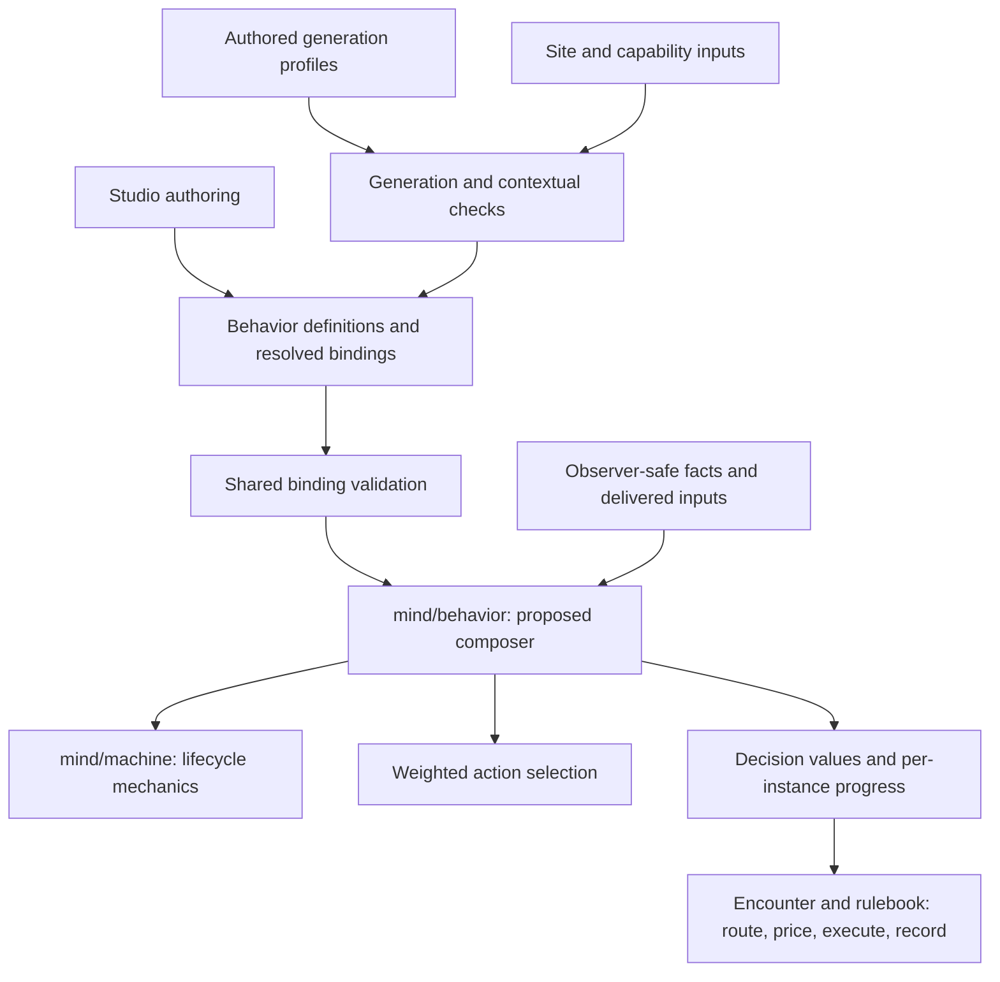

# ADR-0049: Behavior Composes Parameterized Mind Primitives

Date: 2026-11-05

## Status

**Proposed. Not accepted or implemented.**

This records a candidate responsibility boundary for
[rpg-project#859](https://github.com/KirkDiggler/rpg-project/issues/859).
It does not select public APIs, migrate either machine, or authorize production
implementation. The [exploration walkthrough](../ideas/machine-foundation/README.md)
explains the starting seams; the
[work journal](https://github.com/KirkDiggler/rpg-project/pull/864) preserves the
investigation. Implementation contracts still require design agreement. The related
[mind vocabulary review](https://github.com/KirkDiggler/rpg-project/issues/700)
remains separate; this proposal does not select its check primitive or absorb
its implementation scope.

## Context

An encounter designer should be able to reuse a self-contained behavior,
bind its parameters to a particular NPC and site, and compose it with other
behaviors. Patrol should not lose its unfinished work merely because an
investigation takes precedence. An NPC's own information should change its
available behavior without becoming universal world knowledge.

The same components must be useful to **procedural generation**, not only to
hand-authored guards. A generator needs to know which values are valid and
how to choose compatible values that suit a desired encounter. Independently
randomizing every numeric field is not equivalent to generating good behavior.
Generated bindings should be inspectable and adjustable through the same studio
contract as hand-authored ones, rather than require a second runtime language.

### What exists, and what does not

- [`mind/machine`](../../mind/machine/doc.go) is a bus-free transition primitive
  with a supplied vocabulary, instance blob, and listener/due queries. The
  [guard unit probe](../../mind/machine/guard_journey_test.go) exercises a
  single path with supplied inputs; it does not demonstrate a role composer.
- [`mind/behavior`](../../mind/behavior/doc.go) currently owns authored weighted
  table selection and testimony-related tools. It does not yet own reusable
  behavior-instance lifecycles or retained multi-role continuations.
- The encounter's [`TableDriver`](../../rulebooks/dnd5e/encounter/tabledriver.go)
  consumes the selected table and translates its answer into an intent. Its
  [`patrol`](../../rulebooks/dnd5e/encounter/patrol.go) is position-derived,
  not a retained continuation.
- [`keepgen`](../../rulebooks/dnd5e/encounter/dungeonspec/keepgen/keepgen.go)
  already emits ordinary site content with garrison/table bindings and optional
  listening-post recipes, then validates it through the dialect's loader.
  Its benchmark artifacts are deliberately regenerate-only. That is useful
  generation precedent, not an existing general behavior library or a promise
  that those measurement fixtures become hand-editable.

### Composition-era foundation

The starting model is **tools composed from tools, not a new mind application**.
This proposal argues from the current contracts and inspected code:

- The [toolkit's layering contract](../../CLAUDE.md#how-live-play-is-layered)
  separates leaves, compositions and the host seam; each layer absorbs wiring
  so the layer beneath it does not have to.
- [`play/`](../../play/README.md) provides focused, value-returning leaves with
  explicit ownership and refusals. It is a model for boundaries, not a promise
  that a composition automatically inherits every leaf's guarantees.
- [`world`](../../world/doc.go) demonstrates a small composer over independent
  tools and supplied rulebook decisions. Its particular act loop is not an API
  being transplanted into behavior.
- The current [encounter contract](../../rulebooks/dnd5e/encounter/doc.go)
  describes its composition and its ownership of location knowledge. Those
  current responsibilities, not an older arrival-correction design, ground the
  refusals below.
- The inspected execution callback is
  [`Driver.Act(MonsterView) (Decision, error)`](../../rulebooks/dnd5e/encounter/turndriver.go),
  consumed through the current table/intent path. That is a fact about the
  existing code, not proof that an older design named "driver" is still the
  architectural foundation or that this exact API must remain forever.

### Historical context, not inherited authority

[ADR-0016](0016-behavior-system-architecture.md),
[ADR-0014](0014-environment-selectables-integration.md) and
[ADR-0043](0043-a-monsters-turn-has-a-driver.md) record earlier investigation
stages. They are not parent contracts for this proposal. Their example
interfaces, priority categories, application shapes and generation machinery
are not revived here. The older
[location-knowledge record](0047-encounter-owns-location-knowledge.md) is history
too; current behavior is grounded in the encounter contract above.

**Correction to the initial draft:** it used older ADRs as present-day support;
the operator's review identified the shift to composition and "tools and not
applications" as the relevant foundation. The proposal now stands on that
current model and its own consumer need, rather than inheriting authority from
matching terminology. Earlier records and their statuses remain unchanged.

## Alternatives

| Alternative | Benefit | Cost / why not the proposed direction |
|---|---|---|
| **Keep composition entirely in the encounter; retain `mind/behavior` as the picker** | Preserves the current cut and avoids an unused general layer. | Remains viable if the next consumer probes show only encounter-specific wiring is needed. It offers no shared behavior-instance contract by itself; different producers can drift into different ways to assemble the same behavior. |
| **Make `mind/behavior` the reusable composer, using the existing primitives and picker** | Gives the designer's reusable behavior one owner above the mechanisms it combines. | Preferred proposal. Expands the module's responsibility, requires explicit lifecycle/binding contracts, and risks becoming a catch-all unless execution, knowledge interpretation and parameter selection remain outside it. |
| **Keep the picker narrow and add a separate composer module** | Makes the selection/composition distinction explicit in package boundaries. | A real alternative if keeping both in `mind/behavior` obscures the seam. Adds another public module and consumer boundary before their value is demonstrated; no package name or extraction is selected now. |
| **Put composition and generation in `mind/machine`** | One apparent entry point for authoring and runtime. | Not recommended: conflates state progression with NPC composition, content choice and execution. It would burden a possible effects consumer with responsibilities that do not belong to its machine. |

## Decision

**Propose `mind/behavior` as the composer of reusable, parameterized behavior
instances over the mind primitives.** This is a proposed role for the module,
not a claim that the module already has the interfaces below.

### Definitions, bindings and private progress

A reusable definition describes a behavior's supplied inputs, parameters,
local state/lifecycle and possible output vocabulary. A binding supplies its
concrete values and references for an actor or authored composition. Each
attached instance keeps its own progress; sharing a definition does not share
mutable state between guards or between attachments.

The composer would coordinate activation, suspension, resumption and authored
precedence through those contracts, returning decisions as values. It would
not hard-code a universal cognitive ladder, a list of NPC roles, or a single
resume policy. The designer's composition should remain inspectable.

Weighted action selection remains a distinct operation within the composition.
Role precedence is not manufactured by reinterpreting weighted-table row order.
The existing picker can remain an internally distinct tool in the module; this
proposal does not select a move or rename of that implementation.

### Parameter contracts versus choosing good values

| Concern | Proposed responsibility |
|---|---|
| Parameter name, type, unit, requiredness and any explicit default | The behavior definition/contract, in a form producers can inspect and validators can check. |
| Structural validity and compatible bindings | The shared composition validator/compiler; domain checks are supplied by their owning vocabulary/capabilities rather than hard-coded game rules. |
| Valid routes, references, capabilities and site constraints | Their existing content/spatial/rulebook owners, consulted explicitly by generation or binding validation. |
| Which valid combination suits a role and encounter | Designer-authored generation profiles and the generator that applies them. This is content policy, not runtime machine policy. |
| Progress of one running behavior | Its runtime instance and lifecycle contract, not the shared definition or a generator's mutable configuration. |

A generation profile may choose combinations of values together, constrain a
later choice using an earlier one, or derive a value from site/capability inputs.
It is not limited to independent uniform ranges. The exact profile shape,
sampling algorithm and quality criteria remain open.

**Valid and good are different questions.** Type/range checks can reject
nonsense; they do not establish that a patrol is interesting, that an
investigation is appropriately persistent, or that a low-priority duty ever
gets useful time. Profiles need explicit goals and evidence against them,
including meaningful deterministic examples and broader sampling/playtest where
appropriate. There is no universal good-parameter function implied here.

Unsupported words, unresolved required values and incompatible combinations
should be diagnosable at the owning boundary, not silently replaced with a
plausible default. The precise refusal types belong to the later contract design.

### One runtime contract, multiple producers

The studio, hand-authored content and procedural generation would produce the
same supported definitions and bindings. Generation selects/assembles content;
it does not require a special procedural-NPC execution branch. The studio
should preserve those definitions, references and parameters through a
load/edit/save cycle and expose the choices rather than reconstructing them.

Resolved bindings and instance progress are distinct. A started run must not
silently resample configuration on reload or read new settings from a mutable
authoring definition. Concrete materialization/versioning and save shapes
remain design work; this is not a persistence-storage redesign.

Content generation's reproducibility is separate from gameplay rolls.
`keepgen` already has seeded generation. This proposal does not change the
existing gameplay randomness/record-replay contract or choose a shared sampler.
Tests can supply exact rolls at actual selection boundaries.

### Responsibilities that stay outside the composer

- `mind/machine` owns generic transition mechanics, not behavior libraries,
  parameter-generation policy or NPC-specific commands.
- Perception/intel and the encounter's knowledge projection remain the owners
  of what an observer holds and how spatial testimony is interpreted. The
  composer receives lawful facts; it does not consult hidden world truth or
  create another authoritative memory store.
- The encounter/rulebook execution boundary owns routing, action affordability,
  effects of a chosen action, clock driving and audience-aware recording.
  Selecting behavior does not grant an extra turn or perform movement.
- Generators own choosing contextually suitable content. They do not advance
  live behavior instances, and generation-time access to the site does not
  become runtime omniscience.
- The effects composer and its machine remain separate. No dependency from
  effects to an NPC behavior composer, shared-machine extraction, bus relocation
  or effects promotion follows from this proposal.
- Recoverable operations, compensation and transactions remain separate open
  work. Behavior composition does not promise arbitrary rollback.

## Consequences

### Positive

- A designer and generator could reuse the same authored behavior without
  sharing its mutable progress or maintaining parallel runtime languages.
- Parameter contracts could support studio controls, generation validation and
  test fixtures together, making supported combinations discoverable.
- Retained behavior progress and role precedence could become explicit instead
  of being hidden in encounter-specific scripts or geometric inference.
- Existing machine and picker mechanisms remain usable rather than being
  replaced merely to obtain a new abstraction.

These are expected benefits, not measured delivery results.

### Negative

- The composer would need real binding, lifecycle, identity and continuation
  contracts. A name change alone delivers none of them.
- Producers and content owners would pay for parameter metadata, cross-parameter
  validation, authoring diagnostics and suitable generation profiles.
- Multiple instances increase state and scheduling concerns. Starvation,
  compatible outputs, ties and interrupted progress need explicit semantics.
- Consumers may require migration if the module's public surface changes;
  release-unit boundaries and pinned dependencies still apply.

### Neutral

- Not every behavior must use every primitive, and not every new capability
  belongs in the machine or the composer.
- Selecting the composer's responsibility would not select a tree/graph editor,
  a wire format, a schema language, an async runtime or an implementation plan.
- Benchmark fixtures may retain their regenerate-only contract; ordinary
  editable generated content is a different producer/consumer use case.
- Acceptance would require reconciling the affected design/package contracts;
  this Proposed record leaves current behavior and other ADR statuses intact.

## Example

This is an illustrative future authoring boundary, not implemented studio
fields or a selected Go/YAML API.

A reusable **Patrol** could bind a route and waiting/resumption policy. A
profile could select a traversable route and compatible pacing values for the
site and actor capabilities. An **Investigate disturbance** behavior could bind
supported sound categories and completion policy. Their composition could give
investigation movement precedence while retaining patrol's continuation.

For example, a profile aiming for a particular patrol revisit interval would
consider route length, actor speed and waypoint waits together. A long route and
long waits can each be valid while failing that profile's goal. The generator
could choose or derive waits after selecting a valid route, and report when the
goal cannot be met. No particular interval or tuning formula is selected here.

The parameter names and policy choices are examples. This does not select
whether [NPC behavior S1](https://github.com/KirkDiggler/rpg-project/issues/866)
resumes at the exact interruption cell or heads toward the unfinished waypoint.
It does not require every behavior to expose that same choice.

## Open questions and evidence needed

These questions and prospective checks guide review and later slices. They are
not completed evidence or a requirement to build the entire system before
choosing where composition belongs:

- Compare composition in `mind/behavior` with a separate composer using a real
  consumer. Identify which existing picker contracts stay unchanged.
- Define the minimum definition/binding/instance contract and ownership of a
  retained continuation. Settle S1's concrete resume behavior without hiding it
  in test helpers or silently changing existing patrol policy.
- Exercise the same resolved binding through hand authoring and generation;
  with equal facts/time/scripted rolls, compare resulting decisions. Check
  invalid/missing parameters and cross-parameter constraints by name.
- Prove independent progress for instances sharing a definition, applicable
  save/load without resampling, and priority versus weighted choice.
- Walk a studio load/edit/save/compile round trip for any new authoring fields.
  A valid emitted file or passing Go literal is not proof of editor support.
- Establish what makes one generation profile suitable, rather than claiming
  that structural validation proves interesting or balanced content.

The existing single-path unit probe and keep generator are starting evidence,
not acceptance of this architecture. Investigation continues in
[rpg-project#859](https://github.com/KirkDiggler/rpg-project/issues/859) and its
journal; exact API, generation-profile representation, lifecycle conflict rules
and implementation/release slices remain open.
