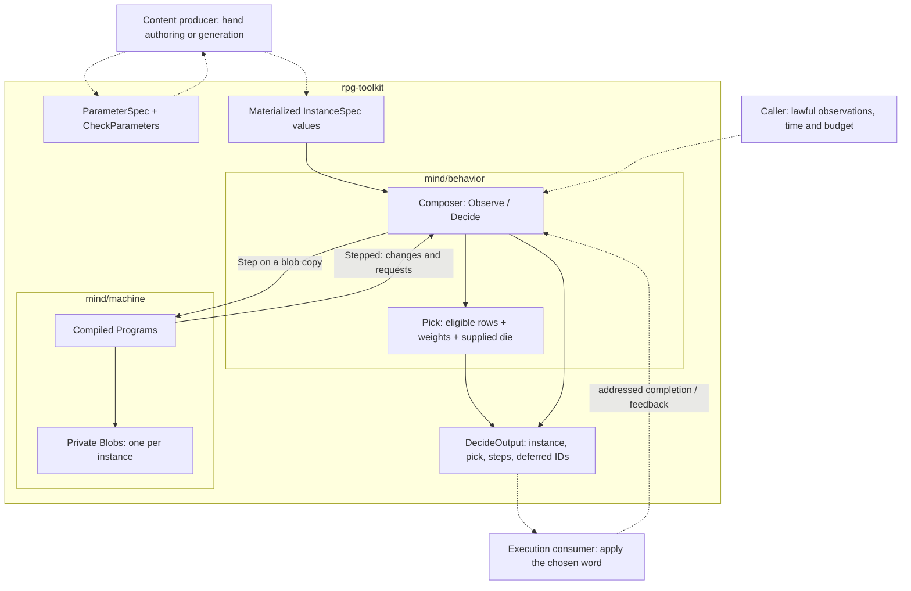
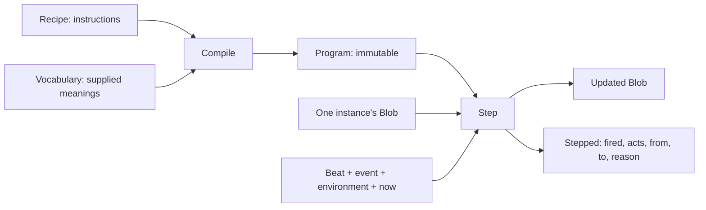
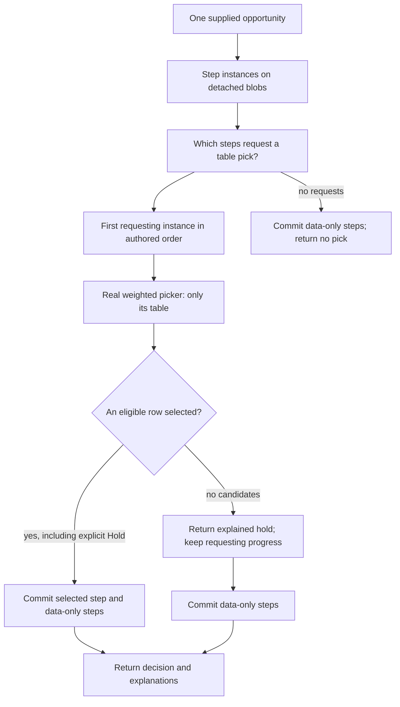
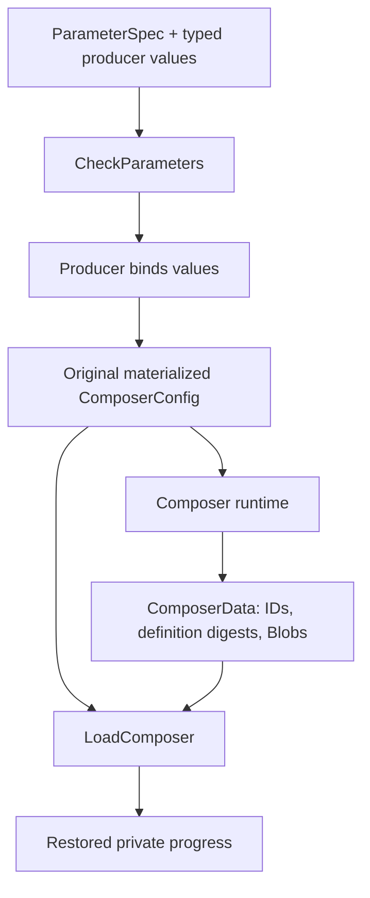

# Mind: machines, behaviors, and the world outside them

Work: [NPCs that feel alive](https://github.com/KirkDiggler/rpg-project/issues/859).
Design record: [ADR-0049, behavior as composer](https://github.com/KirkDiggler/rpg-toolkit/pull/2271).
The package contracts and source linked below define the implemented APIs;
the issue owns delivery and adoption status.

## What this is

A machine keeps the progress of **one behavior**. A composer gives several
behaviors independent progress and decides which one gets an opportunity.
A weighted table chooses an answer inside that behavior. The caller gives the
answer its meaning in the game. These are cooperating tools, not one NPC
application with every rule hidden inside it.

The short version:

| Question | Tool |
|---|---|
| Given this input and my current state, what changes? | `mind/machine` |
| Which behavior gets this selection opportunity? | `behavior.Composer` |
| Which eligible answer does that behavior choose? | `behavior.Pick` |
| What does the answer actually do, and what did the NPC perceive? | The owning game composition/rulebook |

Read straight through, or jump to a zoom:

- [The whole shape](#component-shape)
- [Zoom 1: one machine](#zoom-1-one-machine)
- [Zoom 2: several behaviors](#zoom-2-several-behaviors)
- [Walk the guard through both](#walk-the-guard-through-both)
- [Zoom 3: parameters and saved progress](#zoom-3-parameters-and-saved-progress)
- [What this makes possible](#what-this-makes-possible)
- [Source map](#source-map)

## Component shape

The solid arrows describe implemented tool relationships. Dotted arrows are
producer/execution integration responsibilities, **not a claim that the live
encounter or studio already uses the new composer**.

There is no world lookup inside a machine or composer. The surrounding
composition assembles an observer-safe view from the existing knowledge owners:
`play/intel` / `mind/perception` for testimony, and the encounter's own path for
named learned facts. `play/clock` owns clock state; geometry and game-rule
execution keep their own owners. The `play/` and `world/` model is the useful
one here: focused tools assembled through explicit seams.

### Ownership and contracts

| Component | Owns | Input → output |
|---|---|---|
| Parameter checker | Mechanical scalar constraints | `CheckParametersInput{Schema, Values}` → checked, detached values |
| Content producer | Binding concrete values/references into content | Checked values → `InstanceSpec{ID, Recipe, Table}`; the producer, not the composer, performs this binding |
| Machine compiler | Binding a recipe's names to supplied readers | `Recipe.Compile(Vocabulary)` → immutable `Program` |
| Machine step | Progress of one instance | `Blob`, beat, event, environment, time → updated blob and `Stepped` |
| Behavior composer | Private instance progress and authored precedence | `ObserveInput` / `DecideInput` → committed step explanations and at most one selected table result |
| Weighted picker | Eligibility and weighted choice within a table | `PickInput{Table, Facts, Temper, Die}` → `PickOutput`, including candidates and roll arithmetic |
| Execution consumer | Meaning and consequences of the selected word | Selected `Answer` → game operation and, where needed, completion feedback; this adapter is not supplied by the composer |
| Reloading caller | Retaining the started configuration and storing progress | Original `ComposerConfig` + `ComposerData` → `LoadComposer` |

**The refusals matter.** A machine does not roll a table. The composer does not
move a creature or teach an NPC a fact. The picker does not execute its answer.
The caller does not reapply a machine's state change or roll again after the
composer already selected a row. A saved blob is not a second copy of intel.

## Zoom 1: one machine

### Recipe, Program, Blob

These are three different things, not three copies of the same state:

| Name | Think of it as | What changes during play? |
|---|---|---|
| `Recipe` | The authored instructions: states, transitions, declared bag keys | Nothing inside a running instance rewrites it |
| `Program` | Those instructions checked and bound to a vocabulary | Immutable; it can safely serve multiple blobs |
| `Blob` | Where one instance has got to | Current state, local bag values, optional anchor and wake |

A recipe is not an NPC. It has no position, senses or action budget. A program
is not a running goroutine. **Nothing happens until a caller supplies an input
and calls `Step`.** The program is shareable; mutable instance progress is not.
The composer need not deduplicate compiled programs to preserve that boundary.

### On, when, do, to

A transition is one sentence:

> **On** this kind of input, **when** this guard applies, **do** these acts,
> and optionally go **to** this state.

- `On` matches a beat name from the supplied vocabulary. `heard`, `tick` and
  `arrived:a` are consumer words, not built-in NPC concepts.
- `When` is a guard tree. `All`, `Any` and `Not` combine leaves such as supplied
  facts, local bool flags, scope and elapsed rounds. A nil guard always applies.
- `Do` contains internal bookkeeping acts or a `Pick` request.
- `To` names the next state. Empty means stay; acts can still run.

**Only the current state's transitions are considered.** Among its transitions
on this beat, the first guard that applies wins. A later transition is not also
fired merely because its guard would pass.

Here is a readable rendering of the investigation recipe in the
[component fixture](../../../mind/behavior/patrol_composition_test.go), not a new
YAML syntax:

| Current state | On | When | Do | To |
|---|---|---|---|---|
| `idle` | `heard` | supplied `heard.kind` is `clang` | anchor at `now` | `active` |
| `active` | `tick` | rounds since anchor ≥ configured window | nothing | `idle` |
| `active` | `tick` | always, if the earlier row did not fire | request table `look` | stay |

The order of the two active-state rows is meaningful. With anchor 1 and window
2, tick 2 requests `look`. Tick 3 takes the expiration row instead, so it requests
no table. There is no special `else` keyword: the later unguarded transition is
the authored fallback. **While** a state holds, those are its available input
rules; nothing is looping in the background. **Until** a condition holds is
expressed by a transition out of that state, not another hidden execution engine.

### What a guard knows

A guard returns **Applies**, **DoesNotApply**, or **Depends**. Unknown information
is not false: `Not(Depends)` still depends. A transition whose guard depends does
not fire; another authored transition may handle the situation.

`Vocabulary.Facts` supplies typed readers over the caller's `Env`.
`BeatSpec.InScope` interprets the event for scope checks; `BeatSpec.Round` reads
its clock value. The machine never obtains hidden world facts to fill a gap.
The caller is responsible for whose knowledge these readers expose.

The bag is **machine-local scalar bookkeeping**: bool, int and string keys with
declared zero values. It is not a general memory database or expression engine.
`Flag` reads a local bool; `Set` writes a declared literal value; `Clear` restores
a declared zero. It does not automatically increment counters or interpret
arbitrary stored payloads.

### A Pick is a request, not a roll

`machine.Act{Pick: "look"}` means **ask the consumer to select from the named
table**. The machine neither looks that table up nor knows what its rows mean.
`behavior.Pick` is the separate function that performs weighted selection.

`Step` applies its own `Set`, `Clear`, `Anchor`, and `WakeIn` acts to the blob,
then enters `To` if one is named. Its returned `Stepped.Acts` includes those acts
as an explanation alongside the consumer's Pick request. Do not apply the
bookkeeping again. A terminal state permits no transitions; it does not
unsubscribe a bus or clean up game effects on its own.

### Time is supplied, not running inside the machine

`Anchor` stamps the caller's `now`; a rounds guard reads the beat's round and
compares it with that anchor. `WakeIn` stores a requested wake at `now + N`.
The caller keeps those clock meanings compatible.

`Program.Listens(blob)` describes the non-timed inputs the current state cares
about. `Program.DueAt(blob, now)` describes its next requested round: an explicit
wake, otherwise the next round for a timed state, otherwise not due. The `Due`
and `Listeners` helpers let a caller index those answers.

These are scheduling **answers**, not a scheduler. No timer fires itself.
A due timed input can consume a wake even if no transition fires, so `Fired`
is not a general-purpose dirty flag.

## Zoom 2: several behaviors

Think of a composer as **one ordered decision lane**, with private progress for
each behavior attached to it. The caller associates that composer with an actor;
the tool contains no actor registry.

A guard can carry an investigation machine and a patrol machine. Changing the
investigation's state does not replace the patrol's blob. `InstanceSpec.ID`
names an attachment; `Recipe.Ref` identifies its definition. Two attachments
can use the same definition without sharing progress.

### Observe: information without implicit action

`Observe` previews the input against the addressed instance, or every instance
when `Instance` is empty. If no transition requests a Pick, it commits those
local changes and returns their step explanations.

If any firing transition requests a Pick, it returns `ErrSelectionRequired`
and commits none of the observation. It does not silently throw away an action
request, and it does not spend an action just because information arrived.
Use `Decide` when the caller is granting a selection opportunity.

Completion normally goes to the instance returned by the previous decision.
Broadcasting one job's arrival to every attachment could advance another job
that happens to use the same input word.

### Decide: precedence outside, weighted choice inside

The other requesting instances are named in `Deferred`, and **their previewed
progress is discarded**. Preview is not permission to advance every behavior.
A data-only transition can still commit alongside the selected behavior—for
example, investigation can finish without requesting a pick, allowing patrol
to receive this opportunity.

There are three different selection rules here:

| Level | What order means |
|---|---|
| Transitions inside one machine state | First applying transition on this input wins |
| Instances inside one composer | First instance requesting a pick gets the lane |
| Eligible answers inside that instance's table | Authored weights and temperament load a die; row order maps faces, not priority |

A high-priority role with no eligible answer produces an explained hold; the
composer does not silently try a lower-priority role. Its pending machine step
is retained. An **explicit Hold row** is an eligible selected answer and can
advance its authored step. Authors can use guards/data-only transitions to say
when a behavior should stop requesting the lane.

The returned `PickOutput` includes candidates, eligibility information, the roll
and chosen row. The caller executes that already-selected row; rolling again
would make a different decision. Selection itself is not proof of execution.
If real completion must advance progress, author a completion input rather than
marking the work complete merely when its row is selected.

## Walk the guard through both

The actual fixture binds `investigation_rounds = 2`, after checking metadata with
bounds 1–4. Those numbers and positions are fixture content, not keep tuning
rules. Investigation has precedence over patrol; all selection steps below
supply a movement-eligible view and an exact scripted die.

| Input | Investigation blob | Patrol blob | Observable result |
|---|---|---|---|
| `Decide(tick 0)` | `idle` | `leg-a` | Patrol requests target A `(0,0)`; d100 selects its only row |
| `Observe(arrived:a, Instance: patrol)` | `idle` | becomes `leg-b` | Only the owning patrol advances; no roll |
| `Decide(tick 1)` | `idle` | `leg-b` | Patrol requests pending target B `(4,0)` |
| `Observe(heard, kind: clang, now: 1)` | becomes `active`, anchor 1 | still `leg-b` | Information changes the investigation; no roll |
| `Decide(tick 2)` | `active`, requests `look` | still `leg-b`, deferred | d200 face 1 or 101 selects `(8,1)` or `(8,-1)` |
| Save/load during investigation | `active`, anchor 1 | still `leg-b` | No activation or roll is replayed |
| `Decide(tick 3)` | expiration row enters `idle`, no pick | still `leg-b`, selected | Patrol again requests B `(4,0)`, not A or a new nearest waypoint |

At tick 2, the output names `Instance: "investigate"`, the authored table key
`look`, its d200 result and selected `Answer.Toward.At`, plus `Deferred:
["patrol"]`. The losing behavior's private blob stays intact. At tick 3, the
same call can commit investigation's data-only completion and select patrol's
pending work: **one selection, not two executed actions**.

This trace deliberately ends at the returned movement decision. The fixture
does not move an entity, resolve a path, deliver a player event or draw a screen.
Those consumer seams must be connected before this describes a live guard.
The test also does not choose a universal rule about returning to the exact
interruption cell versus proceeding toward the unfinished waypoint.

## Zoom 3: parameters and saved progress

**Configuration says what the behavior is. Progress says where one instance is.**

Parameter metadata describes supported scalar kinds, requiredness, inclusive
integer bounds, string choices, and opaque description/unit labels. It does not
sample a value, invent a default or convert units. The producer uses checked
values to build ordinary recipes and tables. A general template language,
behavior-library registry and studio binding format are not implied by these
APIs.

`ToData` saves the ordered instance IDs, a digest identifying each materialized
specification, and its machine blob. It does not duplicate configuration into
another mutable authority or persist compiled programs. The caller retains the
original resolved configuration separately.

`LoadComposer` recompiles that configuration and checks count, order, definition
identity, named states and bag kinds. It refuses incompatible progress instead
of silently resetting, resampling, or loading an edited definition under an old
continuation. The digest identifies the materialized recipe/table binding;
it is not a version of arbitrary caller callback implementations.

## Separations that look like one thing

| Easy to confuse | Keep distinct |
|---|---|
| Knowing a report and being suspicious | Knowledge belongs to the observer's holdings; the behavior interprets supplied facts |
| A behavior definition and its current progress | Reusable configuration versus one private blob |
| A machine Pick and a weighted pick | A table-name request versus the selected row and roll |
| Selection and execution | A returned decision versus a world operation and its completion |
| Retaining progress and freezing time | Losing action candidates keep blobs; caller-supplied time still has its meaning |
| A no-candidate hold and an explicit Hold row | No eligible work versus an authored eligible answer |
| Local error atomicity and world rollback | Composer-owned changes are staged; consumed dice, external callbacks and executed world effects are not undone |

Combining those questions is how a guard forgets its duty, consumes two rolls,
learns something it never heard, or reports an action as complete before it ran.

## Trade-offs

| Choice | Benefit | Cost / who pays | Not taken |
|---|---|---|---|
| Independent blobs and preview before commitment | Deferred behavior keeps its progress; errors need not partially mutate the composer | The composer pays for copies; the caller must separate observation from selection | Mutating every candidate before choosing |
| One authored precedence order | Predictable ownership of one opportunity | Authors must make a role stop requesting when it should yield | A general resource scheduler or automatic fallback among roles |
| Existing weighted picker inside the selected role | One meaning for eligibility, temperament and roll arithmetic | The caller supplies the die and executes the returned answer once | A second evaluator or row-order priority |
| Identity-checked continuation reload | A saved continuation cannot quietly attach to different content | The caller retains the original materialized configuration | Rebuilding progress from current position or resampling on load |

## What this makes possible

The immediate reusable capability is **an ongoing duty that yields without
losing its unfinished work**. The same mechanism can be configured for different
actors because progress is private, input words are supplied, and selection
remains authored data rather than a fixed cognitive ladder.

That provides paths toward reusable patrol/investigation definitions, actor
presets assembled from several behaviors, and generated configurations checked
by the same mechanical parameter contract a studio can inspect. It does not
by itself implement those authoring surfaces.

Knowledge-driven conversations, report propagation, faction coordination and
richer memory policies can use these tools, but still need their owning consumer
contracts. The effects prototype retains its separate machine/composer; this
work does not demonstrate or perform shared-machine extraction.

### Edges

This composer has a fixed instance list and one action-selection lane. It has no
global listener index, background scheduler, per-role paused clock, dynamic
attachment management or transaction/recovery engine. The concrete fixture is a
component proof, not a multiplayer or studio walk. The open consumer questions
remain in [the owning story](https://github.com/KirkDiggler/rpg-project/issues/859).

## Where a change lands

- A new input word or game-specific fact reader belongs to the **consumer's
  vocabulary/projection**, not a new hard-coded machine branch.
- A new stage in a behavior belongs to its **recipe and local progress**;
  a genuinely new transition mechanism belongs to `mind/machine` with its tests.
- A different precedence/coordination contract belongs to the **composer**;
  different odds among answers belong to the **table and picker**.
- A new mechanical parameter constraint belongs to **metadata validation**;
  route validity, world rules and suitable contextual choices remain with their
  existing semantic owners and producers.
- Executing the chosen row and reporting completion belongs to the **execution
  consumer**. An adapter must not call a roll-and-select entry point as though it
  merely executed an already-selected answer.

## Source map

| Zoom | Source |
|---|---|
| Tool/composition model | [`play/README.md`](../../../play/README.md), [`world/doc.go`](../../../world/doc.go) |
| Recipe grammar and vocabulary | [`mind/machine/recipe.go`](../../../mind/machine/recipe.go), [`vocabulary.go`](../../../mind/machine/vocabulary.go) |
| Compile and one step | [`machine/compile.go`](../../../mind/machine/compile.go), [`step.go`](../../../mind/machine/step.go) |
| Private progress and scheduling answers | [`machine/blob.go`](../../../mind/machine/blob.go), [`due.go`](../../../mind/machine/due.go), [`listeners.go`](../../../mind/machine/listeners.go) |
| Composition and addressed feedback | [`behavior/composer.go`](../../../mind/behavior/composer.go) |
| Reload contract | [`behavior/composer_data.go`](../../../mind/behavior/composer_data.go) |
| Parameter metadata | [`behavior/parameters.go`](../../../mind/behavior/parameters.go) |
| Weighted answers and selection | [`behavior/answer.go`](../../../mind/behavior/answer.go), [`table.go`](../../../mind/behavior/table.go) |
| Executable joined example | [`patrol_composition_test.go`](../../../mind/behavior/patrol_composition_test.go) |
| Refusals, ownership and reload cases | [`composer_test.go`](../../../mind/behavior/composer_test.go), [`parameters_test.go`](../../../mind/behavior/parameters_test.go) |
