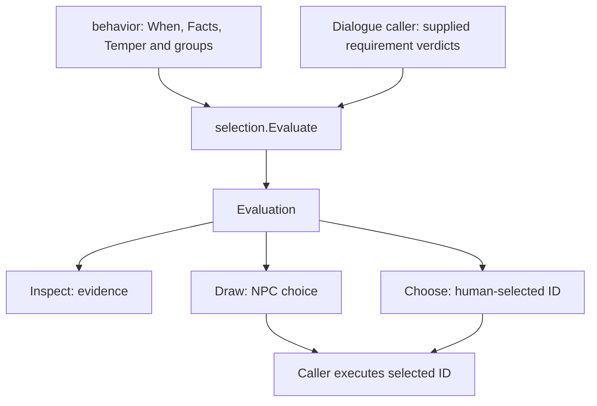

# One choice pool, two choosers

[Behavior selection#917](https://github.com/KirkDiggler/rpg-project/issues/917)
forms a primitive under `mind/behavior`; [the design](design.md) defines its
contracts. A routine owns progress, a composer owns precedence, and a caller
owns facts and execution. Selection owns the evaluated pool between them.

## Component shape

## Ownership and contracts

| Component | Owns | Input → output |
|---|---|---|
| Domain caller | Whether a requirement holds, whose knowledge is read and what a preference means | World/profile information → `Candidate` values with `Requirement` verdicts and `Factor` values |
| `selection.Evaluate` | Validation, captured order, eligibility fold and checked integer multiplication/sum | `EvaluateInput` → `Evaluation` |
| `Evaluation.Inspect` | Detached evidence, no reads or dice | Evaluation → `Inspection` with rows, eligible count and total |
| `selection.Draw` | One weighted choice from an evaluated pool | `DrawInput` and supplied `Die` → `DrawOutput` with choice, face and total |
| `selection.Choose` | Explicit selection from that same pool | `ChooseInput` and ID → `Choice` with input index and row |
| `behavior.Pick` | Fact/affordability vocabulary, nested traversal and hold/silence meaning | `PickInput` → existing `PickOutput`, using selection per level |
| `behavior.Deal` | Sorted profile names and their authored raw shares | `DealInput` → existing `DealOutput`, using the same selection primitive |
| Execution caller | Current authority, commitment and consequences | Selected identity → actual action or refusal |

Selection cannot discover a hidden actor, interpret a trait, refresh a fact,
spend an item or open a game interaction. Inspection cannot rerun rules. A
profile factor cannot override a failed requirement. Choose validates against
its snapshot, not against a world it cannot see (R1–R5).

## Walk one value through

A guard caller supplies `search` at base weight2 with a `lead` requirement
marked Met and a `persistent` factor3. It supplies `hold` at weight4 without
factors. Evaluation records effective shares6 and4 and total10. A supplied
face6 selects search; face7 selects hold. No formula is recomputed to explain
that decision. The caller decides what starting search means.

A dialogue caller instead supplies an earned-information reply whose
requirement is Unknown and an ordinary reply whose requirements hold. The
same evaluator explains why the former is unavailable. The player explicitly
chooses the ordinary reply by ID, with no random draw. The caller must apply
its own disclosure rules before showing private diagnostic reasons.

These examples do not introduce a personality catalog or change existing
Speak. They demonstrate different consumers of one evaluated choice contract.

## Separations that look alike

| Question | Owner |
|---|---|
| Is the guard permitted to leave its post? | Domain requirement supplied by the caller |
| How much does the guard favor an allowed search? | Supplied profile factor |
| Can a zero-share reply be deliberately selected? | Choose: yes, if eligible |
| Does a random draw select a zero-share row? | Draw: never |
| Does a selected Search mean the rogue was found? | No; execution and completion are the caller's |
| Does knowing an option ID grant permission now? | No; current execution authority is outside this snapshot |

## Trade-offs

| Decision | Benefit | Cost / boundary | Not taken |
|---|---|---|---|
| Existing behavior module | One release unit while the seam forms | Package home still names its first consumer | New independently tagged generic module |
| Caller-supplied verdicts | No second world/predicate interpreter | Caller owns provenance and valid fact evaluation | Untyped mutable context callbacks |
| Nonnegative integer factors | Exact, checkable arithmetic; preserves behavior's current shares | Fractional/additive/override policies are not provided | Several modifier modes without a consumer |
| Per-level pool | Reusable for menus and nested NPC decisions | Behavior retains its group traversal | Flattening groups or building another workflow engine |
| Detached evidence | Inspection cannot mutate a later choice | Copies have an allocation cost, measured at the consumer | Exposing mutable selection internals |

## Edges and changes

The evaluation is not serialized or retained as a second live-world cache.
Empty eligibility and all-zero eligible shares are different facts. The
behavior adapter keeps its established hold/silence interpretation rather than
teaching it to selection. A new fact belongs in the caller; a new choice mode
or numeric operation would change this package's contract. No event bus,
clock, profile registry or parent import crosses its boundary.

## Source map

| Concern | Path |
|---|---|
| Values, evaluation, checked arithmetic | `mind/behavior/selection/selection.go` |
| Explicit and weighted choice | `mind/behavior/selection/choose.go` |
| Package contract | `mind/behavior/selection/doc.go` |
| Generic/guard/dialogue proofs | `mind/behavior/selection/{selection_test,example_test}.go` |
| Existing domain judgment and nested traversal | `mind/behavior/table.go` |
| Consumer seam proofs | `mind/behavior/selection_integration_test.go` |
