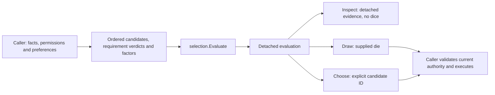

# Behavior selection

## Shape

## Law

### R1 — One value-only package

`mind/behavior/selection` belongs to the existing behavior Go module. It
imports neither its parent nor game, actor, event, storage or clock packages.
It owns no mutable world context, callbacks, scheduler or execution. Domain
callers supply already-evaluated facts and requirements; the package introduces
no competing predicate language.

### R2 — Identity and eligibility

Candidates have unique nonempty IDs and retain their supplied order. Each
named requirement is `Met`, `Unmet` or `Unknown`; the zero verdict is Unknown.
A candidate is eligible exactly when all requirements are Met. An empty
requirement list is satisfied. Unknown and Unmet remain distinct in evidence.
A requirement is not consumed by evaluating, inspecting or choosing it.

### R3 — Integer relative shares

A candidate's nonnegative base weight is multiplied by its ordered named
nonnegative integer factors. No factors means multiplication by one. A factor
of zero leaves an eligible candidate with no random share; it is not a failed
requirement and does not forbid explicit selection. No implicit minimum,
rounding, normalization, percentage conversion or additive/override mode exists.

Each factor is an integer multiplier in the caller's chosen share units.
Behavior's existing percentage number is supplied directly as its load factor,
so `authored weight × temperament percent` and the actual die size are unchanged.
The primitive does not interpret the label as a percentage.

Malformed identities/verdicts, negative numbers and overflowing eligible
weight products or totals are refused. Gated-out rows retain their supplied
inputs but contribute no weight and do not perform weight arithmetic. The
caller does not use a positive factor to revive a failed requirement.

### R4 — Captured evaluation

Evaluate captures its input and computes each eligible row's load once.
Inspection returns detached rows containing the original requirements,
factors, eligibility and effective weight. Mutating either the input or an
inspection/choice result cannot change later choices from that evaluation.
A zero-value or nil evaluation is invalid; a constructed empty evaluation is
valid evidence of no candidates.

### R5 — Two choice modes, one evaluated pool

Draw requires supplied randomness only when a positive share can be selected.
It rolls exactly once over the positive total and maps inclusive one-based
faces in supplied candidate order; it rejects out-of-range faces and preserves
roller errors. Empty eligibility and eligible-but-zero-total are distinct
refusals. It neither reruns eligibility nor executes a result.

Choose accepts an eligible ID from the captured pool without calling a die.
Unknown and ineligible IDs are refused. The result identifies the input index
and carries detached row evidence. Explicit selection of a zero-share eligible
row is valid. A captured evaluation is not a current authorization token;
execution revalidation remains the consumer's responsibility.

### R6 — One real consumer, preserved behavior

The behavior picker uses this evaluator and draw at each table level. Behavior
retains fact vocabulary, affordability, temperament interpretation, hierarchical
traversal, and time-hold versus event-silence meanings. Groups are not flattened:
only a selected group consumes its child die, and existing candidate/row/path
outputs remain unchanged for valid inputs. There is no second weighted landing
algorithm left in behavior. Spawn-time `Deal` also uses the primitive over
its sorted word/share list, preserving valid selected profiles and raw die
sizes; malformed or empty mixes are refused before inventing a word.

### R7 — Scope

The package has no profile catalog, expression language, automatic routine
instantiation, resource consumption, persistent selection store or public wire
format. `tools/selectables` and its existing consumers are untouched. A guard
choice and a player reply menu are usage proofs; new gameplay, human-dialogue
transport, admission, routine handoff and Studio remain separate deliveries.

## Rulings

| ID | status | scope | ruled by | date |
|---|---|---|---|---|
| R1 | settled | Form the primitive inside behavior; no new module or engine | KirkDiggler | 2026-11-10 |
| R2 | settled | Stable IDs, named supplied verdicts, unknown distinct from false | KirkDiggler; concrete representation by monster-ai | 2026-11-10 |
| R3 | settled | Explained integer shares with one multiplicative adjustment form | monster-ai under delegated implementation choice | 2026-11-10 |
| R4 | settled | Detached evaluation and evidence, no re-evaluation for choice | monster-ai under delegated implementation choice | 2026-11-10 |
| R5 | settled | Weighted and explicit choice with supplied randomness and refusals | KirkDiggler; validation details by monster-ai | 2026-11-10 |
| R6 | settled | Real behavior-picker adoption without a competing implementation | KirkDiggler | 2026-11-10 |
| R7 | settled | Bounded package/consumer proof, not a broader migration | KirkDiggler | 2026-11-10 |

## Open

None blocking this bounded package. Fractional factors, additional modifier
operations and extraction to another home require an actual consumer and a
separate design decision; they are not hidden extension hooks in this API.
