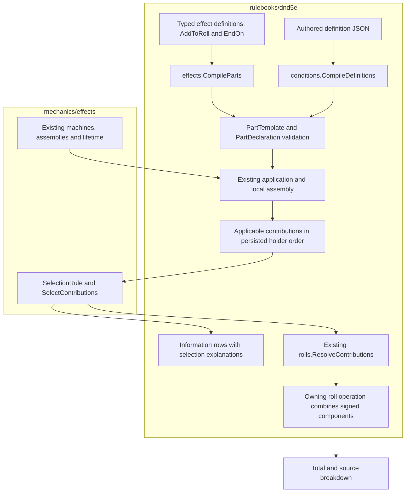

# Bless and Bane as consumers of effect tools

This is the proposed construction surface for [composable conditions #703](https://github.com/KirkDiggler/rpg-project/issues/703), governed by [the design](design.md). **The Go names below are proposals, not implemented APIs.** The existing composer, assemblies, application custody and roll resolver remain the runtime. This cut gives authors typed effect values and makes contribution selection an explicit, reusable value operation.

## Component shape



Construction is inert. **Selection does not apply, suspend, remove or roll an effect.** R1–R3.

## What the author writes

The proposed Go entry point compiles an ordered list of typed values in one fallible operation. Effect values contain no callbacks or runtime state. `CompileParts` converts them to the existing canonical declarations and returns any validation/encoding error; no `must` wrapper is involved.

```go
func blessedParts() (*effects.CompilePartsOutput, error) {
    return effects.CompileParts(&effects.CompilePartsInput{
        Parts: []effects.PartSpec{
            {
                Key: "roll",
                Effect: effects.AddToRoll{
                    Amount: effects.SignedDice{
                        Notation: "1d4",
                        Polarity: effects.Positive,
                    },
                    Rolls: []contributions.RollKind{
                        contributions.RollKindAttack,
                        contributions.RollKindSavingThrow,
                    },
                    Selection: generic.SelectionRule{
                        Mode:  generic.OldestApplicable,
                        Group: "bless",
                    },
                },
                OnTerminal: generic.EndPart,
            },
            {
                Key: "rest",
                Effect: effects.EndOn{
                    Beat:   effects.BeatRest,
                    Reason: "rest",
                },
                OnTerminal: generic.EndAttachment,
            },
        },
    })
}
```

Bane declares the same mechanical effect with `Polarity: effects.Negative` and `Group: "bane"`. Its definition is explicit content, not a helper taking a positional subtract boolean. The two short declarations may repeat their actual content; they do not duplicate execution logic.

`AddToRoll` alone supplies no ending. The separate `EndOn` is the recipient's rest policy. **The caster's concentration and spell duration remain in the spell's coordinator maintenance**, not in `AddToRoll` or silently in the named-condition wrapper. Targeting, Bane's initial saving throws and payment remain in the existing cast/application path.

`PartSpec` supplies the local key and terminal scope around a typed effect definition. Its `Effect` accepts a closed rulebook definition interface, implemented by value types such as `AddToRoll` and `EndOn`; an adapter produces `PartTemplate` and the same kind validator used by JSON authoring checks it. This is a Go construction adapter, not another evaluator or serialized format. The final exported spelling of that interface is an implementation detail; admitting arbitrary runtime callbacks is not.

`CompilePartsOutput.Parts` is an owned `[]PartDeclaration`. It contains no holder, application ID, subscription, cost or live state. A named descriptor retains an error-returning parts factory and invokes it through existing error-returning preparation/create/load boundaries, rather than compiling fallible definitions during package initialization.

### The data equivalent

The proposed canonical leaf has one amount location:

```json
{
  "kind": "add_to_roll",
  "amount": {"dice": "1d4"},
  "params": {
    "polarity": "positive",
    "rolls": ["attack", "saving_throw"],
    "selection": {"mode": "oldest_applicable", "group": "bless"}
  }
}
```

The typed `SignedDice` is lowered to the existing `Amount.Dice` plus explicit polarity. No second dice value remains in params. Authored data and Go values receive the same validation. Unsupported kinds, fields, domains, selection modes, empty groups, invalid dice and invalid scopes are errors, including on a nonselected candidate. R4 is proposed.

## Ownership and contracts

| Component | Owns | Input → output |
|---|---|---|
| `effects.AddToRoll`, `EndOn`, `CompileParts` | Typed definition construction and canonical lowering | `CompilePartsInput{Parts []PartSpec}` → `CompilePartsOutput{Parts []PartDeclaration}`, error |
| Rulebook kind entry | Roll applicability, signed-dice meaning, parameter validation and description | Canonical declaration and actual roll query → unresolved contribution and selection rule |
| Condition holder | Instance identity and durable insertion order | Ordered live/saved conditions → ordered candidate outputs |
| `mechanics/effects.SelectContributions` (proposed) | Pure selection among already-applicable candidates | `SelectContributionsInput{Candidates []SelectionCandidate}` → decisions in candidate order, error |
| Conditions' roll/information adapters | Gathering candidates and attributing selection decisions | Kind answers plus neutral decisions → existing roll contribution values / explanatory rows |
| `rolls.ResolveContributions` and its owning roll operation | Resolving selected dice once, then combining signed components | Selected `DiceContribution` values → sourced `RollComponent` values → operation-owned total |
| Existing application and assemblies | Independent local state and exact linked cleanup | Parts, bindings, occurrences → state changes and existing removal protocol |

The neutral selector knows no dice, D&D roll kinds, condition refs, bus or clock. It receives stable opaque candidate IDs and an already ordered applicable list. It never reconstructs age or returns a replacement/removal plan.

The first supported policies are explicit `AllApplicable` (no group) and `OldestApplicable` (a nonempty group). There is no implicit zero-value policy. Each decision identifies its candidate and either selects it or identifies the selected candidate that excludes it. Duplicate IDs and malformed policies refuse the whole call. There is no cached winner to restore and no configurable strongest/newest/custom-comparator machinery.

The rulebook adapters do not roll or mutate a condition to select it. Missing roll facts remain unknown; they are not treated as known eligibility. The first cut only needs roll-kind applicability, not an arbitrary conditional priority language.

The information adapter keeps the selection decision separate from the kind's applicability answer internally. The existing outward effect-row contract can report a noncontributing row with an explicit “not selected; older instance contributes” reason; this does not require a new proto enum in this cut.

## Walk one roll through

A player holds Bless A, Bless B and Bane C, in that insertion order. Each instance has its own origin, application membership and lifecycle state.

1. On an attack, each `AddToRoll` answers that its domain applies. No dice are rolled while gathering these answers.
2. Candidates retain the holder's order, with declaration/output order as the tie-breaker inside a single instance. The IDs name individual contributions, not the whole condition.
3. The selector chooses A for `bless`, marks B not selected by A, and chooses C independently for `bane`.
4. The information path can still show B as held, with its source and selection reason. Any unrelated effect carried by B's condition remains independent.
5. The roll path evaluates only A's and C's dice, then includes `+A.d4 − C.d4` in the existing breakdown.
6. If A ends, its exact attachment is removed. The next query selects B. B's age and remaining lifetime are unchanged; if B has already expired, it is absent rather than revived.

Saving and loading preserves holder order. No sort by source name, ref, timestamp or subscription ID is involved. A newly admitted replacement is a new insertion; restoring the same instance is not.

## Separations that look like one thing

| Query | Source of truth |
|---|---|
| May this instance coexist? | Existing admission/address and application rules |
| Does its roll effect apply here? | `AddToRoll`'s mechanical meaning and roll query |
| Which applicable effects contribute? | Explicit selection policy over ordered candidates |
| How do selected values combine? | Additive meaning and the existing signed roll fold |
| Does an instance end? | Its own maintenance/ending policies, not selection |
| Which is oldest? | The holder's persisted insertion order |

Selecting at condition granularity would incorrectly suppress unrelated effects. Replacing a nonselected instance would destroy its independent lifetime. Rolling every candidate before selection would consume extra randomness and produce facts that never participated.

## Trade-offs

| Decision | Benefit | Cost / boundary | Not taken |
|---|---|---|---|
| Typed values plus one compile boundary | Readable definitions; callers own failures | Rulebook maintains small adapters into its canonical templates | Panic constructors or handwritten JSON at the content call site |
| Neutral selection on values | Other meanings can reuse selection without importing roll rules | Conditions supplies ordered, applicable candidates | Another D&D-specific winner loop |
| Persisted insertion order | No second age authority | Holders preserve order through admission, save, load and removal | Wall-clock timestamps or sorting by IDs |
| Signed dice as the first quantity | Uses the native roll contract without invented support | Fixed roll modifiers/check offers need their own consumer contract | Advertising support that only exists in a constructor |

## Edges

This first cut supports signed dice on attacks and saving throws, including the existing death-save path. `SignedDice` makes that boundary visible. Fixed roll adjustments, ability checks, optional offers/consumption (Guidance), advantage/disadvantage and non-roll selection consumers are not claimed implemented. A future quantity should reuse the existing amount machinery and extend the actual roll consumer; it must not fake a scalar as a die.

The JSON kind/parameter change is a proposed current-format change, not an implicit migration commitment. No historical reader, normalization or automatic operator-data reset is introduced. The independent application protocol, native Raging/Reckless behavior and deferred item adoption remain unchanged. No repo-wide removal of unrelated registry/trait panics is claimed by removing the Bless/Bane construction panic.

## Where a change lands

- Change `1d4` to `1d6`, narrow to attack rolls, or change sign: the authored effect value only.
- Let independently applicable roll gifts all contribute: select `AllApplicable`; additive arithmetic does not change.
- Change recipient expiry: replace the separately declared lifecycle part; do not edit `AddToRoll`.
- Add a genuinely new selection policy: the neutral selector and its contract, not each named condition.

## Source map

| Concern | Current owner / proposed addition |
|---|---|
| Neutral selection | `mechanics/effects/selection.go` (proposed) |
| Typed effect construction | `rulebooks/dnd5e/effects` (proposed `AddToRoll`, `EndOn`, `CompileParts`) |
| Canonical declaration/validation | `effects/parts.go`, `part_templates.go`, `kinds.go` |
| Current roll implementation | `effects/roll_modifier.go` |
| Named consumers | `conditions/blessed.go`, `baned.go`, `named_linked.go` |
| Current selection and information | `conditions/roll_selection.go`, `action_effects.go`, `linked_info.go` |
| Durable order | `character/character.go`, `character/load.go`, `monster/monster.go`, `monstertraits/prepare.go` |
| Existing cast maintenance | `spells/maintenance.go`, `spells/cast.go` |
| Existing signed roll evaluation | `rolls/resolve.go`, `contributions/source.go` |
