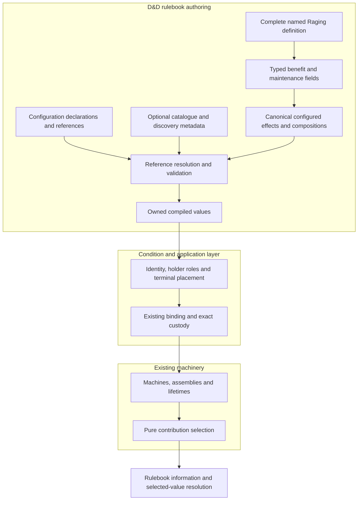

# Effects first: definitions we can inspect and compose

This is the walkthrough for [composable conditions #703](https://github.com/KirkDiggler/rpg-project/issues/703), governed by [the design](design.md). **The reusable unit is an effect composition, not necessarily a condition.** Code and configuration expose two authoring surfaces over the same definitions. The [acceptance scenarios](acceptance.md) describe the observable contract; [source evidence](implementation.md) and the [next design work](next-steps.md) stay separate from that contract.

## Component shape



Compilation of an effect or group does not require a fabricated condition or catalogue. **Making it run still requires a host to bind it.** The diagram does not introduce floating effects, another runtime or a second custody authority. R6/R8.

The [composition contract proposal](composition-contracts.md) makes the canonical
value shape, keys/paths/order, compilation refusals and placement boundary concrete.
Its named-tree model lowers to the existing flat runtime, rather than giving every
authoring group a new lifetime.

## Discovering the definition in Go

A known rulebook definition has a known shape. Its named fields are the primary discovery surface:

```go
// Member-access sketch; exact exported types/signatures belong to the re-cut plan.
raging.Benefits.DamageBonus
raging.Benefits.PhysicalResistance
raging.Benefits.StrengthSavingThrows
raging.Benefits.StrengthChecks

raging.Maintenance.CombatActivity
raging.Maintenance.Duration
```

A whole-group projection, illustratively `raging.Benefits.All()`, exposes the ordered values from those same fields. It does not keep a second list of separately constructed effects. A field is a real configured part, not an accessor that searches a hidden catalogue and panics when the entry is absent. R7.

The configured physical-resistance effect knows its selected damage types. It does not know that its declaration is also useful inside Rage, who will receive it, which item will grant it, or which maintenance will accompany it.

## The same definition in configuration

Configuration needs names because it cannot use Go fields. Its catalogue exposes definition/group/member IDs with display names and descriptions so a tool can enumerate valid choices rather than require authors to guess a string.

A reference can express this selection:

| Reference component | Selected value |
|---|---|
| Definition | Raging |
| Group | Benefits |
| Member | Physical resistance |

This is a semantic sketch, not a finalized JSON path syntax. The reference contract must specify addressing, ambiguity/refusal and supported composition depth before implementation. Configuration can also declare a configured effect directly, or select a whole group/definition. It is not limited to choosing built-in condition names. R6/R7.

**Typed fields and resolved references reach the same canonical values.** The catalogue exports the actual named definition's members, not a separate configuration implementation of Rage. Registration and reference discovery are optional services around those values; they are not prerequisites for compiling an inline effect.

## One definition, three consumers

| Consumer | Benefit composition | Maintenance composition |
|---|---|---|
| Native Rage | Complete Raging benefits | Complete Raging maintenance |
| Raging ring | Complete Raging benefits | Explicit concentration maintenance |
| Activity-sustained ward | Raging physical resistance only | Complete Raging maintenance |

The host binds each choice to its own identity, participants and state. The ring does not acquire the Raging condition identity merely because it borrows the benefits. The ward does not need Rage's damage bonus or advantages merely because it borrows the upkeep. Payment and activation eligibility remain with their existing owners. R8.

An override engine is unnecessary for these choices. They are compositions of values. If a replacement convenience is later useful, it must preserve explicit groups, value ownership and validation rather than patch a live machine's flags.

## Ownership and contracts

The conceptual contracts below are settled in direction. The exact new Go types and catalogue schema are open work named in the design; the current symbols are evidence for where the seams start, not promises that every target API exists.

| Component | Owns | Input → output |
|---|---|---|
| Rulebook effect vocabulary | Mechanical meaning, supported parameters, guard/amount validation | Configured effect value → validated canonical leaf; current owners include `effects.Definition`, `PartTemplate`, `kinds.go` |
| Reusable composition model, below conditions | Ordered named members, ownership and composition structure | Configured values/member references → canonical effect composition; exact type to settle |
| Named rulebook definitions | Content and typed discoverable fields | Raging construction inputs → complete typed Raging definition with benefit and maintenance values |
| Optional catalogue/resolver | Registration, enumeration and reference resolution | Definition/group/member reference → owned canonical value or explicit error |
| Canonical compiler | One mechanical/structural validation path | Inline or resolved effect/composition → owned compiled values, without fake runtime identities |
| Condition/application definition | Placement, host identity and complete lifecycle composition | Compiled values plus explicit roles/scopes → bound instance through the existing host protocol |
| Existing assembly/lifetime machinery | Local running state and exact linked lifetime | Bound declarations and occurrences → state changes and cleanup |
| Neutral contribution selector | Choice among applicable ordered candidates | `SelectionRule` and candidates → per-contribution decisions, without lifecycle mutation |
| Owning roll/information path | Applicable facts, explanation, arithmetic and provenance | Selected unresolved terms → sourced breakdown; excluded rows remain explainable |

The mechanical vocabulary must not import named Rage content. The generic composition model must not require a condition coordinator. The catalogue must not become a running-instance store. The condition host must not reconstruct effect mechanics. The compiler must not read a mutable latest definition during reload. The neutral selector must not decide that a losing instance should end.

## Walk one part through

1. The complete typed Raging definition holds a physical-resistance declaration. Its parameters select bludgeoning, piercing and slashing.
2. A Go author selects the field; a configuration author resolves its named member. Neither operation takes the part away from the source definition or copies runtime state.
3. A ward definition pairs that declaration with the Raging maintenance composition. Canonical validation checks the meanings and structure before binding or payment.
4. The host supplies the ward's own provenance, recipient and exact instance/application identity. It maps lifecycle scope explicitly; the original Rage identity does not travel with the borrowed part.
5. The existing incoming-damage path applies the selected resistance meaning. For nine slashing damage with no other changes, the existing settlement produces four, with the ward's actual source provenance.
6. The reused upkeep observes the bound holder's occurrences under the same rules native Rage uses. It owns independent state; another Rage instance's activity or countdown is not shared.
7. Saving retains the resolved definition and that instance's state. A catalogue edit cannot rewrite the ward during reload.

This walkthrough binds the ward and native Rage to the same upkeep contract. It does not decide new gameplay rules while renaming their containers.

## Separations that look like one thing

| Question | Source of truth |
|---|---|
| What does this configured effect mean? | Rulebook kind and parameters |
| Which effects are assembled together? | Reusable composition value |
| How does a Go author discover named pieces? | Typed definition fields |
| How does a configuration/tool author discover pieces? | Catalogue IDs and enumerable metadata over those same values |
| Who holds/maintains this running grant? | Host binding, not the reusable definition |
| May independent instances coexist? | Existing admission and exact-address policy |
| Which applicable contributions participate now? | Neutral selection policy over durable order |
| How do selected contributions combine? | Mechanical meaning and the owning operation |
| When does this instance end? | Its selected maintenance and independent state |

Using an effect kind as member identity is ambiguous when a definition has two differently configured resistances. Borrowing an already-bound condition leaks identity and lifetime. Treating nonselection as removal loses independent timers. Keeping a typed facade and separate configuration definitions permits them to drift.

## Trade-offs

| Decision | Benefit | Cost / boundary | Not taken |
|---|---|---|---|
| Typed fields over real member values | IDE discovery and documentation at the use site | Named rulebook definitions maintain typed shapes and canonical projections | GetPart as the primary Go authoring surface |
| Configuration references over the same values | Dynamic authoring without duplicate rule implementations | Resolver owns identity, enumeration and refusal contracts | A separate JSON-only Rage implementation |
| General compositions below conditions | Standalone effects and both maintenance/benefit groups are reusable | Condition placement is an explicit adapter boundary | Requiring a coordinator and catalogue for every value |
| Full native Rage consumes the definition | Upkeep reuse is real, not cosmetic | Native timeline/state parity must be measured and preserved | A public maintenance facade over an unrelated private machine |
| Existing runtime remains authoritative | Reuse of custody, selection and lifetime guarantees | Authoring expansion must lower into its actual capabilities | Another nested interpreter or deep-override framework |

## Edges

A native round-anchored duration and a holder-turn counter are different contracts. Decomposing Raging maintenance must account for activation grace, incomplete clocks, backwards/reset clocks, attacks including misses, positive applied damage and competing endings. Preserving native behavior does not imply preserving every private struct; any saved-representation change must be deliberate and obey the current-format/data-preservation policy. R8.

The new acceptance does not establish native inventory acquisition, studio UI, arbitrary scripting, unlimited composition nesting or support for every roll quantity. These remain outside the named proof. A configured definition can be compiled independently; the current condition/application system remains its first runtime host.

## Where a change lands

- New amount/type selection or another arrangement of existing meanings: authored values/compositions.
- Another named reusable part or group: the rulebook definition and its catalogue projection, not another execution handler.
- A genuinely new mechanical meaning: the rulebook kind and its shared validation/execution/information contract.
- Another host placement or source price: the binding/source layer, not the effect definition.
- Changed native upkeep semantics: a rules decision and its lifetime owner, not a renamed field or configuration override.

## Source map

Paths below are relative to the toolkit, and identify the starting seams for the revision.

| Concern | Inspected source / required change |
|---|---|
| Typed leaves and pure lowering | `rulebooks/dnd5e/effects/definitions.go`, `compile_parts.go`, `compile_outputs.go` |
| Neutral selection | `mechanics/effects/selection.go`; preserve |
| Current condition-first composition adapter | `rulebooks/dnd5e/conditions/composition.go`; separate reusable values from host placement/catalogue |
| Current data library | `rulebooks/dnd5e/conditions/definition.go`, `definition_compile.go`; generalize benefit-only sets and clarify catalogue ownership |
| Current Rage benefit source and private upkeep | `rulebooks/dnd5e/conditions/raging_benefits.go`, `raging_definition.go`; replace the asymmetric public surface with a complete definition |
| Reusable upkeep mechanisms to compare | `rulebooks/dnd5e/effects/activity_part.go`, `duration_part.go`, `end_parts.go` |
| Host binding/custody | `rulebooks/dnd5e/conditions/definition_bind.go`, `application.go`, `application_binding.go`; preserve invariant ownership |
| Existing first-cut proof | `rulebooks/dnd5e/conditions/typed_composition_example_test.go`, `typed_composition_test.go`, `contribution_order_test.go` |
