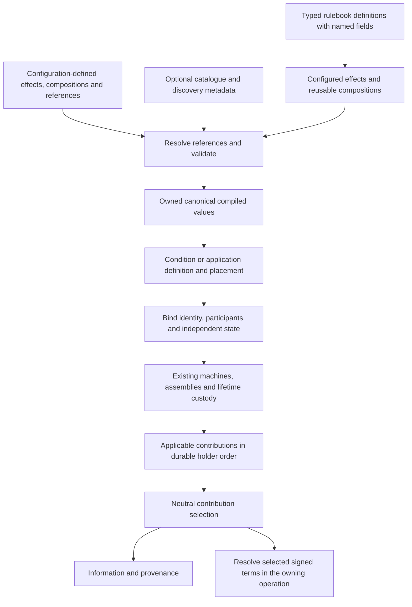

# Effect-first definitions and reusable compositions

## Shape

R6–R8 replace the condition-first construction cut with effect-first authoring; [the direction-change record](https://github.com/KirkDiggler/rpg-toolkit/pull/2425) preserves that cut and the operator's words that moved it. The [walkthrough](README.md) explains the ownership boundaries. Concrete API contracts are the next design work, not authority to infer a second runtime.

## Law

### Authoring units and reuse

1. A configured effect supplies one rulebook-owned mechanical meaning and its supported configuration. It carries no live holder, application identity, source budget or running state. R6.
2. An effect composition assembles ordered, named effects or reusable compositions. A composition can be authored, validated and reused without inventing a condition, coordinator, mandatory maintenance group or catalogue entry. R6.
3. Benefits and maintenance name roles within a complete definition; they are not mandatory top-level categories for every effect composition. Mechanical capability and valid placement remain validated rather than inferred from a friendly group name. R6/R8.
4. A complete Raging definition exposes its benefit and maintenance pieces as discoverable typed fields. Its fields are the actual declaration values consumed by native Raging, not wrappers over a separate implementation or a second catalogue. R7/R8.
5. An author can select an individual configured part, an entire named composition, or the complete definition. Retrieval is not removal from the source definition; deriving and compiling another definition cannot mutate a shared source or an already running instance. R7.
6. Configuration can declare effects and compositions directly, or reference named definitions, groups and members. Typed code and configuration converge on the same canonical values and mechanical validation. A new combination needs content, not a named behavior handler. R6/R7.
7. A catalogue supplies optional registration, reference resolution and enumerable discovery metadata. It is not required merely to construct or compile one value. Stable authored IDs are distinct from runtime application/attachment/output identities. R7.
8. Reference resolution and validation finish before activation/payment. Unresolved or ambiguous references, malformed meanings and unsupported composition shapes fail explicitly without partial activation, guessed defaults or panic convenience. R4/R7.
9. Running instances own resolved declarations and independent state. They do not read a mutable latest catalogue to decide which effects or upkeep they now have. R4/R7.

### Conditions, maintenance and runtime ownership

10. Conditions/applications consume effect compositions and provide placement, binding, identity, persistence and custody. Source payment and activation eligibility remain separate. Reusing a part does not inherit the source condition's identity or its implicit application scope. R6/R8.
11. Native Rage consumes the complete Raging definition. A ring can select its benefit composition with concentration maintenance; a ward can select only physical resistance with Rage's maintenance composition. The two groups have symmetric reuse. R5/R8.
12. Native Raging's activation, scaling and intended upkeep behavior remain unchanged through decomposition, including activation grace, activity observations, duration, clock-reset behavior and terminal ordering. A round-anchored rule is not silently replaced by a holder-turn counter. Any saved-representation change is explicit in the checked plan. R8.
13. Composition/reference expansion belongs to authoring/compilation. Existing machines, assemblies and linked lifetime machinery remain the runtime; no nested interpreter, deep patch engine or tracker-disabling override is implied. R6/R8.
14. Fixed intended recipients, independent finalization, pending saves, exact generation cleanup, observed-versus-authoritative facts and End-before-detach remain binding. No historical reader, dual writer, silent normalization or automatic operator-data reset is added. R1/R4/R8.

### Contribution selection and combination

15. Condition coexistence, effect applicability, contribution selection and arithmetic combination are separate decisions. Nonselection neither removes a held instance nor pauses its lifetime or unrelated effects. R1/R2.
16. Bless and Bane select the oldest applicable contribution within their independent groups. Oldest is durable holder insertion order, with authored output order within one instance; reload does not refresh age. Removing a winner exposes the next eligible live contributor without reapplication. R2/R4.
17. The neutral selector consumes ordered applicable values with explicit policies and returns selection decisions without rolling, world lookup or retained winner state. AllApplicable has no group; OldestApplicable requires a nonempty group. Invalid input is an error with no partial decisions. R4.
18. AddToRoll expresses signed additive meaning, not an additive/stackable flag. The owning roll operation resolves only selected amounts and preserves provenance. Information and execution consume the same selection decisions. Existing supported quantity/domain boundaries stay honest; authoring cannot advertise support absent from the consumer. R3/R4.
19. Named Bless/Bane declarations use explicit ending policies and error-returning construction. Neither rest cleanup nor concentration is hidden inside a roll adjustment. R1/R4.

## Rulings

| ID | status | scope | ruled by | date |
|---|---|---|---|---|
| R1 | settled | Bless/Bane first; tools rather than name-only cleanup; coexistence separate from contribution and lifetime | KirkDiggler | 2026-11-13 |
| R2 | settled | Oldest applicable per group; independent live instances and contribution-level selection | KirkDiggler | 2026-11-13 |
| R3 | settled | AddToRoll is signed additive meaning; select before resolving, no additive/stackable flag | KirkDiggler | 2026-11-13 |
| R4 | settled | Typed construction and explicit selection/validation; concrete spelling may evolve; condition-first public structure is superseded by R6–R8 | KirkDiggler | 2026-11-13 |
| R5 | settled | Raging-ring ease is required; R8 expands the proof beyond borrowing benefits only | KirkDiggler | 2026-11-13 |
| R6 | settled | Configured effects and reusable effect compositions are the authoring units; conditions are consumers | KirkDiggler | 2026-11-14 |
| R7 | settled | Named typed fields for rulebook discovery; configuration IDs/references and enumeration reach the same values | KirkDiggler | 2026-11-14 |
| R8 | settled | One complete Raging definition; reusable real maintenance; native Rage, concentration ring and activity ward through code and configuration | KirkDiggler | 2026-11-14 |
| R9 | open | Ordered named canonical composition tree, field projections, intrinsic compilation and explicit host placement; concrete proposal in composition-contracts.md | — | — |

## Open

- **Canonical contract (R9):** [the concrete proposal](composition-contracts.md) specifies resolved leaf/composition/member shapes, keys/paths/order, ownership, refusal cases and the explicit placement boundary. Its recommended shape is awaiting agreement; the compiler-facing Go projection facade still needs its exact signature. R6/R7 settle the intent, not every proposed type.
- **Reference contract:** fix catalogue identity, member addressing, resolution timing, supported reference depth and invalid/cyclic-reference refusal before deriving implementation tasks. No unlimited nesting or arbitrary scripting capability is inferred.
- **Maintenance contract:** characterize native Rage's real timeline/state first, then choose reusable parts that preserve it and specify the native binding/saved-representation boundary. Reuse of the current Duration adapter alone does not establish parity.
- **Plan replacement:** re-cut concrete task contracts and provider/consumer checks against these seams. The retained first-cut plan is not authority to proceed with its API adoption or declare the new acceptance complete. [Path forward](next-steps.md).
- An override convenience remains optional and uncommitted. Explicit selection/composition is the baseline; no automatic merge or production deployment is authorized.
