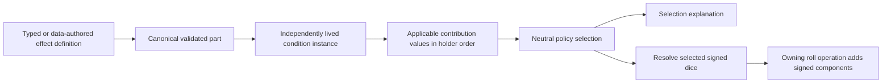

# Roll effects and contribution selection

## Shape

The [walkthrough and working Go surface](README.md) explain the agreed boundaries. Public spellings may evolve with the concrete consumers under R4; the separation of owners and the acceptance outcomes do not.

## Law

### Agreed model

1. Condition coexistence, effect applicability, contribution selection and arithmetic combination are separate decisions. Existing exact-address admission and application custody remain authoritative. R1.
2. Valid independent Bless/Bane instances may coexist. Each retains its provenance, membership and lifetime; not being selected neither removes it nor pauses its lifetime. R1.
3. Bless selects the oldest applicable contributor in the Bless group; Bane selects independently in the Bane group. Selection is at contribution granularity, not whole-condition granularity. Removing a winner allows the next eligible live contributor to participate without reapplication or renewed duration. R2.
4. AddToRoll denotes an additive contribution with a signed amount. It has no separate additive/stackable flag. Selected Bless and Bane terms combine positively and negatively in the existing owning roll operation. R3.
5. Selection spends, rolls and mutates nothing. An unselected die is not rolled. Mechanical applicability is assessed before contribution selection. R2/R3.
6. Named conditions select effects and explicit lifecycle policies; the roll effect does not acquire concentration, rest, duration, targeting or payment as implicit behavior. R1/R3.

### Construction and selection

7. Typed effect values compile through `effects.CompileParts` into owned canonical `PartDeclaration` values. The compiler accepts no runtime participants or callbacks supplied by authored content, and returns validation errors without panic-based construction. JSON-authored templates use the same kind validation. R4.
8. The neutral `mechanics/effects` selector accepts an ordered applicable candidate list with opaque IDs and explicit `SelectionRule` values. It validates the complete list and returns ordered selection decisions, including the selected ID responsible for exclusion. It knows no rules, dice, holder state or clock. R4.
9. The first policies are AllApplicable with no group and OldestApplicable with a nonempty group. An empty/unknown mode, duplicate candidate ID or malformed policy is an error. No winner is persisted separately from the live candidate list. R4.
10. Oldest means earliest surviving holder insertion order. Saving and loading preserve it; removal preserves survivor order. Part/output declaration order resolves ordering within one admitted instance. Restoring does not refresh age; admitting a new instance appends it. R4.
11. The first AddToRoll quantity is explicit SignedDice: unsigned homogeneous dice notation plus nonzero Positive/Negative polarity. Attack and saving-throw domains are supported; unsupported quantities/domains are refused rather than advertised through a constructor alone. R4.
12. The canonical AddToRoll kind is `add_to_roll`. Its sole amount is `Amount.Dice`; params carry polarity, roll domains and selection. The typed construction adapter is not another persisted format or mechanical evaluator. R4.
13. Named Bless/Bane definition factories return errors through existing preparation/create/load boundaries. No fallible definition compilation occurs through a new package-initialization `must` path. Recipient rest cleanup is an explicit EndOn declaration; existing spell-coordinator policy remains spell-owned. R4.
14. Runtime and information adapters consume the same neutral selection decisions. An applicable but unselected contribution remains explainable by identity/source; a projection may express noncontribution through its existing state/reason fields without changing the underlying lifetime or applicability answer. R4.
15. The change preserves fixed intended recipients, independent finalization, pending saves, exact generation cleanup and End-before-detach semantics. Source payment remains outside effects. R1/R4.
16. No old-format reader, dual writer, silent normalization or automatic reset accompanies the current declaration format. Native Raging activation, eligibility, scaling and lifetime behavior remain unchanged; sharing its benefit declarations does not migrate its lifecycle or codec. Reckless, other condition-family migrations, UI authoring, inventory and unrelated static-registry/trait panic cleanup are outside this cut. R4/R5.
17. A concentration-maintained raging ring is an acceptance consumer of the building blocks. Its benefit composition is reusable without inheriting normal Raging's activity/duration rules; changing maintenance neither copies mechanical handlers nor mutates a shared benefit definition. R5.
18. Code-authored compositions and data-authored libraries converge on the same validated expanded declarations and existing binder/runtime. A source may choose a shared benefit bundle or individual typed effects independently of coordinator maintenance. R5.
19. A named Raging benefit bundle belongs to conditions, not the neutral engine or the mechanical vocabulary. Native Raging and the ring consume the same benefit declaration source when a bundle is provided; their independent lifecycle policies remain with their enclosing definitions. R5.

## Rulings

| ID | status | scope | ruled by | date |
|---|---|---|---|---|
| R1 | settled | Bless/Bane first; tools rather than name-only cleanup; coexistence separate from contribution and lifetime | KirkDiggler | 2026-11-13 |
| R2 | settled | Oldest applicable per group; independent live instances and contribution-level selection | KirkDiggler | 2026-11-13 |
| R3 | settled | AddToRoll is signed additive meaning; select before resolving, no additive/stackable flag | KirkDiggler | 2026-11-13 |
| R4 | settled | Construction/selection design direction; concrete API spelling may evolve through the consumer while preserving ownership, explicit validation and supported meanings | KirkDiggler | 2026-11-13 |
| R5 | settled | Raging-ring ease is an acceptance measure: simple/reusable Rage benefits with concentration maintenance rather than native Rage upkeep | KirkDiggler | 2026-11-13 |

## Open

- An override convenience is exploratory, not required. The baseline consumer composes benefits and maintenance explicitly. If a convenience is justified, replacing a declared maintenance group on an owned value is the candidate shape; generic deep patches, hidden tracker disabling and runtime mutation are not implied.
- The checked implementation plan defines native consumer adoption and release evidence. Design agreement authorizes faithful planning/execution, not an automatic merge.
