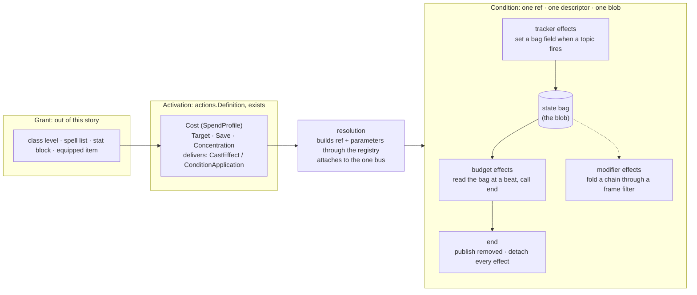

# Conditions Are Composed of Effects

**Status:** Draft, for the operator's agreement on the idea PR

**Story:** [rpg-project#703](https://github.com/KirkDiggler/rpg-project/issues/703)

**Decision:** none yet. The seam between resolution and a condition
(`ConditionBehavior`, the registry, the blob) does not move; if a later slice
moves it, that slice adds an ADR.

**Execution:** `plan.md`, added after design agreement

**Knowledge:** the decisions this design rests on, and the ones it makes, are
lines in [`rulebooks/dnd5e/knowledge/decisions.md`](../../../rulebooks/dnd5e/knowledge/decisions.md).
This story is the first to be run through the knowledge process from its
first day; see "Measures".

## The operator's direction

Recorded close to verbatim, 2026-10-28:

> they are really a series of effects with a budget. what if we made conditions
> composable from the underlying effects. rage is a damage modifier for str
> backed attacks … for some duration?

> if we stack effects in a meaningful way, a conditional effect that could act
> on a shared data structure so it could remove itself. we have literal
> conditions created and spells that could be decomposed. I am looking to
> ultimately getting this into the encounter studio and just want a data driven
> composable component to build with.

> coded hand written conditions are all we need right now … breaking up
> conditions and then spells into their effect components, allowing a grouping
> under a ref like dnd5e:conditions:raging that gets one data structure and the
> effects can drive that condition fully. no need to move quickly here.

> the epic is converting all current conditions to be composed of effects.

> cost is outside the executing of a condition or spell.

> core.Effect was ahead of its time. not imported means it is free for the
> taking or at min deleted … the machine in resolution now speaks that
> language. a modern core.Effects would do it the new way. the goal of
> configuring to subscribe and act on things with the state param filled in
> is what we want.

## Context, measured

What the tree holds on 2026-10-28, at `rpg-toolkit` main:

- `rulebooks/dnd5e/conditions/` has 58 non-test files. `raging.go` is 615
  lines and nine subscriptions: four modifiers (damage bonus on Strength
  melee weapon attacks, resistance to bludgeoning, piercing and slashing,
  advantage on Strength saves, advantage on Strength checks), five upkeep
  handlers (was hit, did attack, turn end with the ten-round cap, dropped to
  zero, rest, combat end), and the subscribe-with-rollback, unsubscribe,
  ToJSON and loadJSON boilerplate that 41 of the 58 files repeat.
- Eleven conditions already carry a free-standing rule value
  (`ragingDamageRule`, `sneakAttackRule`, `duelingRule`, …) that reads only
  the typed frame from `contributions` and answers applies, does not apply or
  depends, with its reason. The fold that lands the answer on a chain is
  near-identical across them. `physicalResistances`, `subscribeRemoveOnRest`,
  `publishStateChanged` and `executeRule` are shared helpers that grew the
  same way. The composition this design names is the shape those pieces were
  already growing toward.
- Rage's assessment answers only its damage row; its comment says the
  resistance and the two advantages "are not part of this answer". The
  information surface is narrower than the behaviour.
- Two earlier attempts at this idea are dead with no importer among the 29
  modules: `mechanics/effects` (a `ComposedCondition` with Temporary, Dice,
  Stackable and Saves behaviours over string-named events and wall-clock
  durations) and `rulebooks/dnd5e/effects` (an `Effect` struct carrying
  bonuses as strings such as `"+1d4"`, and a Rage whose damage bonus is a
  constant with a comment that it varies by level). Both modelled filters as
  strings that a generic interpreter had to know; the first filter the strings
  could not express sent the rule back to hand-written code. `core/effect`
  (an `Effect[T]` with Apply and Remove on a chain) is a third, also unused:
  the chain-modifier kind lifted to core before anything pulled on it.
- The condition descriptor law (rpg-toolkit#1965, shipped in #2014) holds: a
  condition is described once beside its type, one ref, one display, one
  load, one create, its two bearings and any attack override, read through
  the one registry. Monster traits are conditions in that registry.
- Resolution already speaks data for the activation side. `actions.Definition`
  carries a `Cost` (`combat.SpendProfile`: slots, capacity, grants, keyed
  resource `Pools`, and `Requires`), and exactly one of an `Attack`, `Cast` or
  `Sequence` profile. A cast delivers conditions as `CastEffect{Recipient,
  Ref, Parameters, CounterpartKey, SaveDCKey, OptionKey}`; an attack delivers
  them as `ConditionApplication{Ref, Parameters, Save}`. Resolution builds the
  condition from the ref and parameters through the registry's `create` and
  attaches it to the one interaction bus (ADR-0038). Concentration is
  resolution's: `CastConcentration{TurnEnds, SkipFirstTurnEnd}` and
  `resolution/concentration.go`. Spells and monster actions are on this path.
  Features (`Rage`, `Reckless Attack`, `Action Surge`, `Flurry of Blows`)
  still implement `core.Action[FeatureInput]` and spend their resource by
  hand through `core/resources.ResourceAccessor`. Two activation shapes for
  one idea.
- `SpendProfile.Pools` is documented as "a feature's charges. Expressible and
  unexercised in v1". The price of Rage is already sayable as data; nothing
  says it yet.

## The shape

Four nouns, kept apart. Three of them already have a home.



- **Effect**: one atom. Contribute a value to a chain. Set a flag when a topic
  fires. Read the flags at a beat and end the condition. Three kinds,
  one shape: configure what to subscribe to, what must be true, and what to
  do, with the condition's state handed in.
- **Condition**: a bundle of effects grouped under one ref, sharing one
  state bag, ending through one verb. It is what the registry builds and what
  the blob persists. Its outward contract, `ConditionBehavior`, does not
  change.
- **Activation**: the moment of use, already data. Cost, targeting, the
  contest, concentration, and what is delivered. This story moves the four
  features onto it; it does not redesign it.
- **Grant**: how an activation reached a sheet. Named here so the loot door
  (an equipped item that grants an activation or a passive condition) has a
  word when it arrives. No code under it today; it is its own story.

## What a condition looks like

A Go literal, declarative enough that every field is a value. The exact
names are the plan's; the shape is the design's.

```go
var raging = composed{
    ref:   refs.Conditions.Raging(),
    state: &ragingBag{}, // saw_turn_end, round_activated, turns_active, was_hit_this_turn, did_attack_this_turn
    effects: []effect{
        damageBonus{stage: combat.StageFeatures, when: meleeWeaponUsing(abilities.STR), amount: byClassLevel(classes.Barbarian, 2, 3, 4)},
        resist{types: physicalTypes},
        advantage{on: saves, ability: abilities.STR},
        advantage{on: checks, ability: abilities.STR},
        track{topic: PostAttackRollChain, set: didAttack},
        track{topic: DamageReceivedTopic, set: wasHit},
    },
    budget: all(
        rounds(10),                        // clock-anchored, activation turn graced
        sustainedBy(didAttack, wasHit),    // checked at the holder's turn end
        endsOn(droppedToZero, rest, combatEnd),
    ),
}

var blessed = composed{
    ref:   refs.Conditions.Blessed(),
    state: &sourcedBag{}, // member_id, source_id
    effects: []effect{
        rollBonus{on: attackRolls, dice: "1d4"},
        rollBonus{on: savingThrows, dice: "1d4"},
    },
    budget: endsOn(rest), // concentration and its turn ends are resolution's, not the condition's
}

var resistanceDie = composed{
    ref:   refs.Conditions.Resistance(),
    state: &sourcedBag{},
    effects: []effect{
        offerDie{on: PostSaveRollOfferChain, die: "1d4", description: ResistanceOfferDescription},
    },
    budget: all(endsOn(rest), spentWhenTaken()),
}
```

The descriptor stays exactly as it is: ref, display, load, create, bearings,
attack override. `load` reads the bag; `create` fills it from the cast's
parameters. Display may be authored or derived from the effects; each effect
answers its own information row, so the condition's assessment is the sum of
its effects' answers.

## The component

The contract above is what a condition author writes. This is what the author
writes against: the bag, the flags, one effect of each kind, and the shell.
Names are the plan's to settle; the shape and the dependencies are the
design's. Everything here is in `rulebooks/dnd5e/conditions` (E9) and uses
only what already exists: `events.TypedTopicDef`, `events.ChainedTopicDef`,
`core/chain`, `contributions`, the registry's `descriptor`.

### The bag and its flags

The bag is the persisted struct (E4). A budget that needs state declares it
as an embeddable struct, and the condition's bag embeds it, so the JSON keys
the web already reads are promoted unchanged. A flag is an accessor to one
bool field, declared once beside the bag; an effect is handed the accessor,
never a string key.

```go
// ragingBag is Rage's state: what its effects share, what the blob holds.
type ragingBag struct {
    roundsState              // saw_turn_end, round_activated, turns_active: owned by rounds()
    WasHitThisTurn    bool `json:"was_hit_this_turn"`
    DidAttackThisTurn bool `json:"did_attack_this_turn"`
}

func wasHit(s *ragingBag) *bool    { return &s.WasHitThisTurn }
func didAttack(s *ragingBag) *bool { return &s.DidAttackThisTurn }

// roundsState is the state the rounds budget keeps. Embedding it is how a bag
// says "I am measured in rounds".
type roundsState struct {
    SawTurnEnd     bool `json:"saw_turn_end"`
    RoundActivated int  `json:"round_activated"`
    TurnsActive    int  `json:"turns_active"` // derived, display only; no rule reads it
}

func (r *roundsState) rounds() *roundsState { return r }

// roundsHolder is satisfied by any bag that embeds roundsState.
type roundsHolder interface{ rounds() *roundsState }
```

### What every effect is handed

```go
// host is the condition as its effects see it: its state, who holds it, how
// to say the state moved, and the one way out (E5). An effect never sees the
// shell, the descriptor or another effect.
type host[S any] struct {
    state   *S
    holder  string     // member id
    ref     *core.Ref
    changed func(ctx context.Context) error                // publishStateChanged
    end     func(ctx context.Context, reason string) error // publish removed, then detach all
}

// effect is the one contract (E2): attach on a bus with the host filled in,
// return how to detach; answer your own information row (E8).
type effect[S any] interface {
    attach(ctx context.Context, bus events.EventBus, h host[S]) (detach func(context.Context) error, err error)
    assess(in *contributions.AssessActionInput, s *S) (*contributions.Answer, error)
}
```

### A tracker

```go
// track sets a flag when a topic fires about the holder. Idempotent within a
// turn: a second hit does not re-announce.
type track[S any, E any] struct {
    topic *events.TypedTopicDef[E]
    about func(E) string // whose event this is: TargetID, AttackerID, SubjectID
    set   func(*S) *bool
}

func (t track[S, E]) attach(ctx context.Context, bus events.EventBus, h host[S]) (func(context.Context) error, error) {
    id, err := t.topic.On(bus).Subscribe(ctx, func(ctx context.Context, e E) error {
        if t.about(e) != h.holder {
            return nil
        }
        flag := t.set(h.state)
        if *flag {
            return nil
        }
        *flag = true
        return h.changed(ctx)
    })
    if err != nil {
        return nil, err
    }
    return func(ctx context.Context) error { return bus.Unsubscribe(ctx, id) }, nil
}

func (track[S, E]) assess(*contributions.AssessActionInput, *S) (*contributions.Answer, error) {
    return nil, nil // a tracker has no row
}
```

A chained topic (`PostAttackRollChain`) gets the twin `trackChain`, which
subscribes with `SubscribeWithChain` and returns the chain unmodified. Rage's
"did attack" is that one: it fires per attack roll, hit or miss
(rpg-toolkit#755), which is why it is not read off the damage chain.

### A modifier

```go
// damageBonus folds a fixed or scaling bonus onto the dealt damage chain when
// its rule applies. The rule IS the filter (E3): it reads the frame and
// answers three ways, and the same rule answers the information row.
type damageBonus[S any] struct {
    stage  combat.Stage
    when   contributions.ActionAssessor // meleeWeaponUsing(STR) composed with byClassLevel(...)
}

func (d damageBonus[S]) attach(ctx context.Context, bus events.EventBus, h host[S]) (func(context.Context) error, error) {
    id, err := dnd5eEvents.DamageChain.On(bus).SubscribeWithChain(ctx, func(
        _ context.Context, e *dnd5eEvents.DamageChainEvent, c chain.Chain[*dnd5eEvents.DamageChainEvent],
    ) (chain.Chain[*dnd5eEvents.DamageChainEvent], error) {
        out, err := executeRule(&executeRuleInput{Name: h.ref.ID, Rule: d.when, Frame: e.Frame})
        if err != nil || out.Answer.Decision.Applicability != contributions.Applies {
            return c, err
        }
        change := out.Answer.Damage[0]
        return c, c.Add(d.stage, h.ref.ID, func(_ context.Context, e *dnd5eEvents.DamageChainEvent) (*dnd5eEvents.DamageChainEvent, error) {
            e.Components = append(e.Components, dnd5eEvents.DamageComponent{
                Source:     dnd5eEvents.DamageSourceCondition,
                Roll:       dnd5eEvents.RollComponent{Source: change.Source, Modifier: change.Fixed},
                DamageType: e.WeaponDamageType,
            })
            return e, nil
        })
    })
    if err != nil {
        return nil, err
    }
    return func(ctx context.Context) error { return bus.Unsubscribe(ctx, id) }, nil
}

func (d damageBonus[S]) assess(in *contributions.AssessActionInput, _ *S) (*contributions.Answer, error) {
    out, err := d.when.AssessAction(in)
    if err != nil {
        return nil, err
    }
    return &out.Answer, nil
}
```

This is `onDamageChain` from today's `raging.go` with the Rage-specific
parts moved into the rule it already had (`ragingDamageRule`). The fold body
is the part every damage-bonus condition repeats; it is written once here.

### A budget

```go
// sustainedBy ends the condition at the holder's turn end unless one of its
// flags was set since the last one, then clears the flags. The activation
// turn is graced (operator, 2026-08-27): the check is skipped while the
// rounds state has not yet seen a turn end, which is the same bag field
// rounds() anchors on. Requires a bag that embeds roundsState.
func sustainedBy[S roundsHolder](flags ...func(*S) *bool) budget[S] {
    return atTurnEnd[S](func(ctx context.Context, e dnd5eEvents.TurnEndEvent, h host[S]) error {
        var any bool
        for _, f := range flags {
            any = any || *f(h.state)
        }
        graced := !h.state.rounds().SawTurnEnd
        for _, f := range flags {
            *f(h.state) = false // RAW's window is "since your last turn"; the activation swing does not pay twice
        }
        if !graced && !any {
            return h.end(ctx, "no_combat_activity")
        }
        return nil
    })
}
```

`rounds[S roundsHolder](n int)` is the same beat with today's `onTurnEnd`
anchor logic: first turn end anchors `RoundActivated` and marks
`SawTurnEnd`; a round that goes backwards ends with `clock_reset`; a round
with no number skips the cap; `TurnsActive` is recomputed from the anchor.
`endsOn(droppedToZero, rest, combatEnd)` is three one-line subscriptions
each calling `h.end` with its reason. `spentWhenTaken()` subscribes to
`OfferTakenTopic` for the holder and the condition's ref.

**Ordering on one beat.** Two budgets read the same turn end. The shell
delivers a beat to its budgets in the literal's order and stops at the first
`end`, so `all(rounds(10), sustainedBy(...), ...)` means: anchor and cap
first, then the sustain check, exactly today's order. A budget never
subscribes to the bus itself; it registers a beat with the shell, which
holds one subscription per beat topic. That is the one place the shell has
an opinion.

### The shell

```go
// composed is what the registry builds, the bus attaches, and the blob
// persists. It is the only ConditionBehavior a composed condition has (E1).
type composed[S any] struct {
    ref     *core.Ref
    state   *S
    effects []effect[S]
    budget  budget[S]

    holder string    // member id, from create or load
    source *core.Ref // what applied it, for the removal event and the address
    bus    events.EventBus
    detach []func(context.Context) error
}

func (c *composed[S]) Ref() *core.Ref  { return c.ref }
func (c *composed[S]) IsApplied() bool { return c.bus != nil }

// Apply attaches every effect, then the budget's beats. Any failure detaches
// what attached so far; today's rollback loop, written once.
func (c *composed[S]) Apply(ctx context.Context, bus events.EventBus) error {
    if c.IsApplied() {
        return rpgerr.New(rpgerr.CodeAlreadyExists, c.ref.ID+" already applied")
    }
    c.bus = bus
    h := c.host()
    for _, e := range append(c.effects, c.budget.effects(h)...) {
        d, err := e.attach(ctx, bus, h)
        if err != nil {
            _ = c.Remove(ctx, bus)
            return err
        }
        c.detach = append(c.detach, d)
    }
    return nil
}

// Remove detaches everything, in reverse, and reports every failure.
func (c *composed[S]) Remove(ctx context.Context, bus events.EventBus) error { /* today's errors.Join loop */ }

// end is E5: publish the removal first, so the collector that reads removals
// still finds this condition as the owner, then detach.
func (c *composed[S]) end(ctx context.Context, reason string) error {
    if c.bus == nil {
        return nil
    }
    if err := dnd5eEvents.ConditionRemovedTopic.On(c.bus).Publish(ctx, dnd5eEvents.ConditionRemovedEvent{
        MemberID: c.holder, ConditionRef: c.ref.String(), SourceID: c.sourceID(), Reason: reason,
    }); err != nil {
        return err
    }
    return c.Remove(ctx, c.bus)
}

// ToJSON writes the header the loader routes on and the bag beside it, one
// object; loadJSON reads the same. The bag's keys are the blob's keys (E4).
func (c *composed[S]) ToJSON() (json.RawMessage, error) { /* header{ref, member_id, source} merged with *S */ }

// AssessAction is the sum of the effects' rows (E8). Rage answers four rows
// where today it answers one.
func (c *composed[S]) AssessAction(in *contributions.AssessActionInput) (*contributions.AssessActionOutput, error) { /* collect non-nil assess() answers */ }
```

The descriptor for Rage changes in one line: `load` and `create` build a
`composed[ragingBag]` from the literal instead of a `RagingCondition`.
Everything the registry, resolution, session and the api touch is unchanged.

### What this costs, and what it does not

- Go generics carry the bag type through `effect[S]`, `host[S]` and
  `budget[S]`, so a flag accessor for the wrong bag is a compile error, not a
  runtime miss. The literal pays for it with `rounds[ragingBag](10)` where Go
  cannot infer `S` from the arguments.
- One subscription per beat topic on the shell, instead of one per budget,
  is the ordering guarantee and also fewer subscriptions than today's nine.
- The three dead attempts had an `applyDiceModifier` that switched on the
  string `"1d4"`. Nothing here parses a string: dice are `dice.Roll` values,
  stages are `combat.Stage`, abilities are `abilities.Ability`, and the frame
  answers the filter.

## Working agreements of this design

Numbered so slices and knowledge lines can cite them by text. They are
agreements under measurement, not laws; the measures below say whether they
hold.

- **E1. One ref, one descriptor, one blob.** A composed condition registers
  through the same descriptor table as a hand-written one and loads from the
  same blob shape. Effects are internal structure, never registered, never
  addressable from outside the condition. *Because* six parallel tables keyed
  by condition ref drifted once already (rpg-toolkit#1965).
- **E2. An effect is configuration, not code.** It names what it subscribes
  to (a chain or a topic), what must be true (a filter), and what it does (a
  fold, a bag write, or end), and it receives the condition's state. Three
  kinds: modifier, tracker, budget. *Because* "configuring to subscribe and
  act on things with the state param filled in is what we want" (operator,
  2026-10-28).
- **E3. Filters name frame facts.** A modifier's filter reads the typed frame
  and the bag, never the live sheet, and an unknown fact answers Depends, not
  false. *Because* the two dead attempts invented their own filter strings and
  needed an interpreter that knew every one; the frame is a closed, typed
  vocabulary that already exists and already answers three ways.
- **E4. The bag is the blob.** The state the effects share is the state the
  condition persists, with its keys kept stable where a consumer duck-types
  them (`turns_active` for the web's rage badge). *Because* a composition
  that persisted differently from what it ran would be the dual representation
  the toolkit's laws forbid.
- **E5. End is one verb.** Publish the removal, then detach every effect. Only
  a budget calls it, and only through it does a condition leave. *Because*
  every hand-written condition writes this twice today (`endRage`, `end`) and
  the publish-before-detach order is a rule an activation's effect collector
  depends on.
- **E6. Budgets are effects, and they compose.** Ten rounds anchored to the
  clock's round, sustained by a bag predicate at the holder's turn end, ending
  on dropped-to-zero, rest or combat end, spent when an offer is taken.
  Combined with `all`. *Because* three past defects (rpg-toolkit#752, #755,
  rpg-project#253) all lived in hand-rolled upkeep; a budget written once is
  a budget debugged once. The graced activation turn (operator, 2026-08-27)
  and the clock-anchored round are carried into `rounds`, not re-derived per
  condition.
- **E7. Cost is never on a condition.** A condition's price is its
  activation's `SpendProfile`. Concentration is resolution's. *Because* "cost
  is outside the executing of a condition or spell" (operator, 2026-10-28),
  and the dead `Effect` struct is the warning: it carried `Concentration` and
  `Duration` beside a bonus string, cost smeared into effect.
- **E8. Hand-written conditions stay legal.** A condition whose behaviour has
  no atom yet keeps a hand-written effect inside the composed shell, and an
  atom is extracted on its second use, not its first. *Because* a vocabulary
  widened on a gap is the thing the dead attempts became.
- **E9. Rulebook-neutral by lift, not by birth.** The shell (ref, bag,
  effects, budget, end, blob) grows in `rulebooks/dnd5e/conditions` and is
  lifted to a neutral module when a second puller arrives: a second rulebook,
  or the studio. `core/effect` is deleted in the first slice so the ground
  and the import path are free. *Because* `core` is bus-free by design and
  the lift that happened early is the one sitting unused; and "no sense
  pretending like previous us knew how this whole thing would turn out"
  (operator, 2026-10-28).
- **E10. Features become Definitions.** Rage, Reckless Attack, Action Surge
  and Flurry of Blows move from `core.Action` to `actions.Definition`, their
  charges as `SpendProfile.Pools`, their condition as the delivered effect.
  *Because* resolution already speaks that language and two activation
  shapes for one idea is the drift this story exists to close.

## Approaches considered

1. **Strings and an interpreter.** Conditions as data from day one, with a
   generic engine reading bonus strings and filter names. Tried twice in this
   tree; both dead. Rejected: the interpreter must know every filter, and the
   first one it does not sends the rule back to code.
2. **Typed composition in Go, lifted later.** Atoms are Go values whose
   filters name frame facts; the shell is a small type in the conditions
   package; the literal is declarative enough to become a studio form by
   transliteration when the atom list stops moving. **Recommended.** It is
   the path the code is already on, it keeps the descriptor law and the
   resolution seam untouched, and it defers the neutral home to the moment
   something pulls on it.
3. **Keep hand-writing, extract helpers.** The status quo drift: more shared
   functions, no shell. Rejected: it never yields one data structure per
   condition, so the studio never gets a component to build with, and the
   information surface stays narrower than the behaviour.

## Slices

Named here; the plan creates the sub-issues and may re-cut them. Each code
slice is one module PR (one nearest `go.mod`), docs may ride along.

- **S1. The shell, the budgets, and Rage.** `composed`, the bag, `end`, the
  budget combinators (`rounds`, `sustainedBy`, `endsOn`, `spentWhenTaken`),
  the modifier and tracker atoms Rage needs, and `RagingCondition` rebuilt as
  the literal above with the identical blob. The existing rage tests run
  unchanged. Separate module PR: delete `core/effect`.
- **S2. The 1d4 family.** Blessed, Baned, Divine Favor, Guided, Inspired:
  roll bonuses and offered dice, source-qualified bags.
- **S3. The against-holder family.** Prone, Held, Faerie Fire, Sanctuary:
  effects that fold the attacker's chain through the holder's bearing, and
  the save-gated ones.
- **S4. Features become Definitions.** The four `core.Action` features move
  to `actions.Definition` with `Pools` costs; `features` keeps the sheet-side
  surface (status, description) it still owns.
- **S5. The long tail.** The remaining conditions, each either composed from
  atoms or kept hand-written inside the shell under E8, with a count of each.
- **S6. The lift decision.** With five slices behind it, decide the neutral
  home (a new module, or `events`), what moves, and what the studio form is.
  An ADR if the seam moves.

Spells are already on the activation path; the decomposition they need is
of the conditions they deliver, which S2 and S3 cover. Instantaneous spells
(damage, healing, stabilize) are already instantaneous data and are not
conditions.

## Settled, and open

**Settled in conversation, 2026-10-28, ruled by the operator:** the target
is one data structure per condition, driven fully by its effects, under one
ref (E1, E2); hand-written Go is the form for now, content authoring comes
with the studio (E9); cost lives outside the condition (E7); `core/effect` is
free for the taking or deleted (E9); features and spells converge on one
activation shape (E10); no need to move quickly.

**Open, for the design PR's checklist:**

- [ ] Stacking identity: by ref, or by ref plus source, declared per condition
  on the literal. Recommendation: a `stacks` field defaulting to by-ref, with
  the source-qualified conditions (Resistance, Blessed) declaring by-source,
  which is what `ConditionAddressProvider` already distinguishes.
- [ ] Display: authored on the descriptor as today, or derived from the
  effects' rows. Recommendation: authored stays; derivation is a later win
  once every effect answers a row and the words are checked against the
  authored ones.
- [ ] Bag versus parameters: a cast's `Parameters` fill the bag through
  `create`; the keys a cast binds (`CounterpartKey`, `SaveDCKey`,
  `OptionKey`) are bag keys. Recommendation: yes, and nothing else; a bag key
  no effect reads is a finding.
- [ ] Which neutral home at S6. Not decided before S6 by design.

## Measures

Posted on the story issue as slices land, the way the team-memory story
posts its rows on rpg-project#676:

- lines per converted condition, before and after, and the count of atoms;
- conditions converted, kept hand-written under E8, and the ratio;
- information rows a condition answers, before and after (Rage: 1 → 4);
- knowledge lines at the dnd5e level this story adds, and how many of the
  existing lines gain an `upheld` link from its PRs;
- defects found in budgets after S1, against the three that preceded it.

## Delivery finish line

The idea PR carries `design.md`, then `plan.md` after agreement, and stays
open while slices merge in their own module PRs; `implementation.md` is
added with tags and observed deviations before the idea PR merges. Every
slice's PR carries a run record at `rulebooks/dnd5e/knowledge/runs/`, and
every ruling walked in conversation lands as a knowledge line the same day.
