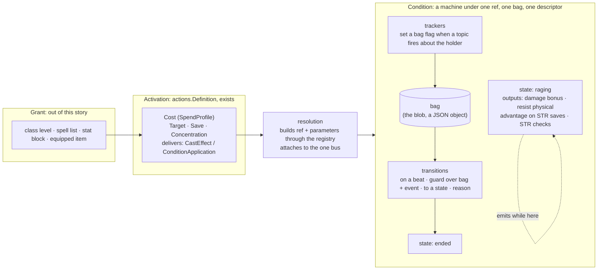

# Conditions Are Composed of Effects

**Status:** Draft, for the operator's agreement on the idea PR

**Story:** [rpg-project#703](https://github.com/KirkDiggler/rpg-project/issues/703)

**Decision:** none yet. The seam between resolution and a condition
(`ConditionBehavior`, the registry, the blob) does not move; if a later slice
moves it, that slice adds an ADR.

**Execution:** `plan.md`, added after design agreement

**Knowledge:** the decisions this design rests on, and the ones it makes, are
lines in [`rulebooks/dnd5e/knowledge/decisions.md`](../../../rulebooks/dnd5e/knowledge/decisions.md).
This story is the first to be run through the knowledge process from its
first day; see "Measures".

## The operator's direction

Recorded close to verbatim, 2026-10-28:

> they are really a series of effects with a budget. what if we made conditions
> composable from the underlying effects. rage is a damage modifier for str
> backed attacks … for some duration?

> if we stack effects in a meaningful way, a conditional effect that could act
> on a shared data structure so it could remove itself. we have literal
> conditions created and spells that could be decomposed. I am looking to
> ultimately getting this into the encounter studio and just want a data driven
> composable component to build with.

> coded hand written conditions are all we need right now … breaking up
> conditions and then spells into their effect components, allowing a grouping
> under a ref like dnd5e:conditions:raging that gets one data structure and the
> effects can drive that condition fully. no need to move quickly here.

> the epic is converting all current conditions to be composed of effects.

> cost is outside the executing of a condition or spell.

> I never want to take, I always want to build it new.

> it is really a state machine … having a proper state machine I think would
> allow us to build easier and better.

> I def do not want to bring in jsonata at the seams anyway. I like the closed
> vocabulary.

> core.Effect was ahead of its time. not imported means it is free for the
> taking or at min deleted … the machine in resolution now speaks that
> language. a modern core.Effects would do it the new way. the goal of
> configuring to subscribe and act on things with the state param filled in
> is what we want.

## Context, measured

What the tree holds on 2026-10-28, at `rpg-toolkit` main:

- `rulebooks/dnd5e/conditions/` has 58 non-test files. `raging.go` is 615
  lines and nine subscriptions: four modifiers (damage bonus on Strength
  melee weapon attacks, resistance to bludgeoning, piercing and slashing,
  advantage on Strength saves, advantage on Strength checks), five upkeep
  handlers (was hit, did attack, turn end with the ten-round cap, dropped to
  zero, rest, combat end), and the subscribe-with-rollback, unsubscribe,
  ToJSON and loadJSON boilerplate that 41 of the 58 files repeat.
- Eleven conditions already carry a free-standing rule value
  (`ragingDamageRule`, `sneakAttackRule`, `duelingRule`, …) that reads only
  the typed frame from `contributions` and answers applies, does not apply or
  depends, with its reason. The fold that lands the answer on a chain is
  near-identical across them. `physicalResistances`, `subscribeRemoveOnRest`,
  `publishStateChanged` and `executeRule` are shared helpers that grew the
  same way. The composition this design names is the shape those pieces were
  already growing toward.
- Rage's assessment answers only its damage row; its comment says the
  resistance and the two advantages "are not part of this answer". The
  information surface is narrower than the behaviour.
- Two earlier attempts at this idea are dead with no importer among the 29
  modules: `mechanics/effects` (a `ComposedCondition` with Temporary, Dice,
  Stackable and Saves behaviours over string-named events and wall-clock
  durations) and `rulebooks/dnd5e/effects` (an `Effect` struct carrying
  bonuses as strings such as `"+1d4"`, and a Rage whose damage bonus is a
  constant with a comment that it varies by level). Both modelled filters as
  strings that a generic interpreter had to know; the first filter the strings
  could not express sent the rule back to hand-written code. `core/effect`
  (an `Effect[T]` with Apply and Remove on a chain) is a third, also unused:
  the chain-modifier kind lifted to core before anything pulled on it.
- The condition descriptor law (rpg-toolkit#1965, shipped in #2014) holds: a
  condition is described once beside its type, one ref, one display, one
  load, one create, its two bearings and any attack override, read through
  the one registry. Monster traits are conditions in that registry.
- Resolution already speaks data for the activation side. `actions.Definition`
  carries a `Cost` (`combat.SpendProfile`: slots, capacity, grants, keyed
  resource `Pools`, and `Requires`), and exactly one of an `Attack`, `Cast` or
  `Sequence` profile. A cast delivers conditions as `CastEffect{Recipient,
  Ref, Parameters, CounterpartKey, SaveDCKey, OptionKey}`; an attack delivers
  them as `ConditionApplication{Ref, Parameters, Save}`. Resolution builds the
  condition from the ref and parameters through the registry's `create` and
  attaches it to the one interaction bus (ADR-0038). Concentration is
  resolution's: `CastConcentration{TurnEnds, SkipFirstTurnEnd}` and
  `resolution/concentration.go`. Spells and monster actions are on this path.
  Features (`Rage`, `Reckless Attack`, `Action Surge`, `Flurry of Blows`)
  still implement `core.Action[FeatureInput]` and spend their resource by
  hand through `core/resources.ResourceAccessor`. Two activation shapes for
  one idea.
- `SpendProfile.Pools` is documented as "a feature's charges. Expressible and
  unexercised in v1". The price of Rage is already sayable as data; nothing
  says it yet.

## The shape

Four nouns, kept apart. Three of them already have a home. The condition is
a **machine**: explicit states, transitions that fire on beats under guards,
and outputs a state emits while the machine sits in it. Guards and amounts
are written in a **closed vocabulary** that is the frame's own fact list, so
a recipe is data from the first slice and is checked against the frame when
it loads.



- **Effect**: one atom. An **output** contributes to a chain through a guard
  over the frame. A **tracker** sets a bag flag when a topic fires about the
  holder. A **transition** reads the bag and the beat's event through a guard
  and moves the machine to another state, with a reason. Three kinds, one
  shape: configure what to listen to, what must be true, what to do, with the
  bag handed in.
- **Condition**: a machine. States, each with its outputs; transitions
  between them; trackers that feed the bag; one terminal state whose entry is
  the one verb that removes the condition. It is what the registry builds and
  what the blob persists. Its outward contract, `ConditionBehavior`, does not
  change.
- **Activation**: the moment of use, already data. Cost, targeting, the
  contest, concentration, and what is delivered. This story moves the four
  features onto it; it does not redesign it.
- **Grant**: how an activation reached a sheet. Named here so the loot door
  (an equipped item that grants an activation or a passive condition) has a
  word when it arrives. No code under it today; it is its own story.

## What a condition looks like

A recipe. Shown as Go literals because that is where the first slices write
them; every field is a value, so the same recipe is one JSON object, which is
what the studio writes later and what the blob's `recipe` key can carry when
content arrives. Nothing in a recipe is a closure.

```go
var raging = recipe{
    ref:     refs.Conditions.Raging(),
    initial: "fresh",
    bag:     bag{"was_hit_this_turn": false, "did_attack_this_turn": false, "saw_turn_end": false, "round_activated": 0, "turns_active": 0},
    trackers: []tracker{
        {on: topicPostAttackRoll, about: actorIsHolder, set: "did_attack_this_turn"},
        {on: topicDamageReceived, about: targetIsHolder, set: "was_hit_this_turn"},
    },
    states: map[string]state{
        "fresh": {outputs: rageOutputs, transitions: []transition{
            {on: beatTurnEnd, about: holder, to: "raging", do: []act{anchorRound(), clearFlags("was_hit_this_turn", "did_attack_this_turn")}},
            rageEndings...,
        }},
        "raging": {outputs: rageOutputs, transitions: []transition{
            {on: beatTurnEnd, about: holder, when: not(any(flag("was_hit_this_turn"), flag("did_attack_this_turn"))), to: "ended", reason: "no_combat_activity"},
            {on: beatTurnEnd, about: holder, when: roundsSinceAnchor(gte(9)), to: "ended", reason: "duration_expired"},
            {on: beatTurnEnd, about: holder, when: roundWentBackwards(), to: "ended", reason: "clock_reset"},
            {on: beatTurnEnd, about: holder, do: []act{deriveTurnsActive(), clearFlags("was_hit_this_turn", "did_attack_this_turn")}},
            rageEndings...,
        }},
        "ended": terminal,
    },
}

var rageOutputs = []output{
    damageBonus{stage: combat.StageFeatures,
        when:   all(fact(actionMelee, eq(true)), fact(actionWeaponPool, eq(true)), fact(actionAbility, eq(abilities.STR))),
        amount: byClassLevel(classes.Barbarian, steps{1: 2, 9: 3, 16: 4})},
    resist{types: physicalTypes},
    advantage{on: savingThrows, when: fact(actionAbility, eq(abilities.STR))},
    advantage{on: abilityChecks, when: fact(actionAbility, eq(abilities.STR))},
}

var rageEndings = []transition{
    {on: beatDroppedToZero, about: holder, to: "ended", reason: "unconscious"},
    {on: beatRest, about: holder, to: "ended", reason: "rest"},
    {on: beatCombatEnd, about: holder, to: "ended", reason: "combat_ended"},
}

var blessed = recipe{
    ref:     refs.Conditions.Blessed(),
    initial: "blessed",
    bag:     bag{"source_id": ""},
    states: map[string]state{
        "blessed": {outputs: []output{
            rollBonus{on: attackRolls, dice: d4},
            rollBonus{on: savingThrows, dice: d4},
        }, transitions: []transition{
            {on: beatRest, about: holder, to: "ended", reason: "rest"}, // concentration and its turn ends are resolution's
        }},
        "ended": terminal,
    },
}

var resistanceDie = recipe{
    ref:     refs.Conditions.Resistance(),
    initial: "held",
    bag:     bag{"source_id": ""},
    states: map[string]state{
        "held": {outputs: []output{offerDie{on: postSaveRollOffer, die: d4, description: ResistanceOfferDescription}},
            transitions: []transition{
                {on: beatOfferTaken, about: holderAndThisRef, to: "ended", reason: "spent"},
                {on: beatRest, about: holder, to: "ended", reason: "rest"},
            }},
        "ended": terminal,
    },
}
```

Rage's first turn end moves `fresh` to `raging` without a sustain check:
that is the graced activation turn (operator, 2026-08-27) as a state rather
than a flag, and the clock-anchored round as an act on that transition. The
descriptor stays exactly as it is: ref, display, load, create, bearings,
attack override. `load` reads the bag and the current state; `create` fills
the bag from the cast's parameters. Each output answers its own information
row, so Rage answers four rows where today it answers one.

## The component

The contract above is what a condition author writes. This is what they
write against: the vocabulary, the bag, the three kinds, and the machine.
Names are the plan's to settle; the shape and the dependencies are the
design's. Everything here is in `rulebooks/dnd5e/conditions` (E9) and uses
only what already exists: `events.TypedTopicDef`, `events.ChainedTopicDef`,
`core/chain`, `contributions.Frame`, the registry's `descriptor`.

### The closed vocabulary

A guard is a tree of `all`, `any`, `not` over leaves. A leaf is one of a
short, closed set, and every leaf names something that already exists:

| leaf | reads | answers |
|------|-------|---------|
| `fact(<frame fact>, <op>)` | one `contributions.Fact` on the frame: roll kind, ability, melee, weapon pool, finesse, ranged, two-handed, off-hand, advantage, target, a pair's sees or distance, a held condition | the op on the known value; **Depends** when the fact is unknown |
| `flag(<bag key>)` | one bool in the bag | its value |
| `roundsSinceAnchor(<op>)`, `roundWentBackwards()` | the beat's round against the bag's anchor | the comparison; skipped when the beat carries no round |
| `classLevel(<class>, <op>)` | the frame's actor class levels | the op; Depends when the frame does not carry them |

Ops are `eq`, `ne`, `gte`, `lte`, `in`. Amounts are a closed set too:
`fixed(n)`, `dice(d)`, `byClassLevel(class, steps)`, `abilityModifier()`.
Beats are the topics a transition may listen to: turn end, dropped to zero,
rest, combat end, offer taken, save result, condition applied or removed.
Trackers listen to any typed topic with an `about` selector that names which
id on the event must be the holder.

**Validate runs at load, not at the table.** A recipe whose guard names a
fact the frame does not have, a flag the bag does not declare, a state no
transition reaches, a transition to a state that does not exist, or an
initial state that is terminal is refused by name when the registry loads
it, the way `actions.Definition.Validate` refuses a cost no ledger holds.
That is where the dead attempts' runtime misses go to be caught.

**Three-valued, by construction.** A leaf over an unknown fact answers
Depends. `all` is Depends if any leaf is and none is false; `any` is Depends
if any leaf is and none is true. An output whose guard answers Depends fails
the fold with `ErrRuleCannotAnswer`, exactly as `executeRule` does today; a
transition whose guard answers Depends does not fire. Information and
execution ask the same guard.

### The bag

A JSON object (`encoding/json/v2`, Go 1.27) whose keys the recipe declares
with their zero values. Trackers and acts write it, guards read it, and it
is the blob: `{ref, member_id, source, state, bag…}` flattened so the keys
the web already duck-types (`turns_active`) are where they are today (E4).
A key no guard, act or output reads is refused by Validate.

### What every kind is handed

```go
// host is the condition as its parts see it: the bag, who holds it, how to
// say the state moved, and the one way out (E5). No part sees the machine,
// the descriptor or another part.
type host struct {
    bag     *bag
    holder  string
    ref     *core.Ref
    changed func(ctx context.Context) error                // publishStateChanged
    end     func(ctx context.Context, reason string) error // publish removed, then detach all
}
```

### The three kinds

```go
// tracker sets a bag flag when a topic fires about the holder; idempotent
// within a turn. One Go type serves every typed topic; chained topics get
// the twin that returns the chain unmodified (PostAttackRoll fires per
// attack roll, hit or miss, rpg-toolkit#755).
type tracker struct {
    on    beat        // which topic
    about selector    // which id on the event must equal the holder
    set   string      // bag key, declared in the recipe
}

// output contributes to a chain while its state is current. Each output
// kind is one Go type that knows its chain and its stage; the recipe
// supplies the guard and the amount. The same guard answers the
// information row (E8).
type damageBonus struct {
    stage  combat.Stage
    when   guard
    amount amount
}

func (o damageBonus) attach(ctx context.Context, bus events.EventBus, h host) (detach, error) {
    id, err := dnd5eEvents.DamageChain.On(bus).SubscribeWithChain(ctx, func(
        _ context.Context, e *dnd5eEvents.DamageChainEvent, c chain.Chain[*dnd5eEvents.DamageChainEvent],
    ) (chain.Chain[*dnd5eEvents.DamageChainEvent], error) {
        verdict, err := o.when.answer(e.Frame, h.bag) // Applies, DoesNotApply, Depends + reason
        if err != nil || verdict.Applicability != contributions.Applies {
            return c, err // Depends is ErrRuleCannotAnswer here, as today
        }
        n, err := o.amount.value(e.Frame)
        if err != nil {
            return c, err
        }
        return c, c.Add(o.stage, h.ref.ID, func(_ context.Context, e *dnd5eEvents.DamageChainEvent) (*dnd5eEvents.DamageChainEvent, error) {
            e.Components = append(e.Components, dnd5eEvents.DamageComponent{
                Source:     dnd5eEvents.DamageSourceCondition,
                Roll:       dnd5eEvents.RollComponent{Source: sourceOf(h), Modifier: n},
                DamageType: e.WeaponDamageType,
            })
            return e, nil
        })
    })
    if err != nil {
        return nil, err
    }
    return func(ctx context.Context) error { return bus.Unsubscribe(ctx, id) }, nil
}

func (o damageBonus) assess(in *contributions.AssessActionInput, b *bag) (*contributions.Answer, error) {
    return o.when.answerWithAmount(in.Frame, b, o.amount)
}

// transition is read by the machine, never attached itself: the machine
// holds one subscription per beat and runs the current state's transitions
// in recipe order, stopping at the first that fires.
type transition struct {
    on     beat
    about  selector
    when   guard   // nil means always
    to     string  // empty means stay; do still runs
    do     []act   // bag writes: anchorRound, clearFlags, deriveTurnsActive
    reason string  // required when to is terminal
}
```

`damageBonus` is today's `onDamageChain` with the Rage-specific parts moved
out of code and into the recipe's guard and amount; the fold body is the
part every damage-bonus condition repeats, written once. `rollBonus`,
`resist`, `advantage` and `offerDie` are the same move on their chains.

### The machine

```go
// machine is what the registry builds, the bus attaches, and the blob
// persists. It is the only ConditionBehavior a composed condition has (E1).
type machine struct {
    recipe  *recipe
    bag     bag
    current string

    holder string
    source *core.Ref
    bus    events.EventBus
    detach []func(context.Context) error // outputs of the current state, plus trackers and beats
}

func (m *machine) Ref() *core.Ref  { return m.recipe.ref }
func (m *machine) IsApplied() bool { return m.bus != nil }

// Apply attaches the trackers, one subscription per beat the recipe names,
// and the current state's outputs. Any failure detaches what attached so
// far: today's rollback loop, written once.
func (m *machine) Apply(ctx context.Context, bus events.EventBus) error

// onBeat is the machine's one opinion: run the current state's transitions
// in recipe order; the first whose guard applies runs its acts and, if it
// names a state, enters it. Entering a state detaches the old outputs and
// attaches the new; entering the terminal state calls end (E5).
func (m *machine) onBeat(ctx context.Context, b beat, ev any) error

// end publishes the removal first, so the collector that reads removals
// still finds this condition as the owner, then detaches everything.
func (m *machine) end(ctx context.Context, reason string) error

// ToJSON writes {ref, member_id, source, state} and the bag's keys beside
// them, one object; loadJSON reads the same (E4).
func (m *machine) ToJSON() (json.RawMessage, error)

// AssessAction is the sum of the current state's outputs' rows (E8).
func (m *machine) AssessAction(in *contributions.AssessActionInput) (*contributions.AssessActionOutput, error)
```

The descriptor for Rage changes in one line: `load` and `create` build a
`machine` from the `raging` recipe instead of a `RagingCondition`.
Everything the registry, resolution, session and the api touch is unchanged.

### What this costs, and what it does not

- No generics, no closures, no expression engine. A recipe is one JSON
  object and a Go literal of the same shape; the studio form is the literal's
  fields as a form. The price is that the vocabulary is closed: a condition
  that needs a leaf the table does not have is a finding (E8), and the leaf
  is added to the table with its test, never worked around in a closure.
- Validate at load is the safety the dead attempts lacked and the one Go's
  compiler cannot give data. Every recipe ships with a transition-walk test
  that drives each beat and asserts the state and the reason.
- One subscription per beat on the machine, with transitions in recipe
  order, is the ordering guarantee today's nine subscriptions only have by
  accident. It is also fewer subscriptions.
- Guards are evaluated per event per condition. At table scale (a handful
  of participants, a dozen conditions) this is nothing; one benchmark before
  S2 says so in numbers.

## Working agreements of this design

Numbered so slices and knowledge lines can cite them by text. They are
agreements under measurement, not laws; the measures below say whether they
hold.

- **E1. One ref, one descriptor, one blob.** A composed condition registers
  through the same descriptor table as a hand-written one and loads from the
  same blob shape. Effects are internal structure, never registered, never
  addressable from outside the condition. *Because* six parallel tables keyed
  by condition ref drifted once already (rpg-toolkit#1965).
- **E2. A condition is a machine, and its parts are configuration.** States
  with outputs, transitions on beats under guards, trackers feeding the bag;
  each part names what it listens to, what must be true, and what it does,
  with the bag handed in. Three kinds: output, tracker, transition. *Because* "configuring to subscribe and
  act on things with the state param filled in is what we want" (operator,
  2026-10-28).
- **E3. Guards and amounts are a closed vocabulary, validated at load.** A
  guard is `all`, `any`, `not` over leaves that name a frame fact, a bag flag,
  the beat's round against the anchor, or an actor's class level, with a short
  list of ops; an amount is one of a short list of named functions. No
  expression language crosses the seam. An unknown fact answers Depends, not
  false, and a recipe naming a fact, flag or state that does not exist is
  refused when the registry loads it. *Because* the two dead attempts invented
  their own filter strings and needed an interpreter that knew every one; the
  frame is a closed, typed vocabulary that already exists and already answers
  three ways; and "I def do not want to bring in jsonata at the seams … I like
  the closed vocabulary" (operator, 2026-10-28).
- **E4. The bag is the blob.** The state the effects share is the state the
  condition persists, with its keys kept stable where a consumer duck-types
  them (`turns_active` for the web's rage badge). *Because* a composition
  that persisted differently from what it ran would be the dual representation
  the toolkit's laws forbid.
- **E5. End is one verb.** Publish the removal, then detach every effect. Only
  a budget calls it, and only through it does a condition leave. *Because*
  every hand-written condition writes this twice today (`endRage`, `end`) and
  the publish-before-detach order is a rule an activation's effect collector
  depends on.
- **E6. Lifecycle is the machine's transitions.** Ten rounds anchored to the
  clock's round, sustained by a bag guard at the holder's turn end, ending on
  dropped-to-zero, rest or combat end, spent when an offer is taken: each is
  a transition with its reason, run in recipe order, the first that fires
  winning. *Because* three past defects (rpg-toolkit#752, #755,
  rpg-project#253) all lived in hand-rolled upkeep; a budget written once is
  a budget debugged once. The graced activation turn (operator, 2026-08-27)
  and the clock-anchored round are a state (`fresh`) and an act
  (`anchorRound`) every recipe reuses, not re-derived per condition.
- **E7. Cost is never on a condition.** A condition's price is its
  activation's `SpendProfile`. Concentration is resolution's. *Because* "cost
  is outside the executing of a condition or spell" (operator, 2026-10-28),
  and the dead `Effect` struct is the warning: it carried `Concentration` and
  `Duration` beside a bonus string, cost smeared into effect.
- **E8. Hand-written conditions stay legal, and the vocabulary grows by
  finding.** A condition whose behaviour has no leaf or kind yet stays
  hand-written on its current `ConditionBehavior`; the missing leaf or kind is
  a finding, added to the table with its test on its second use, never worked
  around with a closure in a recipe. *Because* a vocabulary
  widened on a gap is the thing the dead attempts became.
- **E9. Rulebook-neutral by lift, not by birth.** The machine (ref, bag,
  states, transitions, end, blob) grows in `rulebooks/dnd5e/conditions` and is
  lifted to a neutral module when a second puller arrives: a second rulebook,
  or the studio. `core/effect` is deleted in the first slice so the ground
  and the import path are free. *Because* `core` is bus-free by design and
  the lift that happened early is the one sitting unused; and "no sense
  pretending like previous us knew how this whole thing would turn out"
  (operator, 2026-10-28).
- **E10. Features become Definitions.** Rage, Reckless Attack, Action Surge
  and Flurry of Blows move from `core.Action` to `actions.Definition`, their
  charges as `SpendProfile.Pools`, their condition as the delivered effect.
  *Because* resolution already speaks that language and two activation
  shapes for one idea is the drift this story exists to close.
- **E11. Build it new.** No state or expression library is brought in at
  the seams, and nothing is copied from earlier work elsewhere; the machine,
  the vocabulary and its validator are this repo's. *Because* "I never want
  to take, I always want to build it new" (operator, 2026-10-28), and the
  vocabulary has to be the frame's own list or it is a second place a fact is
  defined.

## Approaches considered

1. **Strings and an interpreter.** Conditions as data from day one, with a
   generic engine reading bonus strings and filter names. Tried twice in this
   tree; both dead. Rejected: the interpreter must know every filter, and the
   first one it does not sends the rule back to code.
2. **A machine with a closed vocabulary.** States, transitions, trackers and
   outputs as data; guards and amounts from a short table that names the
   frame's facts; a validator at load; the kinds in Go. **Chosen**
   (operator, 2026-10-28). It is data from the first slice, it keeps the
   descriptor law and the resolution seam untouched, and it defers the
   neutral home to the moment something pulls on it. An earlier draft of this
   design used typed Go atoms with closures and generics; the operator read
   it as "very code centric" and it was replaced by this.
3. **A machine with a general expression language.** States and transitions
   as data, guards and amounts as JSONata (or similar) over a JSON projection
   of frame plus bag. Considered 2026-10-28 and rejected by the operator: a
   complete interpreter at the rules seam, a dependency we did not build, and
   a typo that is a runtime miss. The closed vocabulary keeps the frame as the
   one place a fact is defined and lets Validate refuse a bad recipe at load.
4. **Keep hand-writing, extract helpers.** The status quo drift: more shared
   functions, no shell. Rejected: it never yields one data structure per
   condition, so the studio never gets a component to build with, and the
   information surface stays narrower than the behaviour.

## Slices

Named here; the plan creates the sub-issues and may re-cut them. Each code
slice is one module PR (one nearest `go.mod`), docs may ride along.

- **S1. The machine, the vocabulary, and Rage.** `recipe`, `machine`, the
  bag, `end`, the guard tree with the leaves and ops in the table, the
  amounts, the beats, `Validate`, the output and tracker kinds Rage needs,
  and `RagingCondition` rebuilt as the recipe above with the identical blob.
  The existing rage tests run unchanged, plus one transition-walk test.
  Assumes Go 1.27 has landed (rpg-toolkit#2145). Separate module PR: delete
  `core/effect`.
- **S2. The 1d4 family.** Blessed, Baned, Divine Favor, Guided, Inspired:
  roll bonuses and offered dice, source-qualified bags.
- **S3. The against-holder family.** Prone, Held, Faerie Fire, Sanctuary:
  effects that fold the attacker's chain through the holder's bearing, and
  the save-gated ones.
- **S4. Features become Definitions.** The four `core.Action` features move
  to `actions.Definition` with `Pools` costs; `features` keeps the sheet-side
  surface (status, description) it still owns.
- **S5. The long tail.** The remaining conditions, each either composed from
  atoms or kept hand-written inside the shell under E8, with a count of each.
- **S6. The lift decision.** With five slices behind it, decide the neutral
  home (a new module, or `events`), what moves, and what the studio form is.
  An ADR if the seam moves.

Spells are already on the activation path; the decomposition they need is
of the conditions they deliver, which S2 and S3 cover. Instantaneous spells
(damage, healing, stabilize) are already instantaneous data and are not
conditions.

## Settled, and open

**Settled in conversation, 2026-10-28, ruled by the operator:** the target
is one data structure per condition, driven fully by its effects, under one
ref (E1, E2); hand-written Go is the form for now, content authoring comes
with the studio (E9); cost lives outside the condition (E7); `core/effect` is
free for the taking or deleted (E9); features and spells converge on one
activation shape (E10); no need to move quickly; a condition is a machine,
guards and amounts are a closed vocabulary with no expression language at
the seam, and nothing is brought in or copied (E2, E3, E11).

**Open, for the design PR's checklist:**

- [ ] Stacking identity: by ref, or by ref plus source, declared per condition
  on the literal. Recommendation: a `stacks` field defaulting to by-ref, with
  the source-qualified conditions (Resistance, Blessed) declaring by-source,
  which is what `ConditionAddressProvider` already distinguishes.
- [ ] Display: authored on the descriptor as today, or derived from the
  effects' rows. Recommendation: authored stays; derivation is a later win
  once every effect answers a row and the words are checked against the
  authored ones.
- [ ] Bag versus parameters: a cast's `Parameters` fill the bag through
  `create`; the keys a cast binds (`CounterpartKey`, `SaveDCKey`,
  `OptionKey`) are bag keys. Recommendation: yes, and nothing else; a bag key
  no effect reads is a finding.
- [ ] The first table of leaves, ops, amounts and beats: the one above, or
  trimmed to exactly what Rage, Blessed and Resistance need. Recommendation:
  trimmed; E8 grows it by finding.
- [ ] Where a recipe lives at S1: a Go literal beside its descriptor (as the
  hand-written types are today), or a JSON file under `conditions/recipes/`
  embedded at build. Recommendation: Go literal at S1, JSON when the studio
  reads them, since the shape is identical and the literal gets `go vet`.
- [ ] Which neutral home at S6. Not decided before S6 by design.

## Measures

Posted on the story issue as slices land, the way the team-memory story
posts its rows on rpg-project#676:

- lines per converted condition, before and after, and the count of atoms;
- conditions converted, kept hand-written under E8, and the ratio;
- information rows a condition answers, before and after (Rage: 1 → 4);
- knowledge lines at the dnd5e level this story adds, and how many of the
  existing lines gain an `upheld` link from its PRs;
- defects found in budgets after S1, against the three that preceded it.

## Delivery finish line

The idea PR carries `design.md`, then `plan.md` after agreement, and stays
open while slices merge in their own module PRs; `implementation.md` is
added with tags and observed deviations before the idea PR merges. Every
slice's PR carries a run record at `rulebooks/dnd5e/knowledge/runs/`, and
every ruling walked in conversation lands as a knowledge line the same day.
