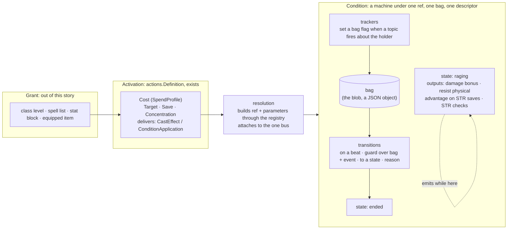

# Conditions Are Composed of Effects

**Status:** Approved by the operator 2026-10-28 ("I am ready to sign off on this prototype"); execution in `plan.md`

**Story:** [rpg-project#703](https://github.com/KirkDiggler/rpg-project/issues/703)

**Decision:** none yet. The seam between resolution and a condition
(`ConditionBehavior`, the registry, the blob) does not move; if a later slice
moves it, that slice adds an ADR.

**Execution:** [plan.md](plan.md)

**Knowledge:** the decisions this design rests on, and the ones it makes, are
lines in [`rulebooks/dnd5e/knowledge/decisions.md`](../../../rulebooks/dnd5e/knowledge/decisions.md).
This story is the first to be run through the knowledge process from its
first day; see "Measures".

## The operator's direction

Recorded close to verbatim, 2026-10-28:

> they are really a series of effects with a budget. what if we made conditions
> composable from the underlying effects. rage is a damage modifier for str
> backed attacks … for some duration?

> if we stack effects in a meaningful way, a conditional effect that could act
> on a shared data structure so it could remove itself. we have literal
> conditions created and spells that could be decomposed. I am looking to
> ultimately getting this into the encounter studio and just want a data driven
> composable component to build with.

> coded hand written conditions are all we need right now … breaking up
> conditions and then spells into their effect components, allowing a grouping
> under a ref like dnd5e:conditions:raging that gets one data structure and the
> effects can drive that condition fully. no need to move quickly here.

> the epic is converting all current conditions to be composed of effects.

> cost is outside the executing of a condition or spell.

> I never want to take, I always want to build it new.

> it is really a state machine … having a proper state machine I think would
> allow us to build easier and better.

> I def do not want to bring in jsonata at the seams anyway. I like the closed
> vocabulary.

> why would the example need the rulebook? this is the tool the rulebook would
> use right?

> we do not need a toy, let's make it our current use case. set up raging. if
> we think a thing like the state machine would ever be broken out just create
> the machine package under the main module, watch the seams. I think we can
> get some tools out of this project and not just composable conditions.

> I think the dnd5e conditions will remain in go code and refactoring that
> with a low level tool is a win by itself. that it enables a loading of
> content from someone in the studio is just bonus.

> we are under examples/machine for now. I think we call it what the sum of
> its responsibilities are. if it is a state machine that fires configured
> events out on transition that are used by a composer then machine makes
> sense. I think we may have an effects package but it will likely use the
> machine package. alternatively we could shoot for making the effects
> package in example and have a path to effects/machine with a package that
> could be broken out when we leave example.

> core.Effect was ahead of its time. not imported means it is free for the
> taking or at min deleted … the machine in resolution now speaks that
> language. a modern core.Effects would do it the new way. the goal of
> configuring to subscribe and act on things with the state param filled in
> is what we want.

## Context, measured

What the tree holds on 2026-10-28, at `rpg-toolkit` main:

- `rulebooks/dnd5e/conditions/` has 58 non-test files. `raging.go` is 615
  lines and nine subscriptions: four modifiers (damage bonus on Strength
  melee weapon attacks, resistance to bludgeoning, piercing and slashing,
  advantage on Strength saves, advantage on Strength checks), five upkeep
  handlers (was hit, did attack, turn end with the ten-round cap, dropped to
  zero, rest, combat end), and the subscribe-with-rollback, unsubscribe,
  ToJSON and loadJSON boilerplate that 41 of the 58 files repeat.
- Eleven conditions already carry a free-standing rule value
  (`ragingDamageRule`, `sneakAttackRule`, `duelingRule`, …) that reads only
  the typed frame from `contributions` and answers applies, does not apply or
  depends, with its reason. The fold that lands the answer on a chain is
  near-identical across them. `physicalResistances`, `subscribeRemoveOnRest`,
  `publishStateChanged` and `executeRule` are shared helpers that grew the
  same way. The composition this design names is the shape those pieces were
  already growing toward.
- Rage's assessment answers only its damage row; its comment says the
  resistance and the two advantages "are not part of this answer". The
  information surface is narrower than the behaviour.
- Two earlier attempts at this idea are dead with no importer among the 29
  modules: `mechanics/effects` (a `ComposedCondition` with Temporary, Dice,
  Stackable and Saves behaviours over string-named events and wall-clock
  durations) and `rulebooks/dnd5e/effects` (an `Effect` struct carrying
  bonuses as strings such as `"+1d4"`, and a Rage whose damage bonus is a
  constant with a comment that it varies by level). Both modelled filters as
  strings that a generic interpreter had to know; the first filter the strings
  could not express sent the rule back to hand-written code. `core/effect`
  (an `Effect[T]` with Apply and Remove on a chain) is a third, also unused:
  the chain-modifier kind lifted to core before anything pulled on it.
- The condition descriptor law (rpg-toolkit#1965, shipped in #2014) holds: a
  condition is described once beside its type, one ref, one display, one
  load, one create, its two bearings and any attack override, read through
  the one registry. Monster traits are conditions in that registry.
- Resolution already speaks data for the activation side. `actions.Definition`
  carries a `Cost` (`combat.SpendProfile`: slots, capacity, grants, keyed
  resource `Pools`, and `Requires`), and exactly one of an `Attack`, `Cast` or
  `Sequence` profile. A cast delivers conditions as `CastEffect{Recipient,
  Ref, Parameters, CounterpartKey, SaveDCKey, OptionKey}`; an attack delivers
  them as `ConditionApplication{Ref, Parameters, Save}`. Resolution builds the
  condition from the ref and parameters through the registry's `create` and
  attaches it to the one interaction bus (ADR-0038). Concentration is
  resolution's: `CastConcentration{TurnEnds, SkipFirstTurnEnd}` and
  `resolution/concentration.go`. Spells and monster actions are on this path.
  Features (`Rage`, `Reckless Attack`, `Action Surge`, `Flurry of Blows`)
  still implement `core.Action[FeatureInput]` and spend their resource by
  hand through `core/resources.ResourceAccessor`. Two activation shapes for
  one idea.
- `SpendProfile.Pools` is documented as "a feature's charges. Expressible and
  unexercised in v1". The price of Rage is already sayable as data; nothing
  says it yet.

## The shape

Four nouns, kept apart. Three of them already have a home. The condition is
a **machine**: explicit states, transitions that fire on beats under guards,
and outputs a state emits while the machine sits in it. Guards and amounts
are written in a **closed vocabulary**. Two tools, one above the other. The
**machine** is a state machine over a bag that fires configured events on
transition; it knows states, transitions, guards, the bag and its blob, and
nothing about a chain. The **composer**, `effects`, listens to those events
and attaches a state's outputs to the chains while the machine sits in it.
The rulebook plugs the vocabulary into both: facts and beats into the
machine, output kinds and amounts into the composer. `conditions` is the
rulebook's side: recipes, vocabulary and descriptor glue.



- **Effect**: one atom. A **transition** reads the bag and the beat's event
  through a guard and moves the machine to another state, firing an event
  with its reason. A **tracker** sets a bag flag when a topic fires about the
  holder. Those two are the machine's. An **output** contributes to a chain
  through a guard over the frame while its state is current; outputs are the
  composer's. Three kinds, one shape: configure what to listen to, what must
  be true, what to do, with the bag handed in.
- **Condition**: a machine. States, each with its outputs; transitions
  between them; trackers that feed the bag; one terminal state whose entry is
  the one verb that removes the condition. It is what the registry builds and
  what the blob persists. Its outward contract, `ConditionBehavior`, does not
  change.
- **Activation**: the moment of use, already data. Cost, targeting, the
  contest, concentration, and what is delivered. This story moves the four
  features onto it; it does not redesign it.
- **Grant**: how an activation reached a sheet. Named here so the loot door
  (an equipped item that grants an activation or a passive condition) has a
  word when it arrives. No code under it today; it is its own story.

## What a condition looks like

A recipe. Shown as Go literals because that is where the first slices write
them; every field is a value, so the same recipe is one JSON object, which is
what the studio writes later and what the blob's `recipe` key can carry when
content arrives. Nothing in a recipe is a closure.

```go
var raging = recipe{
    ref:     refs.Conditions.Raging(),
    stacks:  byRef, // a second Rage on the same holder is refused as already applied
    initial: "fresh",
    bag:     bag{"was_hit_this_turn": false, "did_attack_this_turn": false, "saw_turn_end": false, "round_activated": 0, "turns_active": 0},
    trackers: []tracker{
        {on: topicPostAttackRoll, about: actorIsHolder, set: "did_attack_this_turn"},
        {on: topicDamageReceived, about: targetIsHolder, set: "was_hit_this_turn"},
    },
    states: map[string]state{
        "fresh": {outputs: rageOutputs, transitions: []transition{
            {on: beatTurnEnd, about: holder, to: "raging", do: []act{anchorRound(), deriveTurnsActive(), clearFlags("was_hit_this_turn", "did_attack_this_turn")}},
            rageEndings...,
        }},
        "raging": {outputs: rageOutputs, transitions: []transition{
            {on: beatTurnEnd, about: holder, when: not(any(flag("was_hit_this_turn"), flag("did_attack_this_turn"))), to: "ended", reason: "no_combat_activity"},
            {on: beatTurnEnd, about: holder, when: roundsSinceAnchor(gte(9)), to: "ended", reason: "duration_expired"},
            {on: beatTurnEnd, about: holder, when: roundWentBackwards(), to: "ended", reason: "clock_reset"},
            {on: beatTurnEnd, about: holder, do: []act{anchorRound(), deriveTurnsActive(), clearFlags("was_hit_this_turn", "did_attack_this_turn")}},
            rageEndings...,
        }},
        "ended": terminal,
    },
}

var rageOutputs = []output{
    damageBonus{stage: combat.StageFeatures,
        when:   all(fact(actionMelee, eq(true)), fact(actionWeaponPool, eq(true)), fact(actionAbility, eq(abilities.STR))),
        amount: byClassLevel(classes.Barbarian, steps{1: 2, 9: 3, 16: 4})},
    resist{types: physicalTypes},
    advantage{on: savingThrows, when: fact(actionAbility, eq(abilities.STR))},
    advantage{on: abilityChecks, when: fact(actionAbility, eq(abilities.STR))},
}

var rageEndings = []transition{
    {on: beatDroppedToZero, about: holder, to: "ended", reason: "unconscious"},
    {on: beatRest, about: holder, to: "ended", reason: "rest"},
    {on: beatCombatEnd, about: holder, to: "ended", reason: "combat_ended"},
}

var blessed = recipe{
    ref:     refs.Conditions.Blessed(),
    stacks:  bySource, // two casters' blessings are two conditions, each with its own concentration
    initial: "blessed",
    bag:     bag{"source_id": ""},
    states: map[string]state{
        "blessed": {outputs: []output{
            rollBonus{on: attackRolls, dice: d4},
            rollBonus{on: savingThrows, dice: d4},
        }, transitions: []transition{
            {on: beatRest, about: holder, to: "ended", reason: "rest"}, // concentration and its turn ends are resolution's
        }},
        "ended": terminal,
    },
}

var resistanceDie = recipe{
    ref:     refs.Conditions.Resistance(),
    stacks:  bySource,
    initial: "held",
    bag:     bag{"source_id": ""},
    states: map[string]state{
        "held": {outputs: []output{offerDie{on: postSaveRollOffer, die: d4, description: ResistanceOfferDescription}},
            transitions: []transition{
                {on: beatOfferTaken, about: holderAndThisRef, to: "ended", reason: "spent"},
                {on: beatRest, about: holder, to: "ended", reason: "rest"},
            }},
        "ended": terminal,
    },
}
```

Rage's first turn end moves `fresh` to `raging` without a sustain check:
that is the graced activation turn (operator, 2026-08-27) as a state rather
than a flag, and the clock-anchored round as an act on that transition.
`anchor_round` sets `round_activated` only while it is zero and the beat
carries a round, so the same act on `raging`'s upkeep transition is today's
late anchoring (a rage whose first turn ends carried no round anchors on the
first one that does) and never re-anchors. `derive_turns_active` runs on the
graced turn too, so `turns_active` reads 1 there as it does today
(`raging.go`, S1 finding). The
descriptor stays exactly as it is: ref, display, load, create, bearings,
attack override. `load` reads the bag and the current state; `create` fills
the bag from the cast's parameters. Each output answers its own information
row, so Rage answers four rows where today it answers one.

## The component

The contract above is what a condition author writes. This is what they
write against: the vocabulary, the bag, the three kinds, and the machine.
Names are the plan's to settle; the shape and the dependencies are the
design's. Three parts (E9): **`effects/machine`**, a state machine over a bag that
fires events on transition (states, transitions, trackers, guards, the bag
and its blob, Validate), importing `core` and `events` only; **`effects`**,
the composer, which builds a condition from a recipe by running a machine
and attaching the current state's outputs to the chains, importing `machine`,
`core` and `events`; and the **plug**, the rulebook's vocabulary in
`conditions`, facts and beats handed to the machine, output kinds and
amounts handed to the composer, all read from `contributions.Frame`, the
typed topics, the chains and their stages. Both tools form in
`examples/effects` and never import a rulebook.

```go
// vocabulary is what a rulebook plugs into the tool. Validate checks every
// recipe against the one it was given; the studio reads the same tables.
// machine's side
type vocabulary struct {
    facts map[factName]factSpec // name → kind of scalar + reader over an opaque event or frame
    beats map[beat]beatSpec     // name → typed topic + the selectors it supports
}

// composer's side
type outputVocabulary struct {
    kinds   map[kindName]kindSpec   // name → attach(ctx, bus, host, params) for one output kind
    amounts map[amountName]amountFn // name → value(frame, params)
}
```

### The closed vocabulary

A guard is a tree of `all`, `any`, `not` over leaves. The tool knows the
leaf shapes; the rulebook supplies the names. For dnd5e every leaf names
something that already exists:

| leaf | reads | answers |
|------|-------|---------|
| `fact(<frame fact>, <op>)` | one `contributions.Fact` on the frame: roll kind, ability, melee, weapon pool, finesse, ranged, two-handed, off-hand, advantage, target, a pair's sees or distance, a held condition | the op on the known value; **Depends** when the fact is unknown |
| `flag(<bag key>)` | one bool in the bag | its value |
| `roundsSinceAnchor(<op>)`, `roundWentBackwards()` | the beat's round against the bag's anchor | the comparison; skipped when the beat carries no round |
| `classLevel(<class>, <op>)` | the frame's actor class levels | the op; Depends when the frame does not carry them |

This table is the intended shape, not S1's contents: S1 ships only the rows
Rage reads (ruling 4); `in`, the pair and held facts, the dice and
ability-modifier amounts, the offer-taken and save-result beats and the
roll-bonus and offer-die kinds arrive with Blessed, Resistance and the
against-holder family, each with its test. Ops are `eq`, `ne`, `gte`, `lte`,
`in`. Amounts are a closed set too:
`fixed(n)`, `dice(d)`, `byClassLevel(class, steps)`, `abilityModifier()`.
Beats are the topics a transition may listen to: turn end, dropped to zero,
rest, combat end, offer taken, save result, condition applied or removed.
Trackers listen to any typed topic with an `about` selector that names which
id on the event must be the holder.

**Validate runs at load, not at the table.** A recipe whose guard names a
fact the vocabulary does not have, a flag the bag does not declare, a state no
transition reaches, a transition to a state that does not exist, or an
initial state that is terminal is refused by name when the registry loads
it, the way `actions.Definition.Validate` refuses a cost no ledger holds.
That is where the dead attempts' runtime misses go to be caught.

**Three-valued, by construction.** A leaf over an unknown fact answers
Depends. `all` is Depends if any leaf is and none is false; `any` is Depends
if any leaf is and none is true. An output whose guard answers Depends fails
the fold with `ErrRuleCannotAnswer`, exactly as `executeRule` does today; a
transition whose guard answers Depends does not fire. Information and
execution ask the same guard.

### The bag

A JSON object (`encoding/json/v2`, Go 1.27) whose keys the recipe declares
with their zero values. Trackers and acts write it, guards read it, and it
is the blob: `{ref, member_id, source, state, bag…}` flattened so the keys
the web already duck-types (`turns_active`) are where they are today (E4).
A key no guard, act or output reads is refused by Validate.

### What every kind is handed

```go
// host is the condition as its parts see it: the bag, who holds it, how to
// say the state moved, and the one way out (E5). No part sees the machine,
// the descriptor or another part.
type host struct {
    bag     *bag
    holder  string
    ref     *core.Ref
    changed func(ctx context.Context) error                // publishStateChanged
    end     func(ctx context.Context, reason string) error // publish removed, then detach all
}
```

### The three kinds

```go
// tracker sets a bag flag when a topic fires about the holder; idempotent
// within a turn. One Go type serves every typed topic; chained topics get
// the twin that returns the chain unmodified (PostAttackRoll fires per
// attack roll, hit or miss, rpg-toolkit#755).
type tracker struct {
    on    beat        // which topic
    about selector    // which id on the event must equal the holder
    set   string      // bag key, declared in the recipe
}

// output contributes to a chain while its state is current. Each output
// kind is one Go type that knows its chain and its stage; the recipe
// supplies the guard and the amount. The same guard answers the
// information row (E8).
type damageBonus struct {
    stage  combat.Stage
    when   guard
    amount amount
}

func (o damageBonus) attach(ctx context.Context, bus events.EventBus, h host) (detach, error) {
    id, err := dnd5eEvents.DamageChain.On(bus).SubscribeWithChain(ctx, func(
        _ context.Context, e *dnd5eEvents.DamageChainEvent, c chain.Chain[*dnd5eEvents.DamageChainEvent],
    ) (chain.Chain[*dnd5eEvents.DamageChainEvent], error) {
        verdict, err := o.when.answer(e.Frame, h.bag) // Applies, DoesNotApply, Depends + reason
        if err != nil || verdict.Applicability != contributions.Applies {
            return c, err // Depends is ErrRuleCannotAnswer here, as today
        }
        n, err := o.amount.value(e.Frame)
        if err != nil {
            return c, err
        }
        return c, c.Add(o.stage, h.ref.ID, func(_ context.Context, e *dnd5eEvents.DamageChainEvent) (*dnd5eEvents.DamageChainEvent, error) {
            e.Components = append(e.Components, dnd5eEvents.DamageComponent{
                Source:     dnd5eEvents.DamageSourceCondition,
                Roll:       dnd5eEvents.RollComponent{Source: sourceOf(h), Modifier: n},
                DamageType: e.WeaponDamageType,
            })
            return e, nil
        })
    })
    if err != nil {
        return nil, err
    }
    return func(ctx context.Context) error { return bus.Unsubscribe(ctx, id) }, nil
}

func (o damageBonus) assess(in *contributions.AssessActionInput, b *bag) (*contributions.Answer, error) {
    return o.when.answerWithAmount(in.Frame, b, o.amount)
}

// transition is read by the machine, never attached itself: the machine
// holds one subscription per beat and runs the current state's transitions
// in recipe order, stopping at the first that fires.
type transition struct {
    on     beat
    about  selector
    when   guard   // nil means always
    to     string  // empty means stay; do still runs
    do     []act   // bag writes: anchorRound, clearFlags, deriveTurnsActive
    reason string  // required when to is terminal
}
```

`damageBonus` is today's `onDamageChain` with the Rage-specific parts moved
out of code and into the recipe's guard and amount; the fold body is the
part every damage-bonus condition repeats, written once. `rollBonus`,
`resist`, `advantage` and `offerDie` are the same move on their chains.

### The machine, and the composer

```go
// machine is a state machine over a bag. It subscribes to the beats its
// recipe names, runs the current state's transitions in order on each, and
// fires a transition event (from, to, reason) that the composer listens to.
// It knows no chain and no output; the composer below is what the registry
// builds and what persists the blob (E1).
type machine struct {
    recipe  *recipe
    bag     bag
    current string

    holder string
    source *core.Ref
    bus    events.EventBus
    detach []func(context.Context) error // outputs of the current state, plus trackers and beats
}

func (m *machine) Ref() *core.Ref  { return m.recipe.ref }
func (m *machine) IsApplied() bool { return m.bus != nil }

// Apply attaches the trackers, one subscription per beat the recipe names,
// and the current state's outputs. Any failure detaches what attached so
// far: today's rollback loop, written once.
func (m *machine) Apply(ctx context.Context, bus events.EventBus) error

// onBeat is the machine's one opinion: run the current state's transitions
// in recipe order; the first whose guard applies runs its acts and, if it
// names a state, enters it. Entering a state detaches the old outputs and
// attaches the new; entering the terminal state calls end (E5).
func (m *machine) onBeat(ctx context.Context, b beat, ev any) error

// end publishes the removal first, so the collector that reads removals
// still finds this condition as the owner, then detaches everything.
func (m *machine) end(ctx context.Context, reason string) error

// ToJSON writes {ref, member_id, source, state} and the bag's keys beside
// them, one object; loadJSON reads the same (E4).
func (m *machine) ToJSON() (json.RawMessage, error)

```

```go
// effects.Composed is the condition the registry builds from a recipe. It
// owns a machine, attaches the current state's outputs on entry and detaches
// them on exit, calls end when the machine enters its terminal state, and
// answers the information rows as the sum of the current outputs' (E8). It
// satisfies the rulebook's ConditionBehavior structurally, importing none
// of it.
type Composed struct {
    m        *machine.Machine
    outputs  outputVocabulary
    attached []func(context.Context) error
}
```

The descriptor for Rage changes in one line: `load` and `create` build a
`machine` from the `raging` recipe instead of a `RagingCondition`.
Everything the registry, resolution, session and the api touch is unchanged.

### What this costs, and what it does not

- No generics, no closures, no expression engine. A recipe is one JSON
  object and a Go literal of the same shape; the studio form is the literal's
  fields as a form. The price is that the vocabulary is closed: a condition
  that needs a leaf the table does not have is a finding (E8), and the leaf
  is added to the table with its test, never worked around in a closure.
- Validate at load is the safety the dead attempts lacked and the one Go's
  compiler cannot give data. Every recipe ships with a transition-walk test
  that drives each beat and asserts the state and the reason.
- One subscription per beat on the machine, with transitions in recipe
  order, is the ordering guarantee today's nine subscriptions only have by
  accident. It is also fewer subscriptions.
- Guards are evaluated per event per condition. At table scale (a handful
  of participants, a dozen conditions) this is nothing; one benchmark before
  S2 says so in numbers.

### The data structs

What an author writes and the studio emits; the machine's structs first,
then the composer's. Go 1.27 shows up at the JSON seam (`omitzero`, the
`inline` bag), not in the shapes. Names are the plan's to settle.

```go
// machine
type Recipe struct {
    Ref      core.Ref         `json:"ref"`
    Stacks   Stacks           `json:"stacks,omitzero"` // by_ref (default) | by_source
    Initial  string           `json:"initial"`
    Bag      map[string]any   `json:"bag"`             // declared keys with their zero values
    Trackers []Tracker        `json:"trackers,omitzero"`
    States   map[string]State `json:"states"`
}

type State struct {
    Outputs     []jsontext.Value `json:"outputs,omitzero"`     // opaque to the machine; the composer's
    Transitions []Transition     `json:"transitions,omitzero"` // run in order; first that fires wins
    Terminal    bool             `json:"terminal,omitzero"`    // entering it ends the condition
}

type Tracker struct {
    On    Beat     `json:"on"`
    About Selector `json:"about"` // which id on the event must be the holder
    Set   string   `json:"set"`   // a declared bag key
}

type Transition struct {
    On     Beat     `json:"on"`
    About  Selector `json:"about"`
    When   *Guard   `json:"when,omitzero"`   // nil means always
    To     string   `json:"to,omitzero"`     // empty means stay
    Do     []Act    `json:"do,omitzero"`
    Reason string   `json:"reason,omitzero"` // required when To is terminal
}

// Guard is a tree. Exactly one field is set per node.
type Guard struct {
    All []Guard `json:"all,omitzero"`
    Any []Guard `json:"any,omitzero"`
    Not *Guard  `json:"not,omitzero"`

    Fact       *FactLeaf       `json:"fact,omitzero"`
    Flag       string          `json:"flag,omitzero"`
    Rounds     *RoundsLeaf     `json:"rounds,omitzero"`
    ClassLevel *ClassLevelLeaf `json:"class_level,omitzero"`
}

type FactLeaf struct {
    Name  FactName `json:"name"`  // from the vocabulary
    Op    Op       `json:"op"`    // eq, ne, gte, lte, in
    Value any      `json:"value"` // typed per fact by the vocabulary at Validate
}
type RoundsLeaf struct {
    SinceAnchor   *IntOp `json:"since_anchor,omitzero"`
    WentBackwards bool   `json:"went_backwards,omitzero"`
}
type IntOp struct {
    Op Op  `json:"op"`
    N  int `json:"n"`
}
type ClassLevelLeaf struct {
    Class string `json:"class"` // a vocabulary fact name space: the rulebook's classes
    Op    Op     `json:"op"`
    N     int    `json:"n"`
}

// Act is a bag write a transition performs. Exactly one field.
type Act struct {
    AnchorRound       bool     `json:"anchor_round,omitzero"`
    DeriveTurnsActive bool     `json:"derive_turns_active,omitzero"`
    ClearFlags        []string `json:"clear_flags,omitzero"`
    Set               *SetAct  `json:"set,omitzero"`
}
type SetAct struct {
    Key   string `json:"key"`
    Value any    `json:"value"`
}

// Closed string sets. The vocabulary names them; Validate reads it.
type Beat string
type Selector string // holder_is_actor, holder_is_target, holder_is_subject, holder_and_this_ref
type Op string
type FactName string
type Stacks string

// Blob is what ToJSON writes and load reads: the header the loader routes
// on, the state, and the bag's keys beside them in the same object.
type Blob struct {
    Ref      core.Ref       `json:"ref"`
    MemberID string         `json:"member_id"`
    Source   *core.Ref      `json:"source,omitzero"`
    State    string         `json:"state"`
    Bag      map[string]any `json:",embed"`
}

// Vocabulary is the rulebook's plug into the machine.
type Vocabulary struct {
    Facts map[FactName]FactSpec
    Beats map[Beat]BeatSpec
}
type FactSpec struct {
    Kind ScalarKind                       // bool, int, string
    Read func(frame any) (any, bool)      // value, known
}
type BeatSpec struct {
    Selectors []Selector
    Subscribe func(ctx context.Context, bus events.EventBus, h func(ctx context.Context, ev any) error) (id string, err error)
    Round     func(ev any) (int, bool)    // the beat's round, when it carries one
    About     func(ev any, sel Selector) (id string, ok bool)
}

// composer (effects)
type Output struct {
    When   *machine.Guard `json:"when,omitzero"`
    Amount *Amount        `json:"amount,omitzero"`
    Kind   KindName       `json:"kind"`             // from the output vocabulary
    Params jsontext.Value `json:"params,omitzero"`  // the kind's own fields, validated by the kind
}
type Amount struct {
    Fixed           *int        `json:"fixed,omitzero"`
    Dice            string      `json:"dice,omitzero"`
    ByClassLevel    *ClassSteps `json:"by_class_level,omitzero"`
    AbilityModifier bool        `json:"ability_modifier,omitzero"`
}
type ClassSteps struct {
    Class string      `json:"class"`
    Steps map[int]int `json:"steps"` // {1: 2, 9: 3, 16: 4}
}
type OutputVocabulary struct {
    Kinds   map[KindName]KindSpec
    Amounts map[AmountName]AmountFn
}
```

Validate walks this: exactly one field per Guard node, Amount and Act; every
fact, beat, kind and amount name in the vocabulary with a value of the fact's
kind; every flag and set key declared in Bag; every `To` an existing state;
the initial state not terminal; every state reachable; a reason on every
transition into a terminal state; `by_source` implies a `source_id` key.

## Working agreements of this design

Numbered so slices and knowledge lines can cite them by text. They are
agreements under measurement, not laws; the measures below say whether they
hold.

- **E1. One ref, one descriptor, one blob.** A composed condition registers
  through the same descriptor table as a hand-written one and loads from the
  same blob shape. Effects are internal structure, never registered, never
  addressable from outside the condition. *Because* six parallel tables keyed
  by condition ref drifted once already (rpg-toolkit#1965).
- **E2. A condition is a machine composed with outputs, and its parts are
  configuration.** The machine is states, transitions on beats under guards,
  trackers feeding the bag, and the events it fires on transition; the
  composer attaches a state's outputs while the machine is in it. Each part
  names what it listens to, what must be true, and what it does, with the
  bag handed in. Three kinds: transition and tracker (the machine's), output
  (the composer's). *Because* "configuring to subscribe and
  act on things with the state param filled in is what we want" (operator,
  2026-10-28).
- **E3. Guards and amounts are a closed vocabulary, validated at load.** A
  guard is `all`, `any`, `not` over leaves that name a fact, a bag flag, the
  beat's round against the anchor, or an actor's class level, with a short
  list of ops; an amount is one of a short list of named functions. The tool
  owns the grammar; the rulebook owns the names (for dnd5e, the frame's
  facts). No expression language crosses the seam. An unknown fact answers Depends, not
  false, and a recipe naming a fact, flag or state that does not exist is
  refused when the registry loads it. *Because* the two dead attempts invented
  their own filter strings and needed an interpreter that knew every one; the
  frame is a closed, typed vocabulary that already exists and already answers
  three ways; and "I def do not want to bring in jsonata at the seams … I like
  the closed vocabulary" (operator, 2026-10-28).
- **E4. The bag is the blob.** The state the effects share is the state the
  condition persists, with its keys kept stable where a consumer duck-types
  them (`turns_active` for the web's rage badge). *Because* a composition
  that persisted differently from what it ran would be the dual representation
  the toolkit's laws forbid.
- **E5. End is one verb.** Publish the removal, then detach every effect. Only
  a budget calls it, and only through it does a condition leave. *Because*
  every hand-written condition writes this twice today (`endRage`, `end`) and
  the publish-before-detach order is a rule an activation's effect collector
  depends on.
- **E6. Lifecycle is the machine's transitions.** Ten rounds anchored to the
  clock's round, sustained by a bag guard at the holder's turn end, ending on
  dropped-to-zero, rest or combat end, spent when an offer is taken: each is
  a transition with its reason, run in recipe order, the first that fires
  winning. *Because* three past defects (rpg-toolkit#752, #755,
  rpg-project#253) all lived in hand-rolled upkeep; a budget written once is
  a budget debugged once. The graced activation turn (operator, 2026-08-27)
  and the clock-anchored round are a state (`fresh`) and an act
  (`anchorRound`) every recipe reuses, not re-derived per condition.
- **E7. Cost is never on a condition.** A condition's price is its
  activation's `SpendProfile`. Concentration is resolution's. *Because* "cost
  is outside the executing of a condition or spell" (operator, 2026-10-28),
  and the dead `Effect` struct is the warning: it carried `Concentration` and
  `Duration` beside a bonus string, cost smeared into effect.
- **E8. Hand-written conditions stay legal, and the vocabulary grows by
  finding.** A condition whose behaviour has no leaf or kind yet stays
  hand-written on its current `ConditionBehavior`; the missing leaf or kind is
  a finding, added to the table with its test on its second use, never worked
  around with a closure in a recipe. *Because* a vocabulary
  widened on a gap is the thing the dead attempts became.
- **E9. Two tools, formed together, each named for the sum of its
  responsibilities; the rulebook plugs into both.** `machine` is a state
  machine over a bag that fires configured events on transition; it imports
  `core`, `events` and the standard library, a test fails on any other
  import, and it knows no chain. `effects` is the composer: it runs a machine
  from a recipe and attaches the current state's outputs; it imports
  `machine`, `core` and `events`, and the same kind of test holds that seam.
  Both form in one module, `examples/effects`, with `effects/machine` as a
  package inside it, tests their only customer and a Rage-shaped test
  vocabulary, no toy name. When `conditions` first consumes them the module
  is promoted to its home as `effects` with `effects/machine` still a
  package; `machine` becomes its own module only when something outside
  `effects` pulls on it. The rulebook supplies facts and beats to the
  machine and output kinds and amounts to the composer from `conditions`.
  Neither tool ever imports a rulebook. `core/effect` is deleted in S2 so the
  ground and the import path are free. *Because* "if it is a state machine
  that fires configured events out on transition that are used by a composer
  then machine makes sense … making the effects package in example and have
  a path to effects/machine with a package that could be broken out when we
  leave example" and "why would the example need the rulebook? this is the
  tool the rulebook would use" (operator, 2026-10-28); generic tools, not
  game rules, is the toolkit's first law. Earlier cuts the same day put one
  undivided tool in `conditions`, then in `examples/` with a toy, then in the
  dnd5e root; this one is two tools because outputs and states are not the
  same responsibility.
- **E10. Features become Definitions.** Rage, Reckless Attack, Action Surge
  and Flurry of Blows move from `core.Action` to `actions.Definition`, their
  charges as `SpendProfile.Pools`, their condition as the delivered effect.
  *Because* resolution already speaks that language and two activation
  shapes for one idea is the drift this story exists to close.
- **E11. Build it new.** No state or expression library is brought in at
  the seams, and nothing is copied from earlier work elsewhere; the machine,
  the vocabulary and its validator are this repo's. *Because* "I never want
  to take, I always want to build it new" (operator, 2026-10-28), and the
  vocabulary has to be the frame's own list or it is a second place a fact is
  defined.

## Approaches considered

1. **Strings and an interpreter.** Conditions as data from day one, with a
   generic engine reading bonus strings and filter names. Tried twice in this
   tree; both dead. Rejected: the interpreter must know every filter, and the
   first one it does not sends the rule back to code.
2. **A machine with a closed vocabulary.** States, transitions, trackers and
   outputs as data; guards and amounts from a short table that names the
   frame's facts; a validator at load; the kinds in Go. **Chosen**
   (operator, 2026-10-28). It is data from the first slice, it keeps the
   descriptor law and the resolution seam untouched, and the tool is neutral
   from birth with the rulebook as its first plug. An earlier draft of this
   design used typed Go atoms with closures and generics; the operator read
   it as "very code centric" and it was replaced by this.
3. **A machine with a general expression language.** States and transitions
   as data, guards and amounts as JSONata (or similar) over a JSON projection
   of frame plus bag. Considered 2026-10-28 and rejected by the operator: a
   complete interpreter at the rules seam, a dependency we did not build, and
   a typo that is a runtime miss. The closed vocabulary keeps the frame as the
   one place a fact is defined and lets Validate refuse a bad recipe at load.
4. **Keep hand-writing, extract helpers.** The status quo drift: more shared
   functions, no shell. Rejected: it never yields one data structure per
   condition, so the studio never gets a component to build with, and the
   information surface stays narrower than the behaviour.

## Slices

Named here; the plan creates the sub-issues and may re-cut them. Each code
slice is one module PR (one nearest `go.mod`), docs may ride along.

- **S1. `examples/effects`, with `effects/machine` inside.** One module at
  Go 1.27 importing `core` and `events` only. `machine`: recipe, state,
  transition, tracker, guard, act and blob structs, the facts-and-beats plug,
  `Validate`, the runner that fires transition events, the import-seam test.
  `effects`: `Composed`, the output kinds plug, attaching and detaching a
  state's outputs on the machine's events, its own import-seam test (only
  `machine`, `core`, `events`). A JSON round-trip test per recipe and a
  benchmark for guard evaluation and a beat. Tests are the only customer and
  carry a Rage-shaped vocabulary: the facts, flags, beats and kinds Rage
  reads (ruling 4), named as Rage names them, over test events and a test
  chain. The transition-walk test drives fresh, raging and ended through
  every reason Rage can end with. Needs the CI PR of rpg-toolkit#2145 first.
- **S2. Promotion, the dnd5e plug, and Rage.** The example is promoted to
  its home as the `effects` module with `effects/machine` a package inside
  it, the example deleted in the same PR (home open below). Then one dnd5e
  root PR: the vocabulary in `conditions` (fact readers over
  `contributions.Frame`, beats over its typed topics, the damage-bonus,
  resist and advantage kinds, the by-class-level amount), the descriptor glue
  that builds an `effects.Composed` from a recipe, and `RagingCondition`
  rebuilt as the recipe above with the identical blob, the existing rage
  tests running unchanged. "Identical" means byte-equal after the new blob's
  `state` key is removed, since the old blob has no state; and the loader
  accepts today's `source` as a ref string (`"dnd5e:features:rage"`) as well
  as a ref object, since `RagingData.Source` is a string today (S1 findings).
  Needs the dnd5e root on Go 1.27 (rpg-toolkit#2145). Separate module PR:
  delete `core/effect`.
- **S3. The 1d4 family.** Blessed, Baned, Divine Favor, Guided, Inspired:
  roll bonuses and offered dice, source-qualified bags.
- **S4. The against-holder family.** Prone, Held, Faerie Fire, Sanctuary:
  outputs that fold the attacker's chain through the holder's bearing, and
  the save-gated ones.
- **S5. Features become Definitions.** The four `core.Action` features move
  to `actions.Definition` with `Pools` costs; `features` keeps the sheet-side
  surface (status, description) it still owns.
- **S6. The long tail.** The remaining conditions, each either composed from
  the vocabulary or kept hand-written under E8, with a count of each.
- **S7. The studio form.** With six slices behind it, the recipe shape has
  stopped moving; decide what the studio reads (the JSON recipe as content
  with a ref) and how a rulebook's vocabulary tables reach it. An ADR if the
  resolution seam moves.

Spells are already on the activation path; the decomposition they need is
of the conditions they deliver, which S3 and S4 cover. Instantaneous spells
(damage, healing, stabilize) are already instantaneous data and are not
conditions.

## Settled, and open

**Settled in conversation, 2026-10-28, ruled by the operator:** two tools,
`machine` (a state machine over a bag that fires configured events on
transition) and `effects` (the composer that attaches a state's outputs),
formed together in `examples/effects` with `effects/machine` a package
inside, tests their only customer and a Rage-shaped vocabulary, promoted as
the `effects` module when `conditions` consumes them, `machine` broken out
only when something outside `effects` pulls on it (E2, E9, S1, S2); **stacking identity is declared
on the recipe** (`stacks: by_ref | by_source`, default by-ref; by-source
requires a `source_id` bag key; the machine answers the condition address
from it, retiring the eleven hand-written address methods), ruled 2026-10-28:
"we are here to evolve our system not be limited by them … each piece does
its one thing"; **display is authored**, on the recipe exactly as on the
descriptor today, with no derivation and no completeness check yet, ruled
2026-10-28: "we don't know what we don't know and we have nothing to act on or
add validation or other checks in place"; **an instance is recipe plus
parameters into the bag**: three levels, the machine package (code, knows the
grammar, no condition), the recipe (configuration of one condition type, at
load), the instance (one recipe on one holder, its bag filled at create from
the applier's parameters and written while it runs); the bag's declared keys
are the only place a parameter can land, a parameter naming an undeclared key
is refused by name, the cast's `CounterpartKey`, `SaveDCKey` and `OptionKey`
name bag keys, and a bag key no guard, act or output reads is a finding, ruled
2026-10-28; **the first vocabulary table is trimmed to exactly what Rage
reads** (facts: melee, weapon pool, ability; the flag, rounds-since-anchor and
round-went-backwards leaves; ops `eq`, `gte`; the by-class-level amount; beats:
turn end, dropped to zero, rest, combat end, post attack roll, damage received;
kinds: damage bonus, resist, advantage), every other row arriving with the
recipe that first reads it and its test, ruled 2026-10-28: "A, trimmed. only
what rage reads"; **recipes are Go literals beside their descriptors**, with a
JSON round-trip test on every recipe keeping the data shape honest; the dnd5e
conditions stay in Go code, and refactoring them onto a low-level tool is the
win by itself, content loaded from the studio being the bonus, ruled
2026-10-28; the target
is one data structure per condition, driven fully by its effects, under one
ref (E1, E2); hand-written Go is the form for now, content authoring comes
with the studio (E9); cost lives outside the condition (E7); `core/effect` is
free for the taking or deleted (E9); features and spells converge on one
activation shape (E10); no need to move quickly; a condition is a machine,
guards and amounts are a closed vocabulary with no expression language at
the seam, and nothing is brought in or copied (E2, E3, E11).

**Open, for the design PR's checklist:**

- [ ] The `effects` module's home at promotion. Decided at S2, when we leave
  `examples/`, not before: "we are building toolkit/examples/effects right
  now. talking about its home is a little premature" (operator, 2026-10-28).
  Instincts on record, not rulings: `effects/` top-level beside `play/`; a
  broken-out `machine` under `tools/` beside `spatial`. The two dead
  `effects` packages are deleted before any promotion so the name is free.

## Findings worth more than this story

Named here as findings, not slices; a use case brings the mechanism.

- **The guard tree is a decision tool with no condition in it.** `all`, `any`,
  `not` over named facts with a three-valued answer and a validator is also
  what mind's "keys as config, roll against a bar" needs: a guard over facts
  with an amount. If mind reaches for it, the package's clean import graph is
  what makes that a reuse rather than a copy.
- **The runner is a lifecycle tool.** States with outputs and transitions on
  beats describe concentration, hidden and revealed, and an encounter's own
  phases as well as they describe Rage. Each of those is a finding to record
  when its owner meets it, not a reason to widen this story.

## Measures

Posted on the story issue as slices land, the way the team-memory story
posts its rows on rpg-project#676:

- lines per converted condition, before and after, and the count of atoms;
- conditions converted, kept hand-written under E8, and the ratio;
- information rows a condition answers, before and after (Rage: 1 → 4);
- knowledge lines at the dnd5e level this story adds, and how many of the
  existing lines gain an `upheld` link from its PRs;
- defects found in budgets after S1, against the three that preceded it.

## Delivery finish line

The idea PR carries `design.md`, then `plan.md` after agreement, and stays
open while slices merge in their own module PRs; `implementation.md` is
added with tags and observed deviations before the idea PR merges. Every
slice's PR carries a run record at `rulebooks/dnd5e/knowledge/runs/`, and
every ruling walked in conversation lands as a knowledge line the same day.
