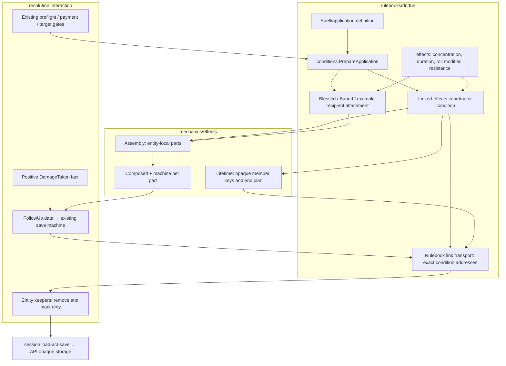

# Composable maintenance: one application, several holders

This is the approved detailed design for [Composable conditions S3](https://github.com/KirkDiggler/rpg-project/issues/706), governed by the [design](design.md). New symbols below name the implementation contracts, not claims that those APIs exist. The composition uses the existing `mechanics/effects` machine, rulebook kind vocabulary, condition registry, recipient roll-contribution protocol and resolution follow-up machinery. It adds no global runtime or persistence service.

## Component shape

**One application is not one object attached everywhere.** A coordinator on the maintainer holds the lifetime authority. Recipients hold their own applicable behavior. A coordinator and a recipient attachment can be on the same entity and still have different addresses and lifetimes (R2, R4).

## Ownership and contracts

| Component | Owns | Input → output |
|---|---|---|
| Authored rulebook application | Which parts exist, their roles, parameters and terminal scope | `ApplicationSpec` → validated coordinator/recipient declarations |
| Existing condition descriptor registry | Canonical attachment refs, loaders and named definition constraints | `CreateFromRefInput` / stored bytes → validated condition behavior |
| Proposed `conditions.PrepareApplication` | Pure binding, required roles, identity validation and the rulebook concentration claim | `PrepareApplicationInput` → `PreparedApplication` |
| Proposed `conditions.SealApplication` | The coordinator for the attachments delivery actually produced | prepared application + `DeliveryReceipt` values → coordinator condition |
| Proposed `effects.Assembly` | A stable, ordered set of local parts; aggregate attach, inspection, snapshot and teardown | `AssemblyInput{Parts, Lifecycle}` → local assembly |
| Existing `effects.Composed` / `machine.Machine` | One part's outputs and local state transitions | `ComposeInput` → part runtime / `Snapshot` |
| Proposed `effects.Lifetime` | Shared live-member set and exactly-once end acceptance, with opaque keys | `LifetimeInput` / `LifetimeSnapshot`, member loss or `EndRequest` → `EndPlan` / membership result |
| Rulebook composed-condition adapter | Binding generic keys to `events.ConditionAddress`, instance codec, display and information | assembly/lifetime values + rulebook bindings → `ConditionBehavior`, linked data, information |
| Proposed `conditions.BindApplications` / interaction-local `ApplicationBinding` | Validating links and delivering end plans against the declared participant universe | `BindApplicationsInput{Participants, Bus}` → binding for existing/new attachments, exact removal facts and teardown |
| Rulebook kind meanings | Concentration, duration, resistance and roll modification | bound parameters + typed event/query → contribution, follow-up request or terminal result |
| Recipient contribution selector | Same-spell non-addition and stable source selection | current `RollContributionProvider` values + requested roll kind → selected unresolved dice |
| Resolution | Door payment, target gates, actual delivery, save execution and result record | prepared application / `events.FollowUp` → outcomes and changed participant data |
| Session / API / web | Load-act-save / serialization and authorization / presentation | canonical data and server information → persisted records and rendered facts |

The generic tool never interprets a D&D address, spell ref, damage type, concentration slot or end reason. A kind never mutates another entity's sheet. The adapter never rolls or chooses targets. Resolution never switches on Bless, Bane, a resistance recipe, or the concrete `ConcentratingCondition` type. API/web never reconstruct lifetime membership or calculate a die.

### Local assemblies are composition, not a second runner

`AssemblyInput.Parts` is an ordered list of `PartInput{Key, Compose, OnTerminal}`. `Key` is a required stable local identifier; duplicate/empty keys are refused. `Compose` is the existing `ComposeInput`. `OnTerminal` explicitly chooses local-part completion or a request to end the linked application. No scope is inferred from a kind's name.

Every part uses the existing machine. Their bags and state names are private to their keys. Two parts listening to the same occurrence both get their own machine evaluation while the application remains live. Concatenating their transitions into one recipe would incorrectly let the first matching transition suppress the other part (R3).

A local terminal part remains terminal in `AssemblySnapshot.Parts`; restoration never recreates it. It is not reattached. A required maintenance part saved terminal while its application is still live is invalid data. A complete snapshot names every declared part exactly once. Empty/missing snapshots are not fresh construction.

The assembly attaches parts in declared order and unwinds successfully attached parts if a later attachment fails. `Remove` detaches without ending gameplay. A bound part key prefixes its output identifiers with the local attachment instance key, so two casters' equal recipes cannot collide in a chain or information row.

The neutral machine extensions needed by a turn-end countdown are an integer bag comparison and a checked integer delta act. They name declared integer keys, reject wrong types and overflow, and contain no turn, spell or concentration policy. The duration part supplies that policy.

### Shared lifetime and the coordinator

`Lifetime` is a value owned by the coordinator, not a process or a registry. It accepts opaque member keys, has a live/ending/ended phase, and returns values rather than publishing. Its saved state contains only its phase and live member keys. Rulebook bindings resolve those keys to exact addresses.

`RequestEnd(EndRequest{Reason, Requestor})` requires a nonempty reason and a bound requestor allowed to end the application. The first valid request yields an ordered `EndPlan`; nested or duplicate requests yield an explicit already-ending/ended disposition, not a second plan. Snapshots handed to persistence are live; a successful gameplay end removes the coordinator rather than saving a dead application.

`MemberRemoved(MemberKey)` forgets a live member once and reports before/after counts. An `until_empty` maintenance part can end an application when an actual member loss takes a nonempty set to zero. An application created with no delivered members does not thereby pretend its last member just ended. This distinction preserves current zero-delivery concentration and area behavior.

The initial member bindings are sealed after delivery. Adding arbitrary new recipients to an existing application is not supported by this cut. Removing members changes only the lifetime's live-key set, not the immutable address bindings.

The coordinator has a neutral registered attachment ref, proposed as `dnd5e:conditions:linked-effects`. Its concentration status is supplied by an active concentration part, not by that ref or a display label. Removing concentration from an authored application therefore does not leave a fake Concentrating condition behind.

### Identity and linking

| Identity | Meaning |
|---|---|
| Application ID | One bound invocation, reused on reload/resume; never a caster ID by convention |
| Coordinator address | The maintainer, neutral coordinator ref, and application-qualified address key |
| Recipient address | Existing `ConditionAddress` replacement semantics; Bless/Bane remain source-qualified by caster |
| Part key | Stable component identity inside one local attachment |
| Origin | Applying content ref and originating entity, independent of the above |
| Contribution group | Which equal-potency contributions compete for one selected die |

The delivery caller supplies a unique application ID; the toolkit constructor does not obtain hidden randomness. Native casting can bind it from the existing act identity plus a local application ordinal and retains it in any frozen continuation. A caller outside that path supplies its own stable invocation ID. Duplicate live coordinator IDs are refused.

The root adapter maps these concepts to the existing registry and address protocol; `SourceID` on an address is not read as provenance. The coordinator holder is storage custody, not automatically a concentration claim: in this cut a concentration part binds its maintainer to that holder, but an application without that part has no concentration requirement. Effect information uses `ConditionOrigin`, and UI code never parses application IDs.

A member binding contains the recipient's exact address and whether its current descriptor supports a linked backlink. New composed recipients persist the application/coordinator link. An unmigrated payload can be adopted by an exact parent-side address without rewriting its still-current codec; at most one coordinator may claim that attachment. Such adoption is explicit in the delivery receipt, not a wildcard lookup by ref.

`BindApplications` receives the complete, explicitly supplied participant conditions after pure loading and before behavior attachment. It builds a transient address/application index and supplies the linked adapters' lifecycle transport for this interaction. New prepared deliveries register with that same binding before they can be sealed; they do not create another resolver or catalog. Its teardown revokes transport without ending applications. No index or runtime pointer survives the call.

The interaction validates live address bindings before it can end them: holder loaded, attachment present, backlink matching where supported, and no competing owner claim. A replacement delivers the old exact removal before the new application attaches. If a member disappears in the current interaction, its removal updates the live set before any later end plan is formed. Stale/foreign links fail rather than removing the new occupant of an address (R4, R7).

### Construction, delivery and persistence

`ApplicationSpec` separates coordinator parts from recipient attachment definitions. Parts are selected from the closed rulebook vocabulary. Named Blessed/Baned descriptors constrain their payload definitions; the neutral linked-effects descriptor validates the composed coordinator or explicitly authored example. This remains one condition catalog plus its kind vocabulary, not a second ref-keyed registry.

`PrepareApplicationInput` names the application ID, origin, maintainer, candidate bindings and authored spec. Its output holds validated construction data and a rulebook-declared exclusive-concentration claim when a concentration part is present. It creates no subscriptions, spends nothing, displaces nothing and rolls nothing.

For a cast, the existing door and target gates run normally. A successful target delivery constructs its local attachment and records `DeliveryReceipt{MemberKey, Address, LinkMode}`. Failed saves, targeting refusals and independent-duration payloads are not silently entered into shared membership. The seal step checks actual delivered attachments and creates the coordinator with that exact membership. Provisional attachments cannot leave the interaction as a successful, saveable result before sealing.

The new linked codec, proposed as `LinkedConditionData`, has these authorities:

| Section | Contents |
|---|---|
| Header | canonical `ref`, `member_id`, address qualifier, application ID, attachment role |
| Origin | immutable `ConditionOrigin` |
| Bindings | validated local part declarations/parameters; recipient coordinator link; coordinator's immutable member-key/address bindings |
| Runtime | `AssemblySnapshot` for local parts; `LifetimeSnapshot` only on the coordinator |

The current Raging `ComposedData` representation and its single-part runtime remain unchanged. `Compose(ComposeInput)` and `machine.New(machine.Config)` remain the single-part construction APIs; the assembly consumes them, not a replacement interpreter. The linked descriptors route their own format. Parts do not hide structured state in JSON strings inside a machine bag. The application does not serialize a second copy of the same part counter or live-member set.

Load refuses unknown roles/kinds/refs, missing parts, invalid local state, non-live coordinator lifetime, duplicate identities, a recipient carrying owner state, an owner missing its lifetime, and state not compatible with its immutable bindings. Cross-attachment consistency is checked when the interaction's complete participant set is available. Recipient-only information can describe its own stored contribution without inventing an unavailable owner's countdown.

R8 assumes freshly created characters: there is no historical Bless/Bane/concentration reader, dual writer, normalization pass, automatic reset or parallel old concentration engine. Unmigrated payloads remain current behavior, not compatibility branches. Raging remains an independent current consumer; preserving it is not support for obsolete Raging data.

### The reusable meanings

A rulebook part binder turns validated parameters into its local recipe, outputs and required capabilities. The rulebook kind table owns that meaning once; named descriptors select and bind it rather than copying it. Lifecycle-only parts may have no numeric output. The assembly does not assume every effect is a numeric modifier, and a second catalog of spell-specific maintenance implementations is not introduced.

**Concentration** binds to the maintainer and declares the exclusive concentration claim. Positive post-application damage produces one `events.FollowUp` with the existing Constitution/DC rule and a consequence naming the coordinator; dropping to zero requests the application end without a save. The check output never rolls. It neither counts duration nor enumerates payloads. The rulebook exposes concentration information through a protocol implemented by the assembly, not a concrete-class assertion.

**Maximum duration** owns its own countdown/grace snapshot and requests application end on expiry. Its clock binding names the maintainer. Bless/Bane retain their existing subsequent-caster-turn-end timing, including casting-turn grace; this cut does not redefine clock transfer or combat timing.

**End policies** such as combat end, rest, and last-member loss are explicit maintenance parts. A generic application without concentration can select duration or another supported end policy. Omitting concentration does not grant infinite duration by accident: the authored application's declared end policies are the complete answer.

**Roll modifier** describes a signed dice contribution for selected roll domains. Bless supplies additive `1d4` for attack rolls and saves; Bane supplies subtraction for those domains. Their initial delivery rules remain outside the effect. The recipient's existing selection operation still chooses one applicable member per same-spell group while keeping Bless and Bane independent.

**Resistance** is the same parameterized rulebook meaning used by Raging. It receives an incoming-damage query for its holder, supplies its types, and knows nothing about a maintainer. A concentrated-resistance recipe does not acquire Rage's damage bonus, class budget, Strength advantages or activity requirement.

### Describing amounts and query-only outputs

The proposed `AmountResult` is a validated union: scalar or unresolved dice expression, never both. `AmountFn` and `Bound.Amount` return it without rolling; fixed/class amounts produce scalars and dice amounts produce descriptions. An unknown required fact remains unknown/error according to the information/execution contract, not a made-up zero.

`Row` carries the optional typed result rather than an integer that would misrepresent an unresolved die. Rulebook `contributions.Effect` continues to carry the richer domain-specific information. Numeric consumers explicitly require a scalar; the roll-contribution kind requires dice. There is no numeric conversion that rolls implicitly.

Kinds declare subscribed or query-only execution. A query-only kind needs no fake no-op subscription. Composition still validates its full output and requires its assessment/description contract. A composed recipient implements `events.RollContributionProvider` by describing its current roll-modifier parts; it does not install a second attack/save die subscriber. Selection and the native roll path remain the evaluators (R5).

### Ending, failure and teardown

1. A maintenance part's terminal result, a failed follow-up, recast, or an addressed external removal reaches the coordinator's end entry.
2. The coordinator validates the requested lifetime and its current live links. Its generic lifetime accepts the end once and captures the reason and pre-end maintenance information.
3. Rulebook transport publishes exact recipient removals while the contributing effects are still available to the event being resolved. Their keepers remove/detach and mark their sheets dirty.
4. Child-removal notices during this walk cannot recursively re-end the application. The coordinator publishes one maintenance end report from the captured source and reason, then its own removal if an external caller has not already published it.
5. All remaining local parts detach. The interaction's ordinary teardown remains a non-gameplay detach and never ends saved applications.

A concentration save observes current effects, including the caster's own Bless, before failure cleanup. A subscriber queued in an event snapshot after a sibling ended the lifetime observes that it is ending and does no further work. Parts retain the interaction bus they were attached with for required end reporting, rather than dereferencing a bus field another subscriber has cleared.

Invalid graphs are refused before mutation. An attachment failure unwinds local subscriptions. A later delivery/publish error fails the interaction; successful persistence must not be reported for an unsealed or failed application. These contracts do not promise a distributed transaction or arbitrary refunds. The host's existing load-act-save boundary persists only successful outputs.

### Existing native integration

All current concentration callers construct the new coordinator through one maintenance assembly path. `actions.CastProfile` expresses maintenance parts rather than one combined concentration/duration field; content declares the parts and the rulebook compiler describes the concentration claim. Resolution executes that declaration without reading kind names or spell-specific behavior.

Concrete assertions in cast replacement, character concentration views, rest/departure, and related paths become queries of the maintenance/linked-application protocol. Other spell payloads remain their current condition implementations and are adopted through their exact addresses. An independent-duration child stays outside membership. Area-only concentration can have zero condition members; the existing area-open/close seam remains encounter-owned and follows the maintenance end report.

Native Bless/Bane preserve actual target gates, resources, same-source replacement, multiple-caster coexistence, zero-delivery paid casts, self targets where legal, old source removal and observable end reasons. The first consumer is not permission to change another spell's gameplay while migrating its shared upkeep.

The rulebook exposes `MaintenanceInfo` and `LinkedApplicationInfo` views from the adapter. They report the active concentration claim and its content identity, available duration progress, application identity and exact owner/member relationships without callers asserting a concrete class. Character, monster, rest and departure consumers use these views. More than one concentration claim on one maintainer is invalid state, not a choice of whichever appears first.

The provider projects a user-visible concentration/maintenance summary from active parts; it does not expose an unlabeled technical coordinator as the only explanation. Recipient rows describe their payload and origin. A recipient-only read without the coordinator reports no known remaining duration rather than a fabricated countdown. API maps those server facts, and web renders them; raw linked-state readers must recognize/refuse the new schema explicitly where such readers are mounted.

Toolkit maintenance identity is a generic content ref/name. Existing spell-only wire fields serve actual spells in this cut. The non-spell resistance-source proof stops at the toolkit boundary; a native non-spell source needs a generic presentation contract before it is shipped. The API must not label an item/feature as a spell to avoid that work (R9).

## Walk one thing through

For the castle's ordinary fight path, a normally created caster casts Bless on itself and one ally.

`spells.CastDefinition` supplies targeting/payment and an application with concentration, maximum duration and the roll-modifier payload. The call binds an application ID, caster origin and maintainer role. Resolution pays at its existing door and delivers two Blessed attachments. Their exact addresses enter two receipts; sealing creates one coordinator on the caster. The caster holds separate recipient and coordinator attachments, so losing its own Blessed child alone need not strip the ally's.

Session stores each entity's returned condition bytes. On the next interaction, assembly snapshots restore each local part, and the coordinator restores the one live-member set. Both recipients describe an unresolved additive d4; the attack/save path selects and rolls it, and the server reports the source and result. No saved die face is authoritative.

An NPC strike applies damage to the caster. One concentration part describes one follow-up. The real save machine can select the caster's Bless die for that save. On failure the consequence ends the coordinator; its end plan removes the two exact Blessed attachments and reports the loss. Another caster's Bless on the ally remains, eligible for the next roll. A fresh reload has no expired application to recreate.

The composition proof replaces the payload with physical resistance while retaining the same maintenance parts. Removing concentration from that authored example changes upkeep, not the resistance implementation. Adding an independent Raging condition on the recipient proves that ending the linked resistance cannot remove Rage's contribution. This example is tool proof, not a claim that the castle contains a newly authored ability.

## Separations that look like one thing

| Query | Source of truth |
|---|---|
| Who maintains it? | Role binding and concentration claim |
| Who receives this contribution? | Local attachment holder |
| Who caused it? | Immutable origin |
| Which active instance is replaced? | Exact condition replacement address |
| Which application ends? | Application identity and coordinator lifetime |
| Which die contributes now? | Recipient contribution selector |
| How long remains? | Duration part on the coordinator, when available |
| Which parts have completed? | Their own assembly snapshots |
| Why did the application end? | First accepted end request and captured end report |

Merging these answers would make loss of one source strip another, turn provenance into stacking permission, create a timer per recipient, or make an information request roll dice.

## Trade-offs

| Decision | Benefit | Cost / boundary | Not taken |
|---|---|---|---|
| Entity-local attachments | Preserves sheet custody and private contribution reads | Adapter validates links; interaction supplies the full affected universe | Central multi-holder object with new persistence/loading |
| Existing runtime per part | Independent reactions and local state without another interpreter | Generic assembly stores keyed snapshots and deterministic order | Concatenating first-match transition lists |
| One coordinator lifetime | Shared cancellation without duplicated checks/clocks | Generic lifetime value plus exact rulebook transport | Complete concentration handler on every recipient |
| Typed scalar/dice result | Information stays non-random and honest | Provider consumers adopt the changed amount API on real pins | Roll a die to satisfy an integer accessor |
| Shared upkeep migration | No old/new concentration engines | All current concentration paths need regression coverage | Bless/Bane-only special case |
| Strict current linked codec | One authority without compatibility branches | Freshly created characters are the supported baseline | Historical reader, dual writer or automatic reset |

## Edges

R9 preserves other concentration payloads without migrating their implementations. Non-spell native wire presentation is deferred until a native consumer; its toolkit capability is still tested. R10 excludes studio authoring, native item inventory, dynamic recipient recruitment, arbitrary component graphs, world-wide background cleanup and distributed rollback.

The participant universe is not inferred from what happened to attach. Departure must settle membership before an entity leaves that universe; an unresolved cross-universe link is an explicit refusal, not successful cleanup. A richer cross-world lifetime service would reopen R2/R7 rather than be hidden in this adapter.

## Where a change lands

- Another damage resistance binding changes the rulebook definition/parameters, not concentration or session.
- Another supported upkeep rule adds a rulebook part built on the same assembly/lifetime contracts, not a named-spell branch in resolution.
- A native non-spell maintainer consumer reopens the presentation boundary under R9, not the resistance or generic lifetime implementation.
- A new unresolved roll contribution changes its kind/selection policy and tests, not the generic machine's random-number behavior; the machine has none.

## Source map

| Concern | Owning paths / symbols |
|---|---|
| Generic composition and proposed assembly/lifetime | `mechanics/effects/{composed,vocabulary,output,snapshot}.go`; new assembly/lifetime files in that module |
| Generic transitions and neutral countdown operations | `mechanics/effects/machine/{machine,recipe,guard,acts,validate}.go` |
| Rulebook meanings and description | `rulebooks/dnd5e/effects/{kinds,amounts,attach,query}.go` |
| Registry, codecs and proposed linked adapter | `rulebooks/dnd5e/conditions/{registry,descriptor,composed,composed_data}.go`; new application/link files |
| Existing behavior being absorbed | `conditions/{blessed,baned,concentrating}.go` |
| Address/follow-up facts | `rulebooks/dnd5e/events/damage_taken.go` |
| Authored cast declaration | `rulebooks/dnd5e/spells/cast.go`, `combat/actions/cast.go` |
| Native execution and departure | `rulebooks/dnd5e/resolution/{action,concentration,damagetaken,depart}.go` |
| Holder views and keepers | `rulebooks/dnd5e/character`, `monstertraits` |
| Host boundary and presentation | `rulebooks/dnd5e/session`; existing API converters and web condition/effect readers |

The [acceptance matrix](acceptance.md) names the required evidence and boundaries; the [checked implementation plan](plan.md) translates the agreed contracts into tasks. Delivery state and investigation receipts belong to the issue/PR, not this walkthrough.
