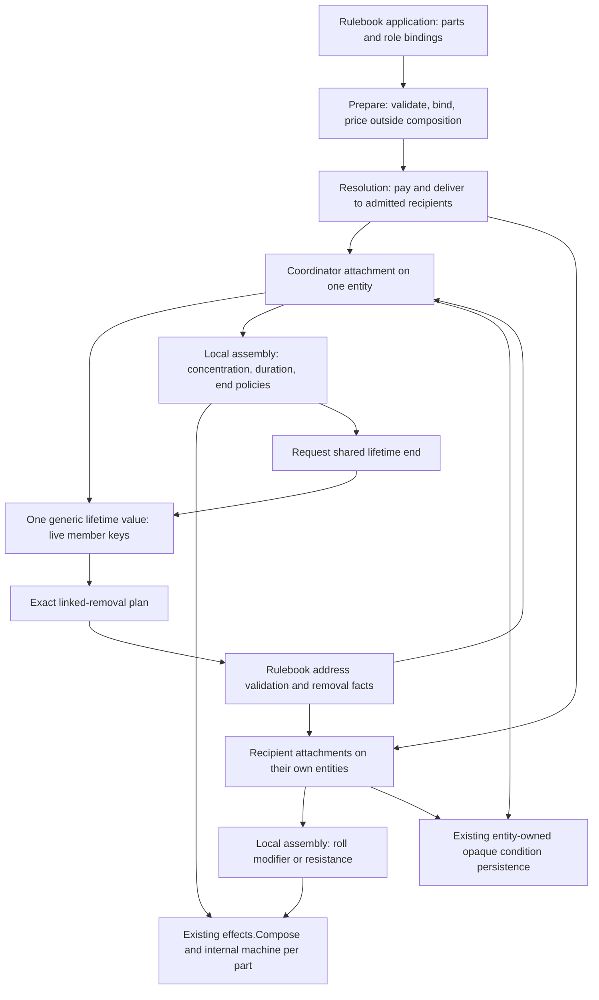

# Composable maintenance and linked effects

## Shape

[The walkthrough](README.md) defines the approved contracts. R1–R10 are settled;
the current-format cut assumes freshly created characters and carries no
historical-save compatibility path. Agreement is not an implementation claim.
The earlier reuse-only concentration cut is superseded by concentration as a
composed part; the operator's words and the alternatives live in the
[shape discussion](https://github.com/KirkDiggler/rpg-project/issues/706#issuecomment-6725313075).
The single-holder [Raging contract](../rulebook-effect-composition/design.md)
and [ADR-0050](../../adr/0050-composed-condition-instances.md) remain the
baseline for that independent consumer.

## Law

1. **R1 — reusable meanings.** Concentration, maximum duration, roll modification
   and resistance are independently selectable parts. Named spells combine
   parts; payloads contain no spell-specific upkeep or concentration flag.
2. **R2 — logical composition, local custody.** An application has one coordinator
   attachment and zero or more recipient attachments, persisted on their own
   entities. The coordinator alone stores shared lifetime membership; no global
   effect service or cross-call runtime owns it.
3. **R3 — composition preserves independent reactions.** Each stateful part uses
   the existing effects machine with its own declared state. A local assembly
   owns attachment/teardown and routes terminal results; it introduces no second
   transition interpreter and does not concatenate independent parts into a
   first-match transition list.
4. **R3 — neutral infrastructure.** Generic mechanics owns part identity,
   snapshots, neutral lifetime membership/end plans and attachment cleanup. D&D
   owns concentration checks, exclusive concentration, turn-end duration,
   contribution selection, named end reasons and condition-address transport.
5. **R4 — identities answer different questions.** Application identity, local
   attachment identity, replacement address, immutable origin and contribution
   selection group are distinct. Ending a lifetime names both its application
   and its exact linked members, not everybody sharing a ref or caster.
6. **R4 — one copy of each state.** Part state is stored once in that part's
   snapshot. Live member keys are stored once in the coordinator lifetime
   snapshot. Recipient links do not duplicate clocks, concentration state or
   membership lists. Construction inputs and address bindings are immutable.
7. **R5 — descriptions are not rolls.** An amount result explicitly distinguishes
   a scalar from unresolved dice. Inspection never rolls, spends or publishes.
   The recipient selects applicable dice contributors, and the existing roll
   path evaluates them. The same kind supplies execution and information.
8. **R6 — maintenance is independent of payment and delivery.** Preparation is
   pure; the existing action door owns payment. Delivery admits recipients and
   records actual attachments before sealing membership. Concentration imposes
   its exclusive hold through a rulebook query, not a concrete condition class
   or a spell-name switch in resolution.
9. **R7 — ending is scoped and ordered.** A valid end request is accepted once.
   An internally initiated end removes recipients before its end report and
   coordinator removal. An external coordinator-removal fact may lead the cascade
   and is not republished. Ordinary interaction teardown publishes no gameplay end. Nested child notices
   during an end cannot initiate a second end. Conflicting same-dispatch requests
   use the authored part order, and the first accepted reason remains authoritative.
10. **R7 — absence is not successful cleanup.** Before mutation, the interaction
    validates every live link it may affect against the declared participant
    universe. Missing or foreign links are errors, not permission to erase an
    owner and abandon a recipient. A duplicate notice for an already-removed
    member is idempotent; it cannot remove a replacement from another application.
11. **R8 — restore does not create.** Linked data requires its exact identities,
    bindings, complete part snapshots and role-appropriate lifetime data.
    Invalid/missing state is refused, never defaulted or refilled. Obsolete
    Bless/Bane/concentration records are not silently converted or reset under
    the fresh-character cut; the independent Raging format is unchanged.
12. **R9 — one concentration implementation.** Existing concentration callers use
    the same composed maintenance parts and protocol. Their recipient conditions
    need not all become composed in this cut. Existing replacement, zero-delivery,
    independent-child, area, rest and departure behavior remains explicit.
13. **R9 — honest consumer boundaries.** Toolkit maintenance information carries
    a content identity, not an invented spell. Native Bless/Bane use the existing
    spell presentation. A native non-spell concentration source requires an
    explicit generic wire identity before shipment; it is not smuggled into a
    `SpellRef` field.
14. **R10 — proof follows the real path.** Bless/Bane require native cast,
    persistence, contribution, concentration and information proof. The
    concentration-held resistance example proves tool composition without
    claiming a newly shipped native ability, item or studio interface.

## Rulings

| ID | status | scope | ruled by | date |
|---|---|---|---|---|
| R1 | settled | Concentration is a reusable effect alongside payloads; resistance sustained by another entity is a design example | KirkDiggler | 2026-11-08 |
| R2 | settled | One authored application, shared lifetime, linked entity-local attachments rather than central runtime persistence | KirkDiggler | 2026-11-08 |
| R3 | settled | Local assemblies of existing composed runtimes; generic lifetime value, deterministic part order and neutral machine additions | KirkDiggler | 2026-11-08 |
| R4 | settled | Application/attachment/address identities, coordinator custody, link validation and saved representation | KirkDiggler | 2026-11-08 |
| R5 | settled | Typed scalar/dice amount results, pull contributions and one assessment path | KirkDiggler | 2026-11-08 |
| R6 | settled | Prepare/deliver/seal contracts and rulebook concentration claims | KirkDiggler | 2026-11-08 |
| R7 | settled | Exactly-once end protocol, errors, partial child loss and teardown ordering | KirkDiggler | 2026-11-08 |
| R8 | settled | Fresh characters; one current linked format, no historical reader/dual writer/normalization or old concentration runtime; Raging remains a current independent consumer | KirkDiggler | 2026-11-08 |
| R9 | settled | Migrate shared concentration upkeep, preserve other payloads and bound native/wire scope | KirkDiggler | 2026-11-08 |
| R10 | settled | Native Bless/Bane acceptance and composed-resistance proof; remaining catalog/studio/item work excluded | KirkDiggler | 2026-11-08 |
| R11 | open | Application custody and successful persistence during paused initial delivery | — | — |

## Open

- R11 must settle how initial delivery crosses a persisted pause: an explicitly
  resumable open application, or deferred shared-payload delivery. The current
  sealed-only save contract does not settle this boundary. The
  [decision and evidence](https://github.com/KirkDiggler/rpg-toolkit/pull/2323#issuecomment-6752508135)
  hold the options; affected native implementation waits for that ruling.
  [The slice](https://github.com/KirkDiggler/rpg-project/issues/706) carries the
  remaining delivery gates.
- R8 is settled explicitly for this cut. No compatibility experiment, automatic
  reset, or dual old/new concentration path is required.
- Non-spell native concentration presentation is deferred until its first native
  consumer. This cut proves such a source in toolkit-level composition tests,
  while browser acceptance covers real Bless/Bane spell sources.
- Divine Favor, Guided and Inspired payload migration, a full condition catalog
  migration, native item inventory, studio authoring, a universal graph language,
  dynamic post-seal recruitment and distributed transactions are outside this cut.
