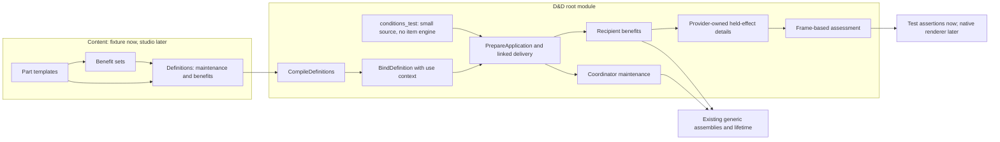

# From authored pieces to a maintained effect

For [composable conditions #703](https://github.com/KirkDiggler/rpg-project/issues/703),
this composition uses the existing rulebook vocabulary and linked applications to
turn authored definitions into independently maintained benefits. The
[design](design.md) fixes the agreed contracts;
[examples.md](examples.md) supplies the agreed fixture inputs. The
[implementation plan](plan.md) maps those contracts to tasks and proof. There is no second
state engine and no effect implementation named after an item. The reusable API,
canonical fixture data and executable examples all belong to the rulebook;
examples/items is an optional downstream consumer. R1/R4/R6.

## Component shape



The public types below implement the contracts in R4; [source and verification
records](implementation.md) identify the implementation cut and release limits.

## Ownership and contracts

| Component | Owns | Input → output |
|---|---|---|
| `conditions.CompileDefinitions` | Strict library validation, reference resolution and immutable ownership | `CompileDefinitionsInput{Data}` containing DefinitionLibrary JSON → `CompileDefinitionsOutput{Definitions *CompiledDefinitions}` |
| `CompiledDefinitions` | Copied templates, benefit sets and validated expanded definitions | Definition ID → validated definition; no mutable map returned |
| `conditions.BindDefinition` | Participant role substitution and deterministic attachment identities | `BindDefinitionInput{Definitions, DefinitionID, UserID, RecipientID, ApplicationID, Origin}` → `BindDefinitionOutput{CoordinatorID, Spec ApplicationSpec}` |
| Existing `conditions.PrepareApplication` | Actual participant/candidate validation and replacement description | Bound spec, origin, invocation and `[]ParticipantConditions` → `PreparedApplication` |
| Rulebook-local test source | Item-like origin, participants and one-use availability | Definition ID and use context → public compiler/binder/preflight; existing resources.Resource.Use settles the source price before delivery |
| Existing application binding | Generation-scoped custody, per-entry finalization and exact removal | Paid owner/recipient delivery → existing linked condition instances |
| `effects.ValidatePartTemplate` | Identity-free template validation and kind-owned benefit/maintenance classification | `ValidatePartTemplateInput{Template PartTemplate}` → `ValidatePartTemplateOutput{Class PartClass, Capabilities PartCapabilities}` |
| `effects.BindPart` and kind table | Mechanical meaning, guard, amount, local recipe and immutable output projection | Extended `PartDeclaration` → existing `generic.PartInput` and provider-owned descriptive values |
| `conditions.ProjectHeldEffects` | Value-only projection of configured target effects | `ProjectHeldEffectsInput{HolderID, Conditions}` → `ProjectHeldEffectsOutput{Details []contributions.HeldEffectDetail}` |
| `contributions.Frame` | The facts available for this particular question | Existing held identities plus copied configured details → assessment context |
| Rulebook assessment and attack attachment | One meaning for explanation and the actual contribution | Frame and configured output → existing effect row / chain contribution |

The compiler does not pay, attach or read the world. The binder does not invent
native target legality. The test source does not implement an item engine or
interpret damage/upkeep. Generic effects
do not interpret item or D&D names. Assessment does not reach into another
creature's live sheet. The studio does not choose a different execution format.

### The authored and bound declarations

The authored library has three maps:

- `parts`: ID → `effects.PartTemplate{Kind, Params, When, Amount}`;
- `benefit_sets`: ID → ordered part IDs, without nested sets;
- `definitions`: ID → `EffectDefinition{Name, Coordinator, Maintenance, Benefits}`.

Each ordered selection is `PartSelection{Key, Part, Set}` with exactly one of Part
or Set. Maintenance selects only lifecycle parts; Benefits selects benefits or
benefit sets. The compiler assigns ending scopes as described by R4 and refuses
inconsistent kinds instead of silently relocating them.

Binding always places Benefits on RecipientID. Coordinator selects UserID or
RecipientID; self-use is explicit equality of the two invocation values. Both
coordinator and recipient use the existing registered linked-effects envelope,
not a condition registration for each author-defined name. A source-facing grant
names a definition ID in one compiled library; it does not embed the recipient.

Resolved Parts are copied into the bound ApplicationSpec and subsequently into
existing LinkedBindings. This is the distinction between reusable content and a
specific cast/use, not two independent authorities for active effects. R4.

## Walk the ring through

1. The author defines four benefit leaves and one `rage-benefits` set. Both ring
   and scroll select that set. Ring maintenance selects concentration, last-member
   cleanup and the user's rest policy. No activity part is selected. R2/R5.
2. CompileDefinitions validates the whole library and takes ownership of copied
   data. All references resolve now, not after a charge has been spent.
3. The external-package rulebook test supplies a small source with an item-like
   origin, user and one-use pool, then selects `rage-ring`. The test host supplies
   a chosen recipient and a fresh invocation ID; no item package is imported.
4. BindDefinition places the coordinator on the user and benefits on the recipient.
   It passes the item's immutable origin separately. PrepareApplication checks the
   complete participant set and describes any concentration replacement without
   performing it.
5. After pure preflight, the test source spends one use through the existing
   resource primitive. The host then performs replacement, creates the
   owner, delivers the exact candidate and calls FinalizeRecipient. CheckComplete
   remains the boundary check; an error after delivery is not a refundable pure
   preparation failure.
6. The recipient's damage and resistance handlers use the established meanings.
   Positive damage to the user requests that user's concentration check. Damage
   to the recipient is not relabeled as damage to the maintainer.
7. Ending concentration removes only this application's delivered attachments.
   Another source's effects remain. Save/reload carries resolved declarations and
   per-part snapshots, not a command to load the latest `rage-ring` definition.
8. Tests inspect execution results, provider-owned information and stored data.
   No new wire/UI path is implied; a future native consumer maps these provider
   facts after adopting the relevant contracts. R3.

For the scroll, coordinator binding changes to the recipient and the selected
maintenance changes to activity/duration/end policies. The user still pays from
the item and remains provenance; the user's continued presence is not the
scroll's lifetime authority. R2/R5.

## The sausage and attacks against a holder

An effect that helps the eater's attacks and one that helps attacks **against**
the eater are different bearings. Swapping actor and target in an existing frame
would also swap ability, weapon and observer facts, so it is not a valid shortcut.

The configured frame detail is a value of this shape:

```text
HeldEffectDetail
  member ID + existing HeldCondition identity (ref, source qualifier)
  application ID
  display name + origin ref + origin entity ID
  ordered outputs:
    stable output ID + generic.Output definition
```

`HeldCondition` remains comparable and continues to state what is held. Details
are a separate Frame collection, allowing old named conditions to retain their
by-reference meanings. Generic linked attachments need a detail record even when
its configured against-holder output list is empty: **unknown is not none**.
A present detail requires an explicit output list; an empty list is valid, while
a missing detail represents unknown configuration.

ProjectHeldEffects asks the provider for currently observable outputs and uses
the kind table's same payload-output builder to copy their definitions. It does
not expose bags or reconstruct availability from a terminal snapshot while
End-before-detach still permits observation. Authored guards use frame facts, so
these output values do not require a live bag or retained runtime pointer.

The information caller supplies its observer's captured details, possibly stale
or unknown. It never fetches the target's live condition to fill a gap. The
execution caller supplies current authoritative details. The applying handler
checks its exact address, generation and configured output against those facts
before contributing; a missing or contradictory fact fails rather than dropping
the drawback. Both paths use the attack kind's same bearing/guard assessment.

In this cut the fixture host exercises that projection seam. A native producer
must explicitly carry it through its observation/authoritative-frame path before
using these authored target-side effects. This cost is visible, not disguised by
an item-specific registry rule. R3/R4.

## Separations that look like one thing

| Question | Source of truth |
|---|---|
| What content was authored? | Validated compiled library |
| What was actually granted? | Frozen bound declarations on the existing linked attachments |
| Who pays? | Source-owned budget; an existing resource primitive in the test demonstration |
| Who benefits? | Recipient role binding |
| Who maintains it? | Coordinator role binding and selected maintenance |
| Which application ends? | Existing coordinator lifetime and generation-scoped member addresses |
| What may this observer know? | Captured frame facts, not the target's current runtime |
| What does the actual attack receive? | The same kind assessment over authoritative facts |

Using origin as the maintainer makes an item ID look like a creature. Looking up
latest content during reload changes an already-paid grant. Treating an absent
target detail as an empty list erases drawbacks. These are different failures,
not variants of one convenient ID or one blob.

## Trade-offs

| Decision | Benefit | Cost / boundary | Not taken |
|---|---|---|---|
| Closed kind meanings and frame-fact guards | Validation and explanation share execution semantics | New meanings require rulebook code/tests | Arbitrary scripts or engine topics in content |
| Non-nested named benefit sets | Reuse between ring/scroll and individual leaf selection | Authors cannot build recursive parameterized macros in this cut | General template language |
| One chosen recipient role | Exercises user/recipient/maintainer separation directly | Multi-target authoring needs a later binding contract; existing application API remains general | Target-query DSL |
| Frozen active declarations | Reload remains independent of mutable content | Saved attachments carry their resolved configuration | Looking up current catalogue data during every read |
| Value-only configured target facts | Honest observed versus authoritative assessment | Frame producers must carry new facts; clone/validation grows | Live-object callbacks or per-item registry entries |
| Rulebook-local public-API examples | Teach and exercise reusable rules beside their implementation | A small source proves the payment boundary, not an item lifecycle or inventory | Making examples/items adoption the primary deliverable |

## Edges

R3 bounds this work to toolkit definitions, primitives, fixture consumers and
teaching docs. Ordinary native Raging/Reckless behavior, studio UI, item inventory,
network contracts, observation disclosure policy and the full against-holder
migration are not silently included. R6 also keeps examples/items adoption separate.
R4/R5 fix the detailed contracts and example policies; [examples.md](examples.md) names the exact proposed
benefits, drawbacks, clocks and prices rather than calling them standard rules.

## Where a change lands

- Change the ring's benefit mix, resistance types or already-supported maintenance:
  edit authored data and corresponding expectation tests.
- Add a genuinely new effect meaning or supported contextual fact: implement it in
  the owning rulebook vocabulary and prove execution/information agreement.
- Expose the definitions in a studio: adopt the validated content contract and
  surface its errors; do not introduce a second evaluator.
- Use the sausage in native play: extend the proper frame producers and inventory/
  activation consumer, then walk the actual native path. Root fixtures alone do
  not discharge that integration work.

## Source map

| Concern | Existing source / proposed home |
|---|---|
| Current vocabulary | [`effects`](../../../rulebooks/dnd5e/effects/README.md) |
| Part binding/validation | `rulebooks/dnd5e/effects/{parts,part_validation,kinds}.go` |
| Definition compilation/binding | `rulebooks/dnd5e/conditions/definition*.go` |
| Linked application and immutable bindings | `rulebooks/dnd5e/conditions/{application,linked_data,linked_condition}.go` |
| Current target-held assessment | `rulebooks/dnd5e/conditions/target_held.go` |
| Frame facts/clone | `rulebooks/dnd5e/contributions/frame.go` |
| Pure projection seam | `rulebooks/dnd5e/conditions/held_effect_details.go` |
| Source budget primitive, test-only use | `mechanics/resources.Resource`; existing rulebook dependency |
| Small source and host in external tests | `rulebooks/dnd5e/conditions/definition_source_test.go` and `definition_world_test.go` |
| Canonical content and executable cookbook | `rulebooks/dnd5e/conditions/testdata/effects/library.json`, `authored_cookbook_test.go`, `authored_example_test.go` |
