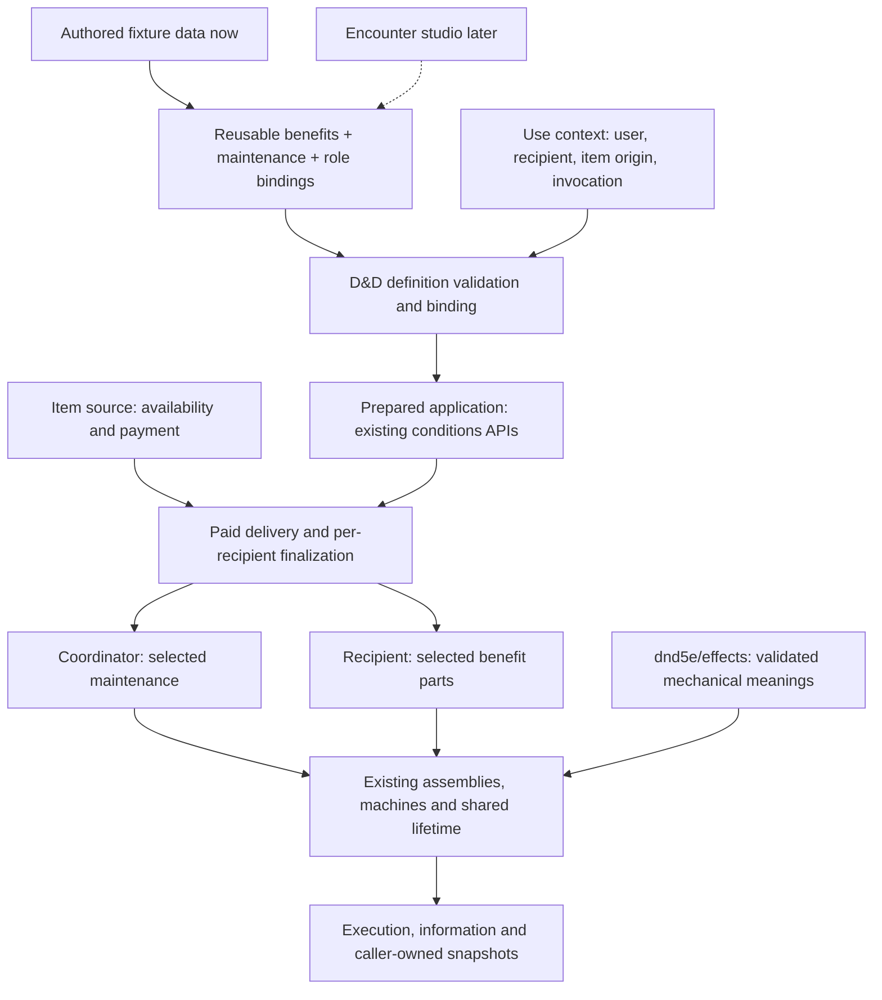

# Data-authored effect compositions

Working brief and proposed component shape for [composable conditions #703](https://github.com/KirkDiggler/rpg-project/issues/703), driven by [item consumers #850](https://github.com/KirkDiggler/rpg-project/issues/850). [Agreed direction and measured starting point](https://github.com/KirkDiggler/rpg-project/issues/703#issuecomment-6831644739).

This is a shape proposal, not a finalized schema or an implementation plan.
The detailed walkthrough and law follow agreement on the component boundary.

## Outcome

An author combines established D&D mechanical pieces through data. The same
benefit set can be sustained by the user's concentration, the recipient's combat
activity, or another explicitly selected policy. Item tests load that data through
the rulebook's ordinary validation/binding path. A future encounter studio authors
the same definition rather than introducing its own execution interpretation.

The teaching surface is the [rulebook effects README](../../../rulebooks/dnd5e/effects/README.md)
and a set of executable fixture examples. Raw fixture data is content; test code
sets up the world, performs interactions and asserts what happens. Assertions and
scripted test steps are not part of the authored item format.

## Shape

**Authoring roles are not concrete instance IDs.** The reusable definition says
which role receives benefits and which role maintains them. The invocation supplies
actual participants and immutable provenance; binding produces the fixed intended
recipient set before payment. Existing per-recipient finalization remains the
membership authority. No second global delivery seal or central multi-holder
runtime is introduced.

**The component to add is the definition/binding surface, not another engine.**
`conditions.ApplicationSpec`, `PrepareApplication`, `CreateApplication`,
`CreateRecipient` and `ApplicationBinding` remain the starting application seam.
`effects.PartDeclaration`/`BindPart` and the generic assembly remain the execution
building blocks. Concrete public types for the new authoring surface are still to
be designed; these labels do not claim an existing loader can read the fixtures.

## Compositions that drive the work

| Fixture | Benefits on recipient | Maintenance | What it proves |
|---|---|---|---|
| Concentration ring | Shared Rage benefit set | User's concentration, **not** recipient activity upkeep | Different beneficiary and maintainer; an idle recipient keeps benefits while maintenance holds |
| Raging scroll | The same benefit set | Recipient's attack/take-damage upkeep, without concentration | Changing maintenance does not change the benefit definition |
| Resistance-only ward | Selected resistance types | Explicitly selected maintenance | No damage bonus or Strength advantages leak in |
| Damage-only variant | Configured damage bonus and eligibility | Explicitly selected maintenance | No resistance or other Rage behavior leaks in; amount source is explicit |
| Kitchen sausage | Reckless-style outgoing advantage and against-holder drawback | Explicitly selected ending policy | Both sides are mechanical pieces with one execution/information meaning |

The ordinary Barbarian composition remains an important regression reference,
not a license to change its eligibility, scaling, duration or payment. Reusing
Rage benefits does not mean granting an opaque Rage condition and disabling some
of its behavior afterward.

A named benefit set is authoring reuse, not a new lifetime owner. Its pieces must
remain usable individually. How bundle references are represented and validated
belongs to the detailed definition contract; no general scripting language is
required by these examples.

## Ownership

| Component | Owns | Must not do |
|---|---|---|
| Authored definition | Benefit selection, parameters, maintenance selection and participant roles | Embed runtime IDs, paid state, callbacks or arbitrary bus/chain wiring |
| D&D definition binder | Validate meanings and bind actual invocation participants into prepared application data | Charge an item, deliver effects during validation, or silently choose missing rules |
| `dnd5e/effects` | D&D kind meanings, applicability, execution and matching information | Know the ring, scroll or sausage by name; choose targets or own inventory |
| `conditions` application | Local attachments, exact identity, linked custody and lifetime coordination | Infer item payment or replace independent runtimes with a shared mutable bag |
| Existing generic effects | Composition, independent part state and neutral lifetime mechanics | Interpret D&D or item names |
| Item source/consumer | Grant availability, authored price, source attribution and paid activation boundary | Reimplement damage, resistance, upkeep or advantage |
| Test host | Participant setup, delivery, storage simulation, events and assertions | Supply a different effect implementation for each fixture |
| Future studio | Author valid definitions and explain validation errors | Reimplement the runtime or maintain a second schema with different meaning |

The item source, user, maintainer, recipient, application ID and replacement
address remain separate. In particular, an item instance's provenance is not a
creature ID merely because the user concentrates.

## Approach

Use **validated authored definitions feeding the existing runtime**. Extend the
small mechanical vocabulary only where these examples expose a missing meaning.
Reuse existing meaning and assessment functions rather than copying them into
fixture-specific adapters.

Alternatives considered:

- Go-only example builders are easy to add, but would leave the studio needing a
  separate authoring path. They can construct test worlds, not substitute for the
  content under test.
- An arbitrary script or event-handler language could express more behaviors,
  but would expose engine plumbing and create another evaluator to validate,
  explain and persist. These examples do not require that cost.

The chosen direction is data composition. The detailed schema, reusable-bundle
resolution and against-holder information contract are not yet settled by that
choice.

## Evidence and finish line

For each fixture, load the authored definition, bind a real use context, pay from
the owning source and deliver through the existing application mechanism. Assert:

- intended recipients, benefit selection and maintenance owner;
- applicable and inapplicable action cases, with execution/information agreement;
- source attribution and payment exactly once;
- ending only the intended attachment/application, including replacement;
- save/reload of independent state without refilling payment or changing meaning;
- refusal of malformed definitions, unsupported meanings and absent binding facts.

The source item may be exhausted while its granted effect is still active. A
one-use pool demonstrates spent availability; it is not proof that a production
inventory object was consumed or destroyed.

Delivery includes the package README, fixture definitions and tests, the reusable
provider work those examples require, and checked module-scoped PRs with owning
gates and required independent review. Provider and item modules remain separate
release units. No merge/release authority is inherited from the preceding wave.

## Non-goals

No studio UI, production inventory/consumable integration, API/proto work, new
native item acquisition, full against-holder condition-family migration, general
scripting engine or historical-data reader. The existing operator walk stack and
run data are not changed. This fixture cut supplies reusable contracts for those
later consumers; it does not claim they are delivered.

## Decisions for the detailed design

- The exact authored definition/bundle representation and separation from bound
  application data and runtime snapshots.
- The smallest reusable activity-maintenance and attack-advantage pieces, keeping
  user/recipient clock ownership explicit.
- The against-holder information seam: a ref alone cannot describe the selected
  pieces of an arbitrary authored benefit set. Both previews and actual rolls
  must consume the same provider-owned meaning, without registry entries per item.
- Explicit fixture policies for durations, attack eligibility, grace, rest and
  consumption. Illustrative values are not canonical keep item balance. The
  sausage is reckless-style, not automatically a promise to implement every
  activation rule of the Barbarian feature.

Detailed design must settle these contracts before an implementation plan is
claimed complete. The against-holder portion coordinates with [#707](https://github.com/KirkDiggler/rpg-project/issues/707);
it does not silently expand this cut to every condition named there.
