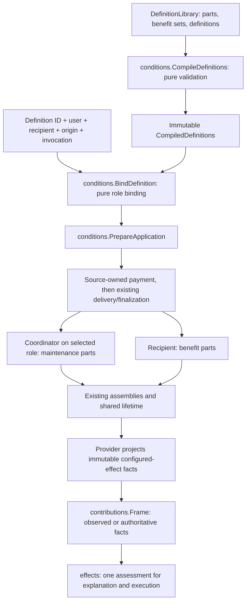

# Data-authored effect compositions

## Shape

The component shape is settled under R1. Concrete types and contracts below are
settled under R4; example policies are settled under R5. The [walkthrough](README.md)
explains the boundaries and the [examples](examples.md) show the authored surface.

## Law

### Authoring and reuse

1. Mechanical meanings belong to `dnd5e/effects`; authoring selects and configures
   those meanings. Definitions contain no callbacks, bus topics, chain stages or
   arbitrary machine programs. R1.
2. A `DefinitionLibrary` contains named part templates, named benefit sets and
   application definitions. A part template supplies `kind`, `params` and, where
   its kind accepts them, `when` and `amount`. R4.
3. A benefit set is an ordered list of part-template IDs. A selection names exactly
   one part or benefit set and has an explicit local key. Benefit sets contain
   benefits only, do not nest, and own no lifetime. R4.
4. Expansion retains declared order. A direct selection uses its key; a benefit
   set uses selection-key/part-ID keys. IDs and local keys exclude the separator.
   Duplicate expanded keys or repeated leaf selections within one attachment are
   refused. Different configured leaves may share a mechanical kind. R4.
5. A definition names its display name, coordinator role, maintenance selections
   and recipient benefit selections. Roles are `user` and `recipient`; one
   invocation binds one chosen recipient, which may equal the user. IDs and display
   names are nonempty; each definition has nonempty maintenance and benefit lists.
   This does not restrict the existing multi-recipient ApplicationSpec API. R4.
6. Compilation validates the entire library, including unreferenced entries,
   before returning an immutable owned result. Unknown fields, duplicate JSON
   keys, unknown references/kinds/facts, invalid parameters and maintenance in a
   benefit set are errors. The effects kind entry supplies template validation and
   benefit/maintenance classification; the compiler has no second kind table.
   There are no implicit defaults for required policy. R4.
7. Authored benefit guards use supported typed frame facts and boolean composition,
   not private bags, clock counters or flags. Stateful policies are maintenance
   parts; guards and amounts use the existing generic value types and vocabulary. R4.

### Binding and source ownership

8. Binding takes a compiled definition ID, UserID, RecipientID, ApplicationID and
   explicit ConditionOrigin. It produces copied concrete ApplicationSpec data and
   CoordinatorID without attachment, payment, dice or world lookup. It does not
   treat the source item ID as a creature ID. R4.
9. The caller supplies the complete participant universe to PrepareApplication.
   Intended participants and candidate shapes are validated before payment.
   Binding is not native range, visibility or target-offer validation. R4.
10. The source selects its own grant and price. After successful pure preflight,
    the existing item Use boundary settles the price; its pure resolver returns
    the prepared result. Delivery, owner creation and recipient finalization occur
    afterward. No world mutation is hidden inside an item refund callback. R4.
11. All item fixtures use one definition-grant adapter, not a resolver per item.
    A grant names a definition in the validated library; runtime participants
    never arrive inside authored grant parameters. R4.
12. Payment, origin, user, recipient, coordinator, invocation and replacement
    address are distinct. The binding adapter derives an invocation-scoped
    attachment address explicitly; it differs from the coordinator address even
    for self-use. Preflight refuses an address collision with another live
    attachment unless it belongs to the explicitly planned replacement. An effect
    kind never reconstructs identity from provenance or parses an opaque ID. R4.

### Benefits and maintenance

13. The concentration ring places concentration on the user and benefits on the
    recipient. Recipient attack/take-damage activity is not a requirement. The
    scroll places its activity upkeep on the recipient without concentration. R2.
14. Payload selections bind with EndPart; maintenance selections bind on the
    coordinator with EndApplication. The compiler owns those scopes for this
    authoring surface; raw PartDeclaration and application APIs retain their
    existing capabilities. R4.
15. Damage bonus, resistance and save/check advantage reuse their existing kind
    meanings. PartDeclaration gains optional When/Amount fields for kinds that
    explicitly support them; unsupported fields are refused, not ignored. Existing
    roll-modifier dice parameters remain their sole amount source. R4.
16. Attack advantage is configured as `on: attack` with an explicit `side` of
    `by_holder` or `against_holder`. The first reads the actor bearing; the second
    reads the target bearing and exact held-effect facts. Save/check advantage
    rejects attack-side parameters. R4.
17. Activity upkeep observes the holder's attack attempts, including misses, and
    positive already-applied damage. It owns its activity flags and explicit
    first-end grace, checks/clears them on holder turn end, and owns no duration,
    payment or concentration. It never applies HP damage. R4.
18. The end-on part supports the named rest, combat-end, dropped-to-zero and
    turn-start beats. A turn-start end policy ends on the first holder turn-start
    occurrence received after attachment. Duration, activity grace and rest policy
    are independent choices; ending reasons do not classify an item as a spell. R4.
19. Native Barbarian Raging and Reckless Attack acquisition/activation remain
    unchanged in this cut. Reusing their underlying meanings is not permission to
    change native eligibility, scaling, codec or lifetime rules. R3.

### Information and execution

20. Configured effects on a target are described by provider-owned immutable facts
    in the frame, not by item-name dispatch, registry entries per item or live
    runtime pointers. Existing HeldCondition remains the comparable ref/source
    identity; a separate frame detail collection is keyed to that identity and
    holder. R4.
21. A detail identifies its application generation, display/origin and active
    against-holder output definitions with stable output IDs. An explicit empty
    list means no such outputs; absent detail is unknown. No private state bag,
    item budget, callback or live catalogue lookup crosses this boundary. R4.
22. The rulebook projects available outputs through CurrentOutputs and the same
    kind entry/output builder that constructs them. End-before-detach observations
    remain available; terminal snapshots alone do not decide output availability.
    Frame cloning deeply copies details. Unknown/malformed kinds, duplicate IDs
    and inconsistent holding/detail identities are refused. R4.
23. Information uses the observer's captured facts. Actual execution uses current
    authoritative facts and verifies that the applying attachment's generation
    and configuration match. Missing facts yield Depends in information; missing
    or contradictory authoritative facts refuse execution rather than silently
    removing a drawback. R4.
24. Information and the subscribed attack handler evaluate the same attack-kind
    meaning and guard. A target's condition changes the attacker's chain without
    pretending the target is the actor. Neither path rolls an extra die. R4.
25. Native frame producers must adopt the configured-detail contract before using
    these new target-side definitions in native play. Fixture hosts exercise the
    provider seam; they do not establish native perception, transport or UI
    adoption. Unmigrated named conditions retain their existing assessment path. R3/R4.

### Saved state and delivery

26. Active effects save resolved immutable declarations, attribution, concrete
    bindings and per-part snapshots through the existing linked codec. Reload does
    not consult a mutable authoring library or regenerate a fresh benefit set. R4.
27. The coordinator remains the sole pending/live membership authority. Recipient
    finalization, generation checks, exact end propagation and failed-boundary
    refusal use the existing application protocol. No second seal or shared bag
    is introduced. R1/R4.
28. An item can be exhausted or detached while an already-delivered grant remains
    active under its own maintenance. First-cut consumables model exhausted
    availability, not inventory deletion; no automatic refund follows effect end.
    Native item possession/consumption policy is outside this fixture contract. R3/R5.
29. Ordinary root regressions remain green, and fixtures assert data-driven
    execution, information, provenance, payment and reload/end behavior. The
    fixtures and assertions are separate artifacts; a passing baseline is not
    proof of a new authored example. R3.

## Rulings

| ID | status | scope | ruled by | date |
|---|---|---|---|---|
| R1 | settled | Mechanical code plus authored composition; role binding into existing application/part machinery, no new runtime | KirkDiggler | 2026-11-12 |
| R2 | settled | Ring concentration replaces recipient activity upkeep; scroll can select recipient attack/take-damage upkeep; benefits remain individually reusable | KirkDiggler | 2026-11-12 |
| R3 | settled | Fixture-first teaching/authoring path and effects README; studio UI/native inventory and unrelated migrations are outside the first cut | KirkDiggler | 2026-11-12 |
| R4 | settled | Concrete library, binding, part and frame-detail contracts in Law | KirkDiggler | 2026-11-12 |
| R5 | settled | Explicit illustrative fixture policies in examples.md, including one-use availability rather than inventory destruction | KirkDiggler | 2026-11-12 |

## Open

No required design decision remains open for this fixture cut. Concrete types
are implementation contracts, not a claim that the API is already available.
The example policies are illustrative fixtures, not canonical keep-item balance.

Full studio authoring, native targeting/inventory/consumption, native frame
producer adoption and the rest of the against-holder family remain outside
this cut. A consumer brings their integration requirements later.
