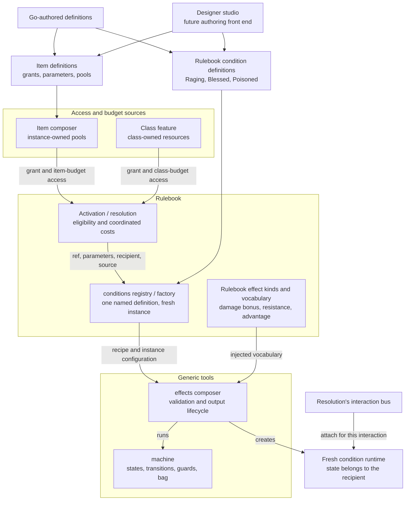

# Item and effect composition: the layers and their contracts

This walkthrough explains [ADR-0048](../../adr/0048-equipment-granted-abilities.md)
for the [item initiative](https://github.com/KirkDiggler/rpg-project/issues/850)
and its [effects extraction work](https://github.com/KirkDiggler/rpg-project/issues/705).
It connects the accepted ownership decision to the larger
[toolkit architecture](../../architecture/overview.md), the
[D&D rulebook's seams](../../../rulebooks/dnd5e/CLAUDE.md),
[actions as data](../../adr/0045-actions-are-data.md) and
[resolution's bus ownership](../../adr/0038-resolution-owns-the-bus.md).

**The generic runtime supplies machinery; the rulebook supplies meaning.**
Conditions name reusable compositions of rulebook effect pieces. Items and class
features grant access and supply parameters/resource sources; they do not each
carry another implementation of Raging.

This is an explanation and target ownership map, not a second decision record or
an implementation plan. Existing interfaces and unselected target contracts are
distinguished below. Exact package homes, schemas and production adapters remain
with the owning design questions. [The connected paper trail](paper-trail.md)
identifies the plans, evidence and skills that carry the work forward.

## Component shape

The arrows show authoring and construction flow, **not an import graph**.
The generic tools never import the rulebook; rulebook vocabulary is injected.

The condition factory does not implement another composition engine. It selects
and binds a definition, then uses the generic effects composer. The machine and
the composer remain distinct: states decide *when* contributions exist; output
kinds decide *what* they contribute.

Storage sits outside that runtime flow. A host supplies authored definitions and
saved data, and persists returned state through its adapters. **An encounter
consumes an item; it is not the only place that item can exist.** The example's
file adapter is a host demonstration, not a repository dependency in either tool.

## Ownership and contracts

| Component | Owns | Input → output |
|---|---|---|
| Authoring front ends | Human-friendly construction of definitions | Go literals or editor data → the same validated composition/item data; editor-facing schema is not yet selected |
| Rulebook effect kinds | Mechanical meanings and parameter validation | `effects.KindSpec` (`Check`, `Attach`, `Assess`) and `AmountFn`; typed rulebook events/frames → chain contributions and information rows |
| Rulebook vocabulary | Names that a recipe may use | `machine.Vocabulary` facts/beats plus `effects.OutputVocabulary` kinds/amounts/hooks → the generic constructor's supplied capabilities |
| Conditions definitions/registry | Named reusable compositions, display, creation and restoration | Composed Raging: `CreateFromRefInput{Ref, Config, MemberID, Origin}` → `ConditionBehavior`, with registry-owned binding validation and strict `ComposedData` create/load |
| Generic effects composer | Recipe/output validation, attaching current outputs, removal ordering | `effects.Compose(effects.ComposeInput)` → `*effects.Composed`; `Apply`/`Remove`, `Rows`, `ToJSON` |
| Effects machine | State, transitions, guards, trackers and its bag | `machine.Recipe` + vocabulary → `Program`; `machine.New(machine.Config)` → runtime state, transition/change notifications and `Blob` |
| Item composer | Instance identity, grants and its own mutable pools | Experimental `Definition`/`Config`/`Data` → `Item`; copied `Offers`; `Use[Result]` → typed consumer result and item-budget facts |
| Class/other grant sources | Their own access rules, parameter sources and budgets | Source-specific rulebook data → access to the same named ability/condition definition; not a copy of its behavior |
| Resolution / session / host | Interaction execution, caller-owned bus, load–act–save coordination and concrete persistence adapters | References and validated intent → results/state; concrete storage remains outside rule content and generic tools |

Composed Raging uses the existing registry seam. Its `Origin` separates granting
content ref from source entity ID, and `ComposedData` retains immutable bindings
beside one runtime snapshot. The legacy `SourceRef` field remains for other
condition constructors; it is not a substitute for instance provenance. Do not
disguise an item ID as a content ref or a stacking qualifier.

### Refusals

- The machine does not know Rage, a damage chain, equipment or a database.
- The generic effects composer does not implement D&D resistance or damage rules.
- Rulebook effect pieces do not select which ring or class pool pays for access.
- A named condition definition does not become a per-item copy or another effects engine.
- Item code does not interpret spell/condition rules, fabricate class levels or pay another owner's cost.
- `Offers` does not claim complete actor eligibility merely because an item can afford its own charge.
- Runtime attachment does not decide equipment/attunement policy or create a permanent bus on a character.
- The host stores toolkit data; it does not reconstruct what Rage means from that data.

## Walk one Rage use through

Use the example's one-charge ring and configured +2 damage bonus. These values
illustrate the path, not a universal rarity or item rule.

1. **Author the composition.** The rulebook names a Raging definition: damage bonus
   for Strength melee weapon attacks, physical resistance, Strength-save/check
   advantage, and lifecycle transitions. Go and a future editor produce the same
   recipe data; only registered effect kinds can execute it.
2. **Author and instantiate the source.** An item `Definition` names its grant,
   parameters and pool. An instance has its own ID and `Data.Pools`. Definition
   ref and item ID answer different questions. The host can store/retrieve these
   before an encounter or bus exists (ADR-0048 R1–R5).
3. **Select a use.** The item exposes an inspectable grant and item-budget answer.
   The surrounding rules layer supplies actor eligibility/action-economy checks.
   Its class-feature counterpart supplies class-owned access and resource facts;
   neither source defines a second Raging implementation.
4. **Bind the shared definition.** Activation supplies the condition ref,
   recipient, parameters and source identity to the rulebook factory. The factory
   uses the Raging recipe and the rulebook vocabulary with `effects.Compose`. A new
   active instance is created; the definition is shared, its mutable state is not.
   The example preparation returns `rageActivation` containing its item `Source`
   and the shared creator's unapplied `ConditionBehavior`; this is not a claim of
   production item inventory or a final grant API.
5. **Attach and calculate.** The caller applies the prepared instance to its
   interaction bus. On a matching `DamageChainEvent`, the rulebook kind reads
   `contributions.Frame`, evaluates the configured guard/amount, and contributes
   a sourced `DamageComponent`. The example's base 10 becomes 12 through the real
   chain, with the item instance retained as provenance. This is an observable
   calculation, not a claim of a native UI or complete battle being delivered.
6. **Keep lifetimes separate.** The item charge remains spent. Raging tracks its
   own activity and duration; its end hook publishes removal before outputs
   detach. Ending Rage does not recharge the ring, and recharging the ring does
   not reactivate Rage. Whether a real unequip should explicitly remove a result
   is a rulebook/relationship decision, not an accidental subscription effect.
7. **Preserve state through the right owner.** The host snapshots item data and
   the recipient's condition state through their owning seams. Detaching runtime
   subscriptions between interactions is not the same as ending the gameplay
   condition. A failed operation's working state must not be blindly committed;
   the example demonstrates commit-on-success, not arbitrary distributed rollback.

## Separations that look like one thing

| Question | Source of truth |
|---|---|
| What does Raging do? | Shared rulebook definition plus registered effect kinds |
| Who grants access, and what are its parameters? | Item/class/spell source and rulebook binding |
| Which uses remain? | The specific budget owner; item instance and class pool are distinct |
| Is a condition active on a recipient? | Recipient-owned condition state and its lifecycle rules |
| Are its handlers attached right now? | The current interaction runtime/bus, not inventory ownership |
| What can a designer configure? | Declared composition data and the rulebook's supported vocabulary/parameter contracts |
| What survives storage? | Irreducible instance data, not Go callbacks, a bus or a projected offer |
| Is a decision implemented? | Code, tests and the implementation record—not the ADR's Accepted status |

Combining these questions makes charges travel with the wrong actor, restores
uses while loading loot, removes effects as an accidental consequence of bus
cleanup, or makes each item a new implementation of a rule.

## Trade-offs

| Choice | Benefit | Cost / boundary | Not taken |
|---|---|---|---|
| Registered Go effect kinds plus recipe data | Authors reuse behavior; Go and editor authoring share a representation | The rulebook author implements/validates each new primitive | Arbitrary executable callbacks in authored data or a general expression language |
| Shared named condition definitions | Ring and class sources converge on one behavior definition | The rulebook factory must bind parameter/source semantics explicitly | Copying Raging code/configuration into every granting item |
| Separate item pools and resulting condition state | Transfer, recharge and effect duration can be reasoned about independently | The host/rules composition must define association and commit boundaries | One mutable bag pretending to own item and recipient lifetimes |
| Examples before extraction | Consumers expose awkward or missing contracts cheaply | Example names and interfaces can change; production adaptation still requires proof | Treating a passing prototype as a stable public API |

The decision's authority and consequences live in ADR-0048. This table explains
the boundaries; it does not accept an additional package or protocol.

## Edges that must remain visible

- **The designer schema is not the Go callback table.** `KindSpec` supplies
  validation/execution/assessment, but it does not expose a complete editor-facing
  field/constraint descriptor. The descriptor's owner belongs beside the rulebook
  implementation; its exact contract remains an authoring-design question.
- **Shared responsibility is not a selected production API.** `Use[Result]` and its
  pure resolver are experimental. Canonical `actions.Definition`, actor payment,
  reaction/interruption flows, condition registration and delivery remain separate
  integration questions under the ADR's open scope.
- **Meaningful source identity must survive.** A recipe/content ref is not the
  item instance ID. `ConditionOrigin` carries both without qualifying Raging's
  by-ref stacking identity; the codec preserves them separately from mutable state.
- **Extraction order is not ownership.** Items can drive generic effects extraction
  while condition definitions remain the intended rulebook home for shared named
  compositions. That does not require migrating the entire handwritten condition
  catalog first. The owning scope/order record is
  [rpg-project#703](https://github.com/KirkDiggler/rpg-project/issues/703) /
  [#705](https://github.com/KirkDiggler/rpg-project/issues/705), not a second plan here.
- **Names do not collapse responsibilities.** `rulebooks/dnd5e/effects` supplies
  reusable mechanical meanings; it does not own named condition recipes or item
  budgets. The top-level `items` interfaces describe properties and equipment,
  not the experimental grant/pool composer.

## Where a change lands

- A new combination of supported effects belongs in a named condition definition,
  with its lifecycle/configuration validation—not in every ring and class grant.
- A genuinely new modifier or damage interaction belongs in the rulebook's effect
  vocabulary and tests. The generic composer changes only if its contract lacks
  a capability the consumer actually needs.
- A new ring level, capacity or supported recovery policy belongs in authored item
  configuration. It does not create a new implementation of Rage.
- A new source-identity, payment or interrupted-delivery contract crosses owners:
  it needs an explicit design/ADR decision and consumer proof, not an adapter that
  silently invents the missing semantics.

## Source map

| Concern | Code / record to inspect |
|---|---|
| Larger layer/import map | [knowledge/map.md](../../../knowledge/map.md), [architecture overview](../../architecture/overview.md) |
| Accepted item ownership | [ADR-0048](../../adr/0048-equipment-granted-abilities.md) |
| Bus and action boundaries | [ADR-0038](../../adr/0038-resolution-owns-the-bus.md), [ADR-0045](../../adr/0045-actions-are-data.md) |
| Generic composition and vocabulary | [mechanics/effects/doc.go](../../../mechanics/effects/doc.go), [vocabulary.go](../../../mechanics/effects/vocabulary.go), `effects.ComposeInput`, `Composed` |
| Machine contracts | [mechanics/effects/machine/doc.go](../../../mechanics/effects/machine/doc.go), `Recipe`, `Vocabulary`, `Program`, `Blob` |
| Current condition registry/factory | [descriptor.go](../../../rulebooks/dnd5e/conditions/descriptor.go), [factory.go](../../../rulebooks/dnd5e/conditions/factory.go), [loader.go](../../../rulebooks/dnd5e/conditions/loader.go) |
| Current class Rage construction | [features/rage.go](../../../rulebooks/dnd5e/features/rage.go), `Rage.Activate` |
| Experimental item API | `examples/items/{definition,item,use}.go`, [item example record](https://github.com/KirkDiggler/rpg-toolkit/pull/2273/files) |
| Shared Rage recipe and rulebook vocabulary | `rulebooks/dnd5e/conditions/raging_definition.go`, `rulebooks/dnd5e/effects/`; item adapter `examples/items/rage_grant_test.go` ([consumer](https://github.com/KirkDiggler/rpg-toolkit/pull/2300/files)) |
| Encounter-independent artifacts and commit boundary | `examples/items/loot_example_test.go`, [consumer record](https://github.com/KirkDiggler/rpg-toolkit/pull/2287/files) |

For the derivation, checked plan, implementation evidence and eventual public
account, follow the [paper-trail map](paper-trail.md). Current delivery state stays
on the owning issues and PRs.
