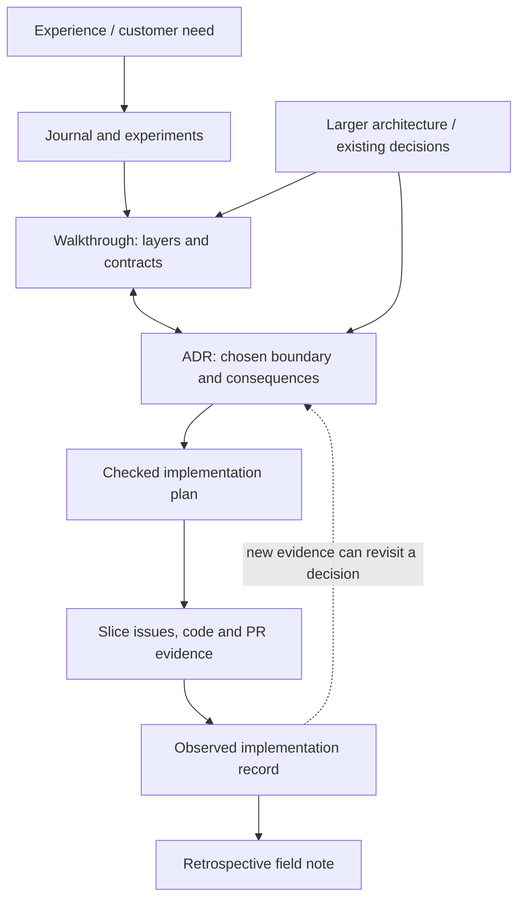

# Item/effect composition: the connected paper trail

This is navigation for the work behind the [layer walkthrough](README.md), not a
second backlog or a new approval process. The owning issues carry current scope
and delivery state. Each document below answers a different question.

These are linked jobs, not a mandatory pile of files for every edit. The
canonical skills and repository instructions govern when each is needed.

## Homes and responsibilities

| Question | Home for this line of work | Governing guidance |
|---|---|---|
| What experience are we enabling? | [Keep goal #702](https://github.com/KirkDiggler/rpg-project/issues/702), [item story #850](https://github.com/KirkDiggler/rpg-project/issues/850), [effects story #703](https://github.com/KirkDiggler/rpg-project/issues/703) | `story` |
| What did we inspect, try and learn? | `rpg-project/docs/journal/second-wind-ring/`; [journal record #863](https://github.com/KirkDiggler/rpg-project/pull/863), plus the example PRs | `work-records` journal guide |
| What architectural decision binds the work? | [ADR-0048](../../adr/0048-equipment-granted-abilities.md), in the context of [ADR-0038](../../adr/0038-resolution-owns-the-bus.md) and [ADR-0045](../../adr/0045-actions-are-data.md) | Owning ADR conventions and `work-records` decision-record guide |
| How do the layers fit and where does a change belong? | [This folder's README](README.md), linked from the architecture/docs index | `design` walkthrough guide |
| What exact work implements an agreed contract? | Extraction scope on [#705](https://github.com/KirkDiggler/rpg-project/issues/705); the derived extraction `plan.md` belongs beside this walkthrough when written | `design` implementation-planning guide; `story` for selected slices |
| What was built and verified per deliverable? | Slice issues and PRs, with owning-module tests, run records and observed integration evidence | `build-slice`, owning repo instructions, applicable `walk` / `pr-review` gates |
| How does the final implementation compare with the decision and plan? | `implementation.md` beside the plan, written from actual implementation evidence | Toolkit idea-record convention; links to code/PRs, versions, verification and deviations |
| How do we share the story afterward? | A separate field-note draft drawing on the records | `work-records` field-note guide; publishing remains explicit |

`plan.md` and `implementation.md` here name the intended artifact homes; this map
does not claim those files already exist or fill them with invented task/result
content. The example plans in the consumer PRs are **experiment plans**, not a
substitute for a checked extraction/production-adoption plan.

The extraction issue carries the current items-first direction and the retained,
superseded condition-first brief. Read its current scope before deriving tasks;
condition parity requirements must not disappear merely because the first
extracted consumer is an item.

## Trace one requirement rather than copying it

For item-owned charges, a reader should be able to follow:

1. **Need:** the item story needs acquired equipment to remain usable with its
   explicitly authored availability and charges.
2. **Decision:** ADR-0048's instance ownership and R2 distinguish the item pool
   from class resources and other instances.
3. **Explanation:** the walkthrough's Item / Data / Offers rows locate mutation,
   persistence and inspection; its lifetime separation explains transfer/recovery.
4. **Plan:** the implementing task cites that decision and names the exact owner,
   interfaces and assertions. It does not paste a second version of the rule.
5. **Evidence:** the item consumer checks transfer/reload without refill; the loot
   consumer checks missing stored data does not create fresh charged loot. Their
   PRs state which real providers and which fixture assumptions were exercised.
6. **Implementation record:** report the adopted module/version and actual
   consumer integration, or explicitly record the remaining gap. Do not replace
   proof with “the ADR is Accepted.”

The same chain should work backward: from a changed function/test or PR, find its
slice and planned contract, then the decision and larger architectural boundary
that explain why the change belongs there.

## Follow the owning guidance

Artifact authority and handoff rules remain in `work-records`, `design`, `story`,
`build-slice` and the owning repository's instructions. This page supplies their
locations for this topic; it does not redefine acceptance, implementation, review
or publication gates.

The reusable reference map lives at
`rpg-project/docs/working-procedures/architecture-records.md`, tracked with
[rpg-project#876](https://github.com/KirkDiggler/rpg-project/issues/876). The canonical
skills catalog links that map. It points to the existing procedures rather than
creating another workflow to maintain.
