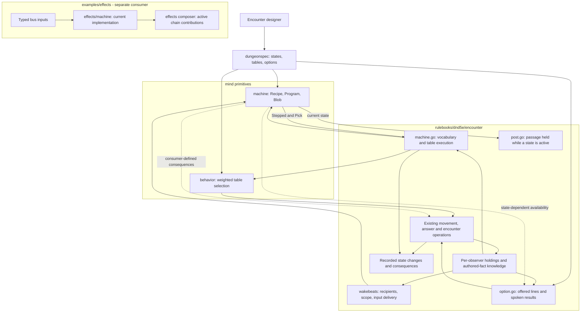

# NPCs that feel alive — exploration walkthrough

Story: [rpg-project#859](https://github.com/KirkDiggler/rpg-project/issues/859).
Examples: [the keep](https://github.com/KirkDiggler/rpg-project/blob/main/ideas/keep-dungeon/design.md)
and [its story index](https://github.com/KirkDiggler/rpg-project/issues/702).

**This is an exploration, not an approved API, new law, or implementation plan.**
The concrete types below describe existing boundaries. The designer-facing
connections are proposals to test against those boundaries; they are not a
claim that the complete keep journeys are authorable today. There is no new
`design.md` yet. Evidence and pending decisions belong to the linked story/PR.

## What this is

A way to explore a small machine underneath designer-authored behavior,
working inside `mind/machine` before considering extraction. The machine keeps
an ongoing situation and evaluates inputs; other components supply what those
inputs mean and carry out the consequences. Intel, authored facts, weighted
behavior tables, dialogue, and the encounter remain cooperating tools, not
features absorbed into a new universal NPC engine. The effects prototype is a
second-domain check, not an implementation to move or replace in this pass.

The designer's vocabulary is **on / when / while / until / do**. These are
questions to make expressible, not five new YAML keys:

- **On** which occurrence does this situation need attention?
- **When** which facts or beliefs hold does an answer apply?
- **While** this situation holds, what behavior or contribution is available?
- **Until** what changes does it remain in force?
- **Do** what, through a tool that understands that consequence?

An occurrence is not limited to a bus event. A heard sound, a received report,
a conversation result, and a clock reaching a point can all be inputs without
sharing a delivery mechanism. Conversely, the same spelling does not make
their delivery timing, recipients, or action costs identical.

## Component shape

Solid arrows show existing paths. Dotted arrows are connections to explore,
not proposed Go interfaces. The effects path is deliberately separate.

The diagram does not put a second knowledge store in the machine. Perception
holdings and authored-fact knowledge also are not interchangeable stores:
location/sound testimony flows through perception/intel; named learned facts
have their encounter journal path. Their existing owners remain authoritative.

## Ownership and contracts

| Component | Owns | Existing input → output | Connection being explored |
|---|---|---|---|
| `dungeonspec` | The designer's content language and lowering | `StatesSpec` → `machine.Recipe` plus separate post/blocking bindings; dialogue and table declarations → encounter inputs | Express the designer's conditions without exposing implementation bookkeeping. |
| `play/intel`, `mind/perception`, encounter knowledge projection | What an observer holds and what its holdings mean at the consuming boundary | `Surveil` / `Report`, observer holdings, encounter `knowsFact(member, fact)` | Receive and consult reports about the party without creating universal knowledge. |
| Encounter input delivery | Who receives an occurrence, scope, and when delivery is processed | `wakeBeat` → listener-specific `wakeEv` → `Program.Step` | Preserve useful occurrence content such as sound kind and relevant subject without leaking unseen identity. |
| `mind/machine` | Recipe validation, transition selection and machine-local state | `Recipe.Compile(Vocabulary)`; `Step(Blob, Beat, event, env, now)` → `Stepped`; `Listens`, `DueAt` | Identify which parts of the action and state-lifetime contract are genuinely general. |
| `mind/behavior` and its encounter binding | Eligible choices, authored weights/temperament, and interpretation of the chosen word | `PickInput` → `Pick`; encounter `runPick` / driver path → intents and execution | Keep selection reusable rather than reimplementing the behavior table inside the machine. |
| Encounter dialogue | Lines offered to a speaker and consequences of a selected line | `OptionsFor` → `[]Option`; `SpeakInput` → `SpeakOutput`; `Option.Requires`, `Success`, `Failure` | Add the relevant target's situation/knowledge to availability without confusing it with the speaker's knowledge. |
| Encounter composition | Applying spatial, social and group-level consequences through their owners | `Stepped.Acts` → `runPick`; `MemberInput.Posts` binds a state's name to a `Post` | Coordinate admission, relocation and communication; their exact new contracts remain open. |
| `examples/effects/machine` and composer | Effect-instance lifecycle, bus attachment and active contributions | `Machine.Apply` / `Remove`, `OnTransition` / `OnChanged`; composer attaches state outputs | Test whether a future bus-free core can serve these semantics without moving the bus or chains into it. |
| Host and presentation seams | Persistence orchestration and displaying returned results | `EncounterData`; `session.StateChange{Machine: *MachineChange}` | Preserve state/history and explain changes without deriving NPC decisions in the client. |

### Refusals to preserve

The machine does not discover recipients, consult the world's hidden truth,
roll a game check, interpret an arrest, or attach a damage modifier. Those
meanings come from the consumer. Machine-local bookkeeping is not a second
copy of shared encounter history.

The knowledge tools do not decide that a report is true or that a suspect
should be arrested. The behavior picker does not execute its selected word.
Dialogue visibility does not grant passage or spend an admission attempt.
The composition does not make a future machine consumer depend on a board,
a bus, or a D&D rulebook. The client does not repair a missing decision.

## Walk the gate guards into the ballroom

This is the existing keep's
[admission/recognition journey](https://github.com/KirkDiggler/rpg-project/issues/769),
read as a designer's set of connected intentions. The labels below are plain
language, not loadable configuration and not final state names.

### 1. Hold the entrance, offer admission

The author identifies the gate group, its passage and admission conversation.
While the duty is to hold the gate, the passage remains restricted. An arrival
can begin a conversation; backing away or closing it does not fulfill admission.

The existing `holds` binding demonstrates one part of this: `StateSpec.Holds`
lowers to a `Post` associated with a machine state, outside `machine.Recipe`.
It proves a state can have an ongoing spatial consequence without the machine
knowing a door. It does **not** prove the automatic conversation or complete
party-admission contract exists.

### 2. Remember the first failure without replacing the duty

The first complete failure warns the party and removes the failed claim.
The guard can remain on gate duty while knowing the party has already tried
that explanation. There is no need to assume a new state for every combination
of duty, belief and attempt count.

**The attempt belongs to the party at this entrance, not to whichever guard's
machine answered.** A per-guard bag counter would let changing guards reset
attempts. This shared record needs an encounter-level owner; each guard reads
it through the appropriate supplied facts. Its representation is not selected
here. The gate's final skill mapping and split-party arrest membership remain
the keep's open content decisions.

### 3. Resolve entry and change the surviving guards' duty

Success grants passage. A second complete failure arrests the affected party,
retaining equipment; arrest also establishes keep entry. An alternate entrance
can establish entry without either conversation result.

That shared outcome releases the gate and starts the living guards' one-time
journey to ballroom posts. The same actor identities, health and memories
survive. Passage does not wait for their walk to finish. A machine can express
changing duty; it is not the owner of the multi-member relocation operation or
the party's admission history.

### 4. Recognize people through memory, not a global prisoner flag

In the ballroom, an arresting guard can recognize the party. A guard that never
learned about the arrest does not gain the same accusation merely because the
run contains that fact. A visible prince/captain opens the authored allegiance
conversation rather than making arrest history an unavoidable fight.

This is the point where dialogue needs to distinguish the **speaker's** ability
to choose a line from the **listener's** knowledge and ongoing situation. A lie
contradicts what the guard believes, which need not be omniscient truth.

The operator's additional report/lie example probes the same seam: another
NPC can communicate a report, making an informed response possible. What the
recipient does with it is content. This does not add a mandatory liar-detection
check, alarm protocol or new gate conversation to the canonical keep.

### 5. Keep the identities through the technical path

For the existing machine portion, an authored state/transition goes through
`StatesSpec` → `recipeOf` → `machine.Recipe` → `Program`. The `Blob` on the
existing member retains the current state and machine-local memory. Encounter
delivery supplies the occurrence and that member's environment to `Step`.

`Stepped{From, To, Reason, Acts}` tells the encounter what happened. The
encounter writes `BeatState` with the same member ID and authored state names,
updates its listener/due indexes, and interprets its `Pick` acts. State-based
post/blocking contributions are read from the member's active state, not copied
into a new admission truth.

The session folds the state beat to `StateChange{Change: StateMachine,
Machine: &MachineChange{From, To, Reason}}`. This is the existing explanation
surface for a presentation to display. This exploration does not claim a new
client display or a verified end-to-end gate journey.

Saving and loading carry machine data **and** the encounter's existing history,
positions and knowledge. A state transition alone cannot guarantee that an
arrest or one-time guard rotation will not execute twice. Resumption needs an
explicit account of completed consequences and any unfinished work in the
owning composition; no new persistence mechanism is selected here.

## Test the shape beyond the gate

These are design probes, not an implementation backlog or new playtest gates.

| Probe | What the designer connects | What the boundary must expose or keep separate |
|---|---|---|
| Sleeping mess guards | Buying a round leaves the guards asleep; a passing pursuer wakes them and tells them about the assassins. | No periodic work merely to discover nothing happened. Waking, receiving information and choosing pursuit are distinct. A distant boss death is not the local wake-up interaction. |
| Banquet gossip | Hearing an insult makes reporting it available; a successful authored check starts a food fight; a failure exhausts that guest's opportunity. | Speaker-held information, a target-specific attempt and a shared scene consequence are different scopes. This must not inherit a lethal keep alarm by accident. |
| Barracks succession | A side's defeat opens a survivor conversation; a living subordinate can replace the leader as speaker. | Group outcome and speaker selection belong outside an individual machine. Substitution does not confer the dead leader's authority or duplicate its identity. |
| Neutralized ballroom guards | Dazzled, drugged or persuaded guards remain neutralized when assassination occurs later. | The later input does not erase established outcomes. Being socially distracted need not instantiate the combat Sleep condition. |
| Rage prototype | Activity trackers update memory, turn ends test continuation, active states contribute modifiers, terminal entry removes them. | Tracking without a state change, first-match transition order, contribution lifecycle, and publish/detach ordering must retain their meanings. A bus adapter is not part of the core machine. |
| Keep bleed effect | Start-of-turn damage for a duration; another puncture extends duration; healing ends it. | Reapplication is not a second damage stack. Damage/healing rules and zero-effective-healing policy are outside the machine. Timing is the affected target's turn, not a guard's world-clock wake. |

Rage is an executable prototype reference; bleed is a canonical keep requirement,
not a claim of an implemented effect. Neither implies adopting the prototype's
condition-specific `AnchorRound` or `DeriveTurnsActive` acts as universal words.

## Separations that look like one thing

| Question | Source of truth / boundary to preserve |
|---|---|
| What happened in the encounter? | Recorded occurrence and owning operation. |
| What did this guard learn, and about whom? | Its own holdings and learned-fact record, interpreted by the consumer. |
| What is this guard currently doing? | Its duty/process state and the behavior selected through it. |
| Has the party used its admission attempts? | The shared entrance/party history, not each guard's machine bag. |
| Is this line available to this speaker and target? | Dialogue eligibility, checked again when spoken; proposed target-state conditions are not a replacement for speaker requirements. |
| Is entry permitted? | The admission/passage contract, not whether a conversation panel is open. |
| Is the actor asleep socially, or holding a combat Sleep condition? | The authored outcome or actual rulebook condition, respectively. |
| Should information be processed now? | The input-delivery policy. |
| May the NPC spend movement or an action now? | Its clock and action economy, not merely receipt of information. |
| Did a consequence finish before saving? | Its owning operation's lifecycle, not a blanket promise made by the machine. |

Collapsing these distinctions produces believable-looking mistakes: every guard
knows an arrest, speaking to a new guard resets attempts, receiving a rumor grants
a free turn, or resuming a saved state arrests the same party twice.

## Trade-offs of this exploration route

| Choice | Benefit | Cost / who pays | Alternative not taken in this pass |
|---|---|---|---|
| Shape the primitive inside `mind/machine` | An existing consumer keeps the boundary honest. | The designer and builder must identify consumer-specific assumptions instead of renaming them as generic concepts. | Extract a third machine package before proving the boundary. |
| Preserve cooperating tools | Intel, tables, dialogue and consequences retain their own authority. | The composition pays explicit wiring and delivery-order costs. | Make the machine the whole NPC/encounter engine. |
| Use several small design probes | Both mind complexity and effects lifecycle challenge the same foundation. | Each proposed capability must be classified as core, vocabulary, authoring, or composition work. | Force the whole keep or effects migration into the first implementation slice. |
| Keep authored meanings outside the kernel | A second consumer can supply different words. | The consumer/compiler must validate those words and report unsupported ones. | Add `arrest`, `share_rumor`, `door` or `rage` branches to machine internals. |

## Edges still to resolve

**Delivery timing.** The live encounter queues addressed wake beats until a
world-clock raise; effects runs handlers synchronously on bus delivery. These
are different consumer policies, not proof the primitive must choose either.
Information-dependent options can otherwise disagree with a machine that has
not yet processed the same information. The first decision on the case file
is when that knowledge should take effect, separately from permission to act.

**Occurrence content.** Sound holdings retain kind/place without identifying an
unseen maker. The machine's current encounter-facing wake event carries time and
scope distances. Expressing the proposed `on hear:clang` / `on hear:voices`
needs a deliberate vocabulary/delivery connection, not a rulebook-specific
sound enum in the core or a source-identity leak. These spellings are illustrative.

**State lifetime versus commands.** Holding a post can be queried from current
state; effect outputs attach/detach; sharing news is a one-time consequence.
A general contract must distinguish these rather than treating every output as
an interchangeable callback. Generic outputs, consumer-owned state bindings,
and transition effects still need comparison before an API is selected.

**Memory and simultaneous concerns.** Duty, belief about a subject, shared
attempt history and an effect's independent duration need not be one state.
This does not yet choose nested machines, parallel regions or multiple machine
instances per actor. Nor does it propose a second copy of intel in a bag.

**Report semantics.** Source, subject, conflicting accounts, retraction and
recipient scope need an explicit contract if introduced. A named known fact is
not automatically a rich report, and knowing a report is not proof it is true.

**Failure and cascades.** The consumer owns execution failures, ordering and
bounded chains of consequences. A shared step result cannot silently promise
transaction rollback, exactly-once external work, or arbitrary recursive
broadcast. The record should explain a decision without disclosing private
knowledge to players who did not receive it.

## Where a change lands

A new sound category should exercise the sound vocabulary and its delivery into
existing observation/machine inputs. It should not require teaching the core
machine a new sensory organ.

A suspicion-dependent reply should exercise dialogue eligibility against the
right actor's knowledge and state, with the same check at offer and execution.
It should not be implemented by hiding a button only in the client.

An arrest should exercise a reusable encounter-level consequence and resumption
contract. It should not become an `Act.Arrest` primitive or a party relocation
implemented by mutating each guard's bag.

An effect ending on healing should exercise effect vocabulary, lifetime and
contribution cleanup. It should not require a dependency from mind to combat.

## Source map

| Concern | Owning source |
|---|---|
| Machine contract, data, vocabulary, stepping | [`mind/machine/doc.go`](../../../mind/machine/doc.go), [`recipe.go`](../../../mind/machine/recipe.go), [`vocabulary.go`](../../../mind/machine/vocabulary.go), [`step.go`](../../../mind/machine/step.go) |
| Executable single-path guard probe | [`mind/machine/guard_journey_test.go`](../../../mind/machine/guard_journey_test.go): caller-supplied inputs and table-name outputs, not live keep delivery or concurrent roles |
| Due and listener indexes | [`mind/machine/due.go`](../../../mind/machine/due.go), [`listeners.go`](../../../mind/machine/listeners.go) |
| Machine authoring/lowering and state-bound posts | [`encounter/dungeonspec/states.go`](../../../rulebooks/dnd5e/encounter/dungeonspec/states.go), [`encounter/post.go`](../../../rulebooks/dnd5e/encounter/post.go) |
| Encounter binding and delivery | [`encounter/machine.go`](../../../rulebooks/dnd5e/encounter/machine.go), [`wakebeats.go`](../../../rulebooks/dnd5e/encounter/wakebeats.go) |
| Testimony and supplied interpretation | [`play/intel/doc.go`](../../../play/intel/doc.go), [`mind/perception/doc.go`](../../../mind/perception/doc.go), [`encounter/world.go`](../../../rulebooks/dnd5e/encounter/world.go) |
| Sound content and landing | [`encounter/noise.go`](../../../rulebooks/dnd5e/encounter/noise.go), [`mind/behavior/sound`](../../../mind/behavior/sound/) |
| Behavior selection and spoken answers | [`mind/behavior/doc.go`](../../../mind/behavior/doc.go), [`encounter/answer.go`](../../../rulebooks/dnd5e/encounter/answer.go) |
| Dialogue offers and execution | [`encounter/option.go`](../../../rulebooks/dnd5e/encounter/option.go) |
| State-change explanation | [`session/act_bodies.go`](../../../rulebooks/dnd5e/session/act_bodies.go), [`act_family.go`](../../../rulebooks/dnd5e/session/act_family.go) |
| Effects comparison | [`examples/effects/README.md`](../../../examples/effects/README.md), [`machine/machine.go`](../../../examples/effects/machine/machine.go), [`composed.go`](../../../examples/effects/composed.go) |

The related [mind vocabulary review](https://github.com/KirkDiggler/rpg-project/issues/700)
keeps rulebook words as supplied inputs. The existing
[world scheduling design](https://github.com/KirkDiggler/rpg-project/blob/main/ideas/the-world-runs/design.md)
provides the due/listener and deterministic-driving contracts; the
[composable effects story](https://github.com/KirkDiggler/rpg-project/issues/703)
provides the other consumer's requirements. This exploration does not supersede
those contracts by implication.
