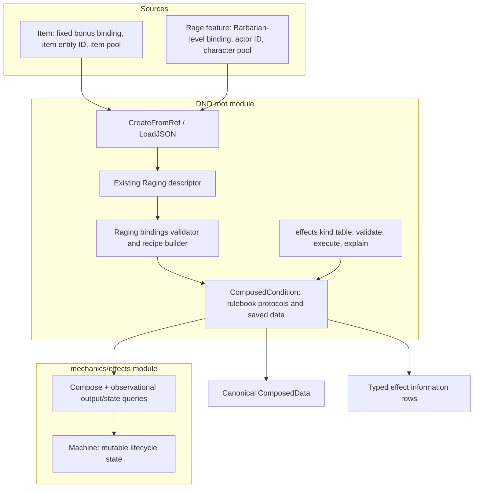

# Shared rulebook effects and Raging creation

This is the approved contract for the Raging-only cut under [story #703](https://github.com/KirkDiggler/rpg-project/issues/703)
and its [design](design.md). It builds on the [item/effect layer walkthrough](../item-effect-composition/README.md):
reusable D&D effect kinds, one named Raging definition, one registry and independent
instances. It introduces no second effects engine or item-specific Rage implementation.
**New types and methods below are implementation contracts, not claims of existing capabilities.** The [checked plan](plan.md) owns execution and the [instance ADR](../../adr/0050-composed-condition-instances.md) owns the persisted boundary.

## Component shape



## Ownership and contracts

| Component | Owns | Input → output |
|---|---|---|
| Class/item activation | Access, its own payment and delivery | Validated source data → `CreateFromRefInput`; unattached `ConditionBehavior` → existing delivery path |
| `conditions` descriptor | One ref, display, binding validation, recipe builder, create/load | Strict `RagingBindings` → a fresh `machine.Recipe`; same builder on creation and restore |
| `events.ConditionOrigin` (proposed) | A value contract, not source behavior | `Ref core.Ref` plus `EntityID string`: granting content and the entity that supplied it |
| `conditions.ComposedCondition` (proposed) | Rulebook codec, origin/bindings, address and information integration | Existing `ConditionBehavior` plus `ComposedData` and observational effect inspection; delegates all execution/lifecycle to the generic runtime |
| `dnd5e/effects` | Closed kind table, facts, beats, amounts and typed query adapters | Full `effects.Output` validation; bound output plus typed rulebook query → chain contribution or `contributions.Effect` information |
| `mechanics/effects` | Generic composition, validation and current outputs | Recipe/vocabularies/runtime inputs → `Composed`; proposed `Snapshot()` and `CurrentOutputs()` expose owned state and observational handles |
| Existing condition information port | Aggregating legacy and composed answers | `AssessActionEffectsInput` → existing repeated `[]contributions.Effect`; composed instances can contribute several rows |
| Host / API | Loading, executing, saving and translating owned values | Opaque current condition data and typed toolkit results → stored values / existing wire contracts |
| Web reader | Recognition and presentation | Canonical ref, runtime progress and server-owned descriptions/answers → condition display; no bonus arithmetic |

The generic tools refuse to import D&D or know which source paid. The rulebook
vocabulary refuses to import `examples/items`, choose budgets or look up live
inventory. The named definition refuses to become one implementation per source.
The codec refuses to reconstruct gameplay from a display label. The renderer
refuses to infer a class-derived bonus from saved parameters.

### One canonical saved instance

R2 removes the need for an old-format reader, writer or normalization pass. The
proposed `conditions.ComposedData` separates three kinds of data (R3):

```json
{
  "ref": "dnd5e:conditions:raging",
  "member_id": "wearer-1",
  "origin": {
    "ref": "example:items:raging_ring",
    "entity_id": "ring-17"
  },
  "bindings": {
    "damage_bonus": { "fixed": 3 }
  },
  "runtime": {
    "state": "raging",
    "bag": {
      "saw_turn_end": true,
      "round_activated": 4,
      "turns_active": 1,
      "was_hit_this_turn": false,
      "did_attack_this_turn": true
    }
  }
}
```

The class variant supplies `{"damage_bonus":{"barbarian_level":true}}` rather
than a stored level or computed number. The rulebook maps that selector to its
Barbarian steps (+2/+3/+4 at levels 1/9/16). The fixed variant retains the current
item consumer's positive authored-bonus contract. Exactly one mode is present;
missing, unknown, conflicting or malformed bindings fail. There is no generic
"zero means use class levels" fallback.

`origin.entity_id` is the character ID for a class grant, and the item instance
ID for an item grant. `origin.ref` identifies the granting feature or item
content. Neither is substituted for `member_id`. These fields supply provenance;
Raging's condition address remains `(Raging ref, empty source qualifier)` under
its existing by-ref stacking rule.

The bindings are immutable instance inputs. The recipe builder uses them to
select an amount expression inside **the same Raging composition**, not to copy
its handlers or lifecycle. A fixed amount becomes an `Amount.Fixed`; the class
selector becomes `Amount.ByClassLevel` using the rulebook-owned table. The
resulting recipe remains plain data. No executable callback is authored in it.

The runtime bag contains only lifecycle state. `ComposeInput.Parameters` receives
that bag when restoring; it does not receive the rulebook `bindings` object.
This avoids pretending that a fixed item amount is a class level or that immutable
construction metadata is a tracker-controlled flag. The rulebook adapter stores
origin/bindings once and holds one generic runtime; it does not mirror that
runtime's mutable counters in another struct.

### Creation, loading and refusal

The proposed extension is `CreateFromRefInput.Origin *events.ConditionOrigin`.
For Raging, `Config` contains the strict `RagingBindings` payload and `Origin` is
required. The existing `SourceRef` field remains solely for not-yet-migrated
condition constructors; Raging refuses mixed/legacy source input rather than
selecting one silently. Other condition types keep their current contract and
refuse the new Origin input until their descriptor supports it; they do not
silently discard provenance.

`CreateFromRef` and `LoadJSON` still dispatch through the one descriptor. Raging's
create validates the origin/bindings and calls the definition builder. Its load
validates the current `ComposedData`, rebuilds the same recipe/vocabulary, and
supplies the saved state and complete bag to `effects.Compose`. The restored
instance is unattached until the caller applies it.

Restore requires a registered canonical ref, nonempty recipient and origin
entity IDs, a valid origin ref, valid explicit bindings, a declared live runtime
state, and all expected bag keys with valid types and lifecycle invariants. It
refuses an old-shaped record, missing/null runtime, partial bag, unknown keys or
inconsistent state. It never uses creation defaults to repair saved state or
silently recreates a character. Tests and local characters are recreated explicitly.

The generic `Snapshot()` proposal returns `effects.Snapshot{State, Bag}` with an
owned bag copy. `ComposedCondition.ToJSON` combines that value with immutable
metadata directly; it does not serialize the generic condition merely to parse
its JSON back into another representation. The generic `ToJSON` contract can
remain for consumers that want its own blob format.

State transitions also have to reach the host's dirty-state mechanism. The
proposed `OutputVocabulary.Changed` contract covers successful nonterminal
transitions after the new outputs attach, in addition to changed tracker/staying
transition bags. Raging's first turn end must therefore publish its changed state,
not merely advance an in-memory machine that the host never saves. Terminal
transitions use `End` and its existing publish-before-detach ordering.

### Reusable kinds, not a relocated item adapter

The first rulebook table contains only the meanings this cut consumes:

- damage bonus, with fixed or class-step amounts;
- resistance with validated damage-type parameters;
- advantage with a closed save/check domain parameter.

Raging combines four output instances: one damage bonus, physical resistance,
Strength-save advantage and Strength-check advantage. Fact/beat adapters use the
existing typed D&D chains and occurrence topics. The table knows no Raging name,
item type, charge count or fixed rarity policy. Display and origin are bound from
the condition descriptor/instance as immutable context, using the same code for
all sources. Binding metadata to Go implementations is not a closure in authored
recipe data.

R4 proposes changing `KindSpec.Check` to inspect the **full Output**, not only its
raw Params, so a kind can refuse a missing amount or an invalid amount/parameter
combination before attaching. There is one validation hook, not competing old/new
hooks. Existing provider consumers adapt in their own module PRs.

### Information uses the same rules

The same rulebook kind assessment builds both the generic `effects.Row` and its
richer `contributions.Effect` projection. R4's `CurrentOutputs()` proposal returns
a defensive slice of observational bound-output handles. Bound parameter and
host metadata reads return safe copies; inspection cannot mutate the composition.
The rulebook adapter can therefore use its single kind table to obtain typed rows
without putting D&D fields or arbitrary projection payloads into the generic Row.

The proposed rulebook `effects.Query` is a closed context: an existing action
`contributions.Frame`, an incoming-damage event, a saving-throw event, or an
ability-check event. At most one context is supplied; no context requests
non-evaluated descriptions. The kind validates/adapts that typed context and uses
the same guard/amount rules as execution.

A known other domain means does-not-apply. A relevant context lacking a needed
fact means depends; execution refuses an unresolved required answer. Descriptions
remain available without a context, but no amount is represented as applied.
Resistance is about incoming damage, not an attack made by its holder. Strength
save/check advantage does not apply to a Strength attack merely because the
ability name matches.

A proposed optional `contributions.ActionEffectsAssessor` lets composed conditions
supply multiple typed rows to `conditions.AssessActionEffects`; existing
single-answer conditions keep their existing path. Row IDs distinguish outputs
within the listing, retain origin provenance, and are not stacking addresses.
The current action Frame supports attack/save contexts only. This cut does not
invent ability-check or incoming-damage previews on that native port: those rows
remain domain-honest there, while their real typed chains and inspection contexts
are exercised directly. Four benefits are inspectable; they are not four effects
silently applied to every action.

## Walk one thing through

1. A retrieved ring `ring-17` offers the authored fixed +3 binding. Its existing
   typed `Use` owns the item reservation and refunds a failed preparation under
   that operation's existing contract.
2. Its resolver calls `conditions.CreateFromRef` with the canonical Raging ref,
   recipient, binding payload and origin `(item ref, ring-17)`. The caller does
   not build a Rage recipe or register output handlers.
3. The Raging descriptor validates the bindings and builds the shared recipe.
   The rulebook adapter binds display/provenance to the reusable vocabulary and
   calls `effects.Compose`. The result is a fresh, unattached condition.
4. The caller applies the result. A Strength melee weapon damage frame with base
   10 becomes 13 through the real chain, with the condition ref and item entity ID
   in the contribution. A class activation follows the same construction path
   with the class selector and its own pool; its amount remains frame-derived.
5. A turn end updates the machine's one bag. The caller snapshots condition data
   without consulting the ring again. The item may detach or transfer without
   resetting the active effect or changing its bound +3.
6. `LoadJSON` reconstructs the same composition from that saved binding/origin
   and runtime snapshot. A new bus attaches it without granting another fresh
   turn or restoring item charges. Ending publishes removal before detachment;
   detaching between interactions is not a gameplay end.
7. API stores/translates toolkit data. The web recognizes the Raging ref and
   reads `runtime.bag.turns_active`; it does not require a cached damage_bonus or
   calculate one from class data. Existing server descriptions remain the badge's
   rule text; action-dependent numerical answers use the information rows.

## Separations that look like one thing

| Question | Source of truth |
|---|---|
| Which behavior is this? | Canonical condition ref and descriptor |
| What amount strategy was granted? | Validated immutable instance bindings |
| What is the class bonus now? | Current authoritative/knowledge frame, as appropriate |
| Which source supplied it? | Origin content ref plus originating entity ID |
| Which condition may coexist? | Recipe/recipient stacking address, not origin |
| Which charges remain? | Item or character pool, never the condition bag |
| Which turn and sustain flags are current? | One machine runtime snapshot |
| What can the player conclude for this action? | Rulebook-owned contextual effect rows |

Conflating origin and address permits unintended stacking. Conflating binding
and upkeep makes loading re-evaluate a vanished item or cache a class level.
Conflating domain and ability makes save/check advantage look like attack advantage.

## Trade-offs

| Decision | Benefit | Cost / boundary | Not taken |
|---|---|---|---|
| Raging-only vertical cut (R1) | Both real sources share the creator | Builder migrates one native condition and its callers | Catalog-wide migration; example-only class stand-in |
| New canonical data (R2) | One reader/writer and explicit current contract | Operator/tests recreate incompatible characters | Byte-compatibility adapters or legacy normalization |
| Bound recipe plus separate runtime (R3) | Fixed item facts survive independently; class amounts stay live | Registry stores/validates immutable bindings and rebuilds a recipe | Per-source Rage code; putting bindings into mutable upkeep |
| Neutral query/validation additions (R4) | Rulebook can own its codec and rich projections | Provider gets focused APIs and tests before consumer adoption | JSON round-tripping or D&D-specific generic fields |
| One kind assessment (R6) | Execution and information agree | Rulebook supplies typed domain adapters | Duplicated arithmetic or all-four-apply rows |

## Edges and finish line

The native Rage feature keeps its eligibility, character-owned payment and
condition-delivery protocol. It validates/prepares the new condition before
payment can fail due to malformed construction inputs; later delivery failure
is not given a new refund guarantee. This cut does not convert features to
`actions.Definition`, add item actor-payment rules, or implement real inventory.

Other condition types keep their constructors and saved formats. No compatibility
shim for the removed Raging type is promised; callers and fixtures move to the
factory. The API may need provider pins and test adjustments, not rule reconstruction.
The web reader work is bounded to this canonical Raging data/owned information
contract; no new card system or client-side calculation is included.

The delivery finish line is a tested shared creator used by the native feature
and item example, strict current-format save/load and separate budgets/provenance,
four domain-honest information rows, and explicit adoption through the actual
API/web readers. The native class journey is walked on an isolated stack before
merge; the item path remains an example, not a claim of native loot integration.
Providers and consumers develop on pushed commits, then merge and adopt real tags
inside-out. The implementation plan names the required module PRs and walk evidence.
An owning toolkit ADR records the approved source/binding/runtime boundary before
its implementation; the existing ADR-0048 remains the composition/ownership
foundation rather than becoming an implementation log.

## Where a change lands

- Another authored fixed ring bonus changes binding data, not effect code.
- Another combination of supported meanings belongs in a condition definition.
- A genuinely new mechanical meaning or query domain belongs in the rulebook
  kind table and its tests; only a missing neutral capability belongs in mechanics.
- A rendering change consumes owned information in the web, never the recipe's
  arithmetic. Storage implementations remain the host's concern.

## Source map

| Concern | Existing source / proposed owner |
|---|---|
| Generic composer / query additions | `mechanics/effects/{composed.go,vocabulary.go}` |
| Generic lifecycle snapshot source | `mechanics/effects/machine/machine.go`: `State`, `Bag`, `ToBlob` |
| Shared recipe and codec | `rulebooks/dnd5e/conditions/`; proposed composed adapter and Raging definition |
| Canonical registration | `conditions/{descriptor.go,registry.go,factory.go,loader.go}` |
| Rulebook meanings | `rulebooks/dnd5e/effects/`; replace its unused old representation, not a second kind catalog |
| Origin value protocol | `rulebooks/dnd5e/events/events.go`, beside the existing condition protocols |
| Native feature caller | `rulebooks/dnd5e/features/rage.go` |
| Information port | `conditions/action_effects.go`, `contributions/{effect.go,frame.go}` |
| Current external consumer | `examples/items/{rage_recipe_test.go,rage_vocabulary_test.go,rage_item_test.go,loot_example_test.go}` |
| Native fixture/adoption surfaces | `rulebooks/dnd5e/{character,resolution,session}` and their own module pins |
| Badge reader | `rpg-dnd5e-web/src/{types/conditionData.ts,components/features/ConditionBadge.tsx}` |
