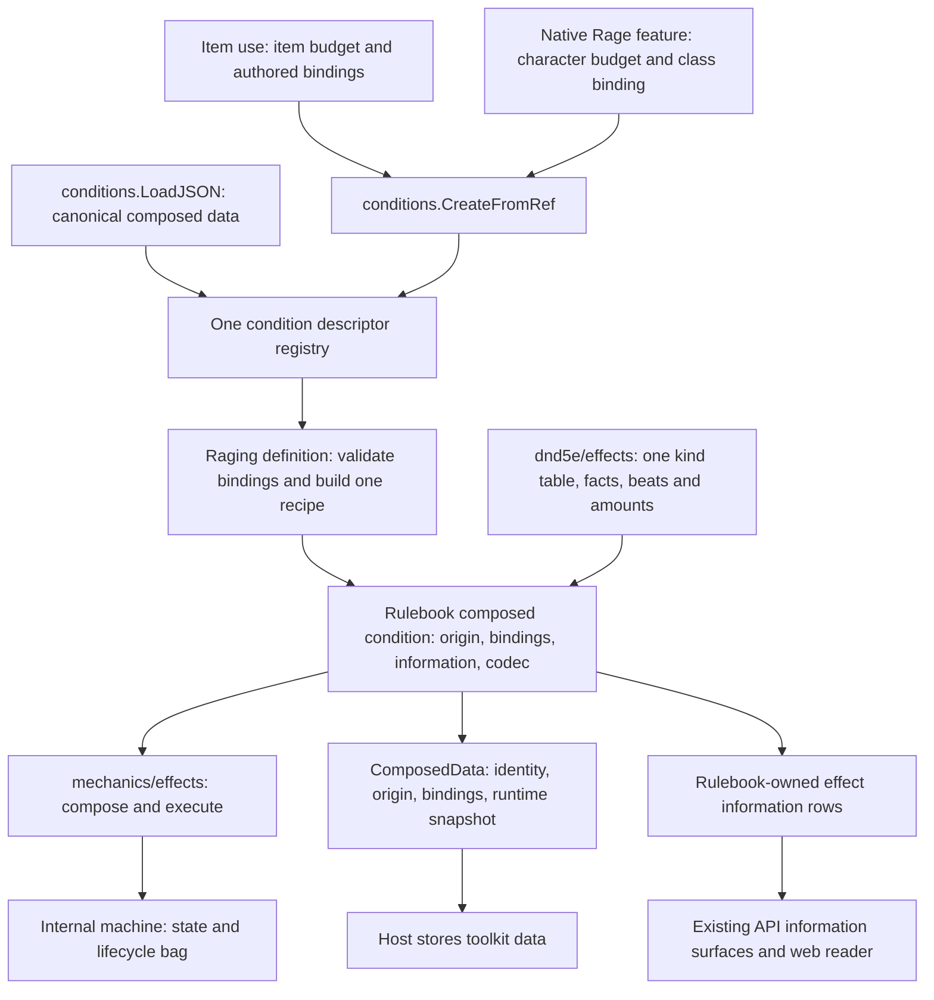

# Shared rulebook effects and Raging creation

## Shape

The governing ownership decision is [ADR-0048](../../adr/0048-equipment-granted-abilities.md).
The [walkthrough](README.md) specifies this cut's approved contracts. R1–R7
are settled by the operator's approval of the complete design. Agreement is
not a claim that these APIs are implemented; execution follows [the plan](plan.md).

## Law

1. **R1 — one Raging implementation.** The item consumer and native Barbarian
   feature request the same named definition through the existing registry.
   Each request creates a fresh runtime; the other condition types remain outside
   this migration.
2. **R2 — one new saved shape.** Raging uses one canonical composed-instance
   representation. Historical Rage blobs are not accepted, converted or written;
   affected characters can be recreated explicitly, never silently reset by a loader.
   Gameplay semantics, not old bytes or
   private Go fields, define migration parity.
3. **R3 — bindings are not mutable upkeep.** An instance owns immutable, validated
   construction bindings and origin separately from the machine's mutable state
   and bag. The persisted record contains both, with no second copy of mutable
   lifecycle state. Generic `ComposeInput.Parameters` remains the machine-bag
   input; it is not the new rulebook binding contract.
4. **R3 — source-specific amounts, shared behavior.** A fixed item bonus is retained
   as the value bound at activation. A class binding selects the rulebook's
   Barbarian-level scaling and reads current levels from the supplied frame.
   Neither serialized class levels nor a cached class-derived bonus is authoritative.
5. **R3 — origin is not an address.** Granting content ref, originating entity ID,
   recipient ID and condition address answer different questions. Raging retains
   its existing by-ref identity on a holder; item provenance does not enable
   source-qualified stacking.
6. **R4 — generic tools stay neutral.** The composer supplies complete-output
   validation, typed runtime snapshots and observational access to current bound
   outputs. Its change hook covers bag changes and successful nonterminal state
   transitions; terminal removal retains publish-before-detach ordering.
   It owns no rulebook origin schema, kind meaning, display, budget,
   registry, persistence adapter or information-domain policy.
7. **R5 — the registry is the only condition catalog.** The Raging descriptor owns
   its bindings contract, recipe construction, display, creation and restoration.
   Creation and restoration invoke the same definition builder; no item-specific
   Raging constructor or second ref-keyed registry exists.
8. **R5 — restore is not create-with-defaults.** A current saved instance requires
   its origin, bindings, runtime state and complete valid bag. Missing or malformed
   saved fields fail by name; they do not produce fresh or refilled state.
9. **R6 — one kind owns execution and explanation.** A rulebook kind validates its
   full output and provides execution and information from the same applicability
   and amount rules. Information queries do not attach, publish, spend or mutate.
   An unknown required fact is not a negative answer.
10. **R6 — a row names its domain.** Save/check advantage and incoming resistance
    do not become outgoing attack benefits because an attack uses Strength.
    Four inspectable benefits do not mean four modifiers apply to every query.
11. **R7 — costs and delivery stay outside composition.** Class and item pools stay
    separate. Construction performs no payment or bus attachment. The existing
    callers own payment and delivery; a later delivery failure is not promised
    arbitrary rollback.
12. **R7 — readers consume owned facts.** API and web do not reconstruct Rage's
    numerical rules from saved bindings or invent class levels. The web recognizes
    the canonical ref and reads current lifecycle data; action-dependent benefit
    amounts come from rulebook information, not a condition-badge calculation.

## Rulings

| ID | status | scope | ruled by | date |
|---|---|---|---|---|
| R1 | settled | Native Raging and item consumer share one creator; no catalog-wide migration | KirkDiggler | 2026-11-07 |
| R2 | settled | New saved shape; no historical Rage save compatibility; characters may be recreated | KirkDiggler | 2026-11-07 |
| R3 | settled | Immutable bindings/origin plus one mutable runtime snapshot; explicit amount modes and by-ref identity | KirkDiggler | 2026-11-07 |
| R4 | settled | Neutral composer queries, full-output validation and state-change notification needed by the rulebook adapter | KirkDiggler | 2026-11-07 |
| R5 | settled | Canonical registry create/load contracts and strict current-format restoration | KirkDiggler | 2026-11-07 |
| R6 | settled | Shared kind assessment and plural, domain-honest information rows | KirkDiggler | 2026-11-07 |
| R7 | settled | Activation/delivery boundaries and explicit API/web consumer adoption | KirkDiggler | 2026-11-07 |

## Open

- No operator-owned design question blocks the scoped implementation. A newly
  discovered ownership, lifecycle or user-visible change returns to design;
  local implementation details do not require another approval.
- No legacy-save migration choice remains open under R2.
- Whole-catalog migration, feature-to-action-definition conversion, studio schema
  authoring, native item inventory, new eligibility/stacking rules and distributed
  rollback remain outside this cut.
