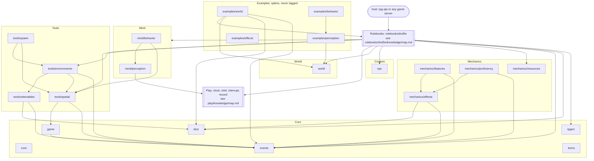

# Map — the repo root

The layers of rpg-toolkit and the seams between them. A layer with its own map
is one box here; its modules are drawn only in that map.

| Level map | What it draws |
|---|---|
| [`rulebooks/dnd5e/knowledge/map.md`](../rulebooks/dnd5e/knowledge/map.md) | `rulebooks/dnd5e`, `encounter`, `resolution`, `session` — the rules, the composition, the bus, the host seam |
| [`play/knowledge/map.md`](../play/knowledge/map.md) | `play/clock`, `play/intel`, `play/interrupt`, `play/record` — the leaves |

Arrows are direct `go.mod` requires; edges into `core` are left out because
most modules import it. Higher layers import lower ones and never the reverse.
The drift check (`scripts/check-knowledge-map.sh`) holds the nodes to the
module tree; the arrows are held by review.

A module node is a rectangle whose label begins with its path,
`ID["tools/spatial …"]`. A level box is `[[…]]` and something outside the
repo is `(…)`; neither is read as a module.

## Seams

**Core ↔ every layer above**
- Flows: upward imports of `core` (Entity, Ref), `events` (typed topics, the bus types), `dice`, `rpgerr`, `game` and the `items` base interfaces.
- Must not cross: an import from a Core module to anything above Core.

**Mechanics ↔ Rulebooks**
- Flows: generic mechanic infrastructure (resource pools, effect tracking, feature loading, proficiency) that a rulebook fills with its own meaning.
- Must not cross: a game's rule into Mechanics; the toolkit provides proficiency, the game defines what Acrobatics means ([`CLAUDE.md`](../CLAUDE.md), "Toolkit is infrastructure, not implementation").

**Tools ↔ Mind and Rulebooks**
- Flows: geometry, grids, rooms, environments, weighted selection and spawn placement, called from above.
- Must not cross: a rulebook rule into a tool ([ADR-0013](../docs/adr/0013-entity-spawn-engine.md): the spawn engine creates no entities); spatial publication beyond observer-only events ([`CLAUDE.md`](../CLAUDE.md), Laws 2).

**Play ↔ Mind and Rulebooks**
- Flows: downward, calls on a leaf's verbs with time and orderings supplied by the caller; upward, results as returned values: milestones, deltas, windows, entries.
- Must not cross: upward, a leaf importing anything but `core`, taking a `context.Context`, publishing to a bus or interpreting a payload; downward, a rule or trigger placed in a leaf ([`CLAUDE.md`](../CLAUDE.md), "How live play is layered"; [`play/knowledge/map.md`](../play/knowledge/map.md)).

**Mind ↔ Play**
- Flows: `mind/perception` holds each observer's testimony in `play/intel`, one `Pass` and one `Delta` per observer.
- Must not cross: a meaning for testimony into `mind/perception`, which holds it opaquely ([ADR-0047](../docs/adr/0047-encounter-owns-location-knowledge.md)); any knowledge of perception into `play/intel`.

**Mind ↔ Rulebooks**
- Flows: downward, a creature's facts, its authored table and a die; upward, testimony and a pick with its whole arithmetic, as values ([`mind/behavior/doc.go`](../mind/behavior/doc.go)).
- Must not cross: a rulebook import or a game rule into Mind; testimony read upward as live truth, since it is per observer and may be false.

**World ↔ Rulebooks**
- Flows: a rulebook plugs into `world` through its `Resolver` and receives `Result` values; `rulebooks/dnd5e` and its encounter import `world`.
- Must not cross: a rulebook import, a bus, or a decision a die or class feature would make, into `world` ([`world/doc.go`](../world/doc.go)).

**Content ↔ Rulebooks**
- Flows: generic NPC records (identity, name, policy, capability labels) read by the rulebook and its host seam.
- Must not cross: placement, hostility, sight or movement into `npc`; a rulebook's merchant rules into `npc` ([`npc/doc.go`](../npc/doc.go), [ADR-0046](../docs/adr/0046-generic-npcs-are-content.md)).

**Rulebooks ↔ host**
- Flows: inward, references (IDs and keys) through the rulebook's host seam; outward, data and rich breakdowns ([`docs/architecture/overview.md`](../docs/architecture/overview.md), the boundary rule).
- Must not cross: an import of rpg-api or rpg-api-protos, persistence, or orchestration into the toolkit; a computed rule into the host ([`CLAUDE.md`](../CLAUDE.md)).

**Examples ↔ shipped modules**
- Flows: an example imports published modules exactly as any host would.
- Must not cross: an import of an example into a shipped module; a release tag onto an example (`scripts/auto-tag-modules.sh` skips `examples/`).
