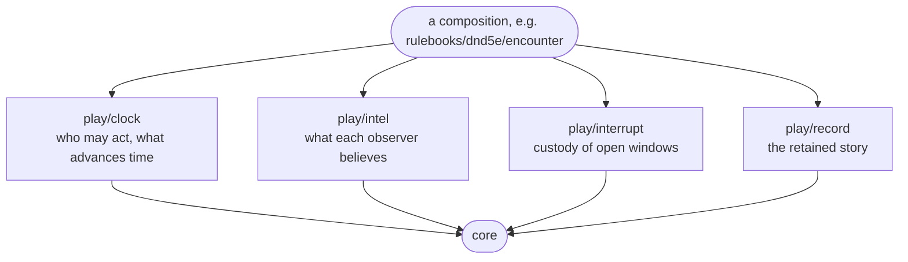

# Map — play

The four leaves beneath this level. Each owns one concern about a game in
motion and knows nothing of the others; [`play/README.md`](../README.md) says
what each owns and deliberately does not, and each leaf's numbered contract
(R1–R10) lives in `docs/ideas/play/<name>/design.md`. Who consumes the leaves
is drawn in the [root map](../../knowledge/map.md).

No arrow joins two leaves, and none may. The composition calls each leaf and
carries values between them.

## What each leaf may import

`core` and the standard library, and nothing else in the repo. A leaf takes no
`context.Context`, contains no randomness, and returns its results as values
without publishing to a bus ([`../../CLAUDE.md`](../../CLAUDE.md), "How live
play is layered").

## Seams

The same two lines hold for every pair of leaves (clock and intel, clock and
interrupt, clock and record, intel and interrupt, intel and record, interrupt
and record) and in both directions:

- Flows: nothing directly. A leaf reaches a sibling only through the
  composition, as a value the first leaf returned and the composition passed
  on.
- Must not cross: an import of a sibling, a shared type beyond `core`, or an
  interpretation of a sibling's value. Each leaf's payloads and tag
  vocabularies belong to the composition and are carried unread.

What each leaf is most often asked to take from a neighbour, and refuses:

- **clock** holds no rules and no randomness, and decides no bubble; trigger detection belongs to the composition, and orderings arrive from the caller.
- **intel** never sees the world or verifies a holding; an illusion and a truth are the same testimony.
- **interrupt** never interprets an option, a choice or a payload; it holds custody, not execution, and has no timeout of its own.
- **record** never interprets or streams an entry; payloads and tag vocabularies belong to the composition.

## The seam above

Between the leaves and the layer that composes them:

- Flows: downward, verb calls with time and orderings supplied by the caller; upward, milestones, deltas, windows and entries as returned values.
- Must not cross: upward, a publish to a bus or a held process; downward, a rule or a trigger placed in a leaf.
