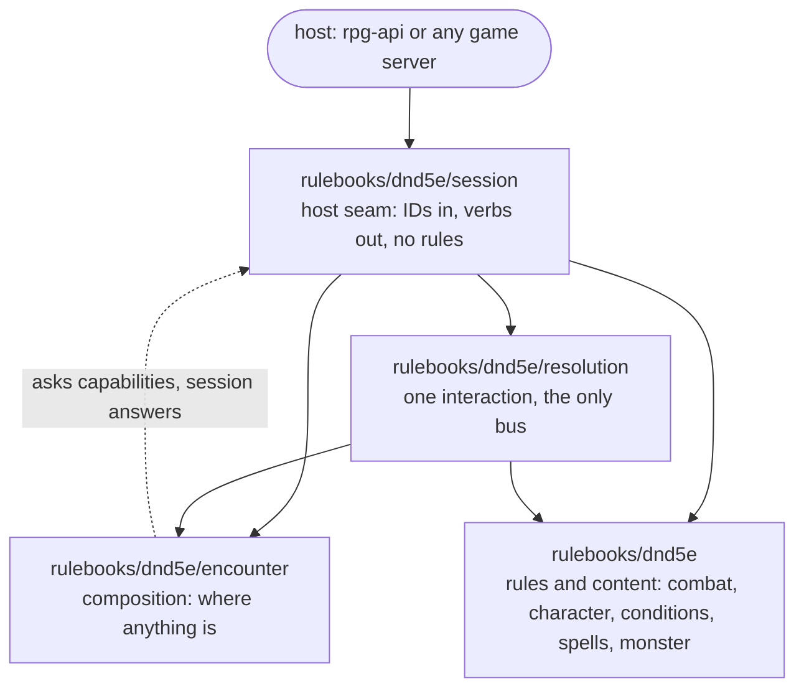

# Map — rulebooks/dnd5e

The four modules beneath this level: the rules, the composition, the bus and
the host seam. Each module's own `AGENTS.md` says what it owns and what it
must never learn; this map says what crosses between them. The layers beneath
the rulebook are drawn in the [root map](../../../knowledge/map.md).

Solid arrows are `go.mod` requires. The dashed arrow is the one question that
runs against them: `encounter` asks for facts it cannot compute through
capability interfaces, and `session` implements them. `encounter`'s `go.mod`
names neither `rulebooks/dnd5e` nor `resolution`.

`character/` is a package inside the `rulebooks/dnd5e` module, not a module of
its own; its contract is [`character/CLAUDE.md`](../character/CLAUDE.md).

The ownership question all three seam docs answer: where anything is belongs
to `encounter`, what happens when things interact belongs to `resolution`,
what was asked for, loaded and saved belongs to `session`
([`encounter/AGENTS.md`](../encounter/AGENTS.md),
[`resolution/AGENTS.md`](../resolution/AGENTS.md),
[`session/AGENTS.md`](../session/AGENTS.md), "Whose question is it?").

## Seams

**session → encounter**
- Flows: the host's verbs as calls on encounter's verbs; the capabilities encounter requires at `NewEncounter` (participation, sight, sheets, equipment, conditions, driver, striker, mover, announcer, check resolver, witness, initiative), each a lookup over records; `EncounterData` for the host to persist.
- Must not cross: a distance, a threshold or a target set computed in session from the roster; a rule inside a capability, which finds records and hands them on ([`session/AGENTS.md`](../session/AGENTS.md), "Whose question is it?").

**encounter → session**
- Flows: answers in geometry, placement, knowledge and clocks; the story's beats; the data the host stores.
- Must not cross: an import of session, the rulebook root or resolution into encounter; a default for a fact a capability did not supply ([`encounter/AGENTS.md`](../encounter/AGENTS.md), law C1).

**session → resolution**
- Flows: `Input` with the world view, every participant (R3), the compiled cost and a required roller.
- Must not cross: a bus, a check or a DC into session; `TestNoBusLivesInThisModule` and `TestSessionConstructsNoCheck` hold it ([ADR-0038](../../../docs/adr/0038-resolution-owns-the-bus.md)).

**resolution → session**
- Flows: `Output` with the world, the dirty sheets, the outcome, any pause, and the areas the interaction opened and closed; session lands it once and saves.
- Must not cross: a repository, or any state kept between calls, into resolution; persistence is session's load-act-save.

**resolution → encounter**
- Flows: the world as data through `Input.World`; the compiled canvas, installed and never rebuilt; a move described as policy, anchor and budget, which encounter walks through its own fold.
- Must not cross: a placement answer computed in resolution, including an enumeration of the room at `Start`; the cells of a move.

**encounter → resolution**
- Flows: nothing by import; settled placement facts arrive in resolution as data.
- Must not cross: a bus, a die or a rule into encounter ([ADR-0038](../../../docs/adr/0038-resolution-owns-the-bus.md); [`encounter/AGENTS.md`](../encounter/AGENTS.md), law C8).

**rulebooks/dnd5e → resolution and session**
- Flows: the rules and content packages as values; a contestable consequence declared as a save gate, which resolution turns into a request ([ADR-0039](../../../docs/adr/0039-the-save-gate.md)); sheets that serialise and reload through one cascade ([ADR-0030](../../../docs/adr/0030-encounter-owns-combatant-hydration.md)).
- Must not cross: a bus a rules package owns or creates ([ADR-0038](../../../docs/adr/0038-resolution-owns-the-bus.md)); knowledge of what a session is ([`../CLAUDE.md`](../CLAUDE.md)). The sheets borrow resolution's bus: it is attached to them at the door for the life of one interaction, their conditions subscribe through it and their chains publish on it, and `saves` and `checks` take it as an input. None of them holds a bus between interactions.

**rulebooks/dnd5e ↔ encounter**
- Flows: nothing in either direction by import; a rulebook fact reaches encounter only as a capability answer that session supplies.
- Must not cross: a `rulebooks/dnd5e` require in `encounter/go.mod` (law C1); hit points, classes, spells or what a `Ref` means into encounter.

**the host ↔ session**
- Flows: IDs in, verbs out, key-value repositories implemented by the host.
- Must not cross: an inner runtime type on session's exported surface (S2, `TestNoInnerTypeCrossesTheBoundary`); a rule into session.

[ADR-0034](../../../docs/adr/0034-where-encounter-logic-lives.md) carries the
reasoning for splitting the encounter along this seam.
